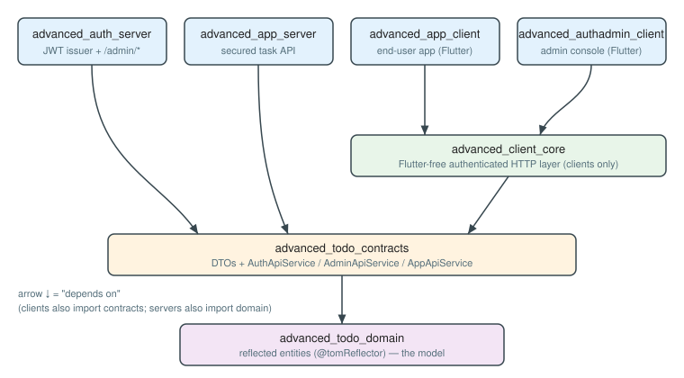
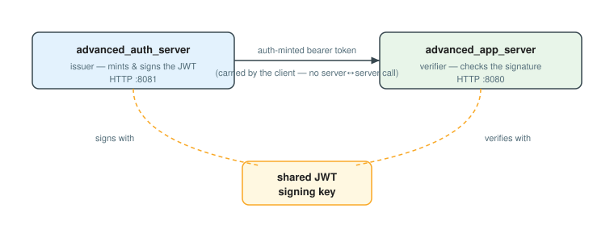
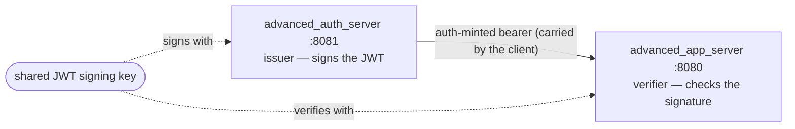
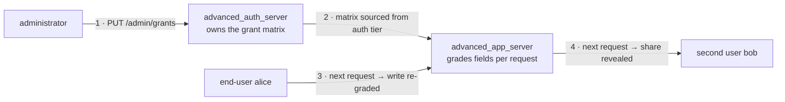
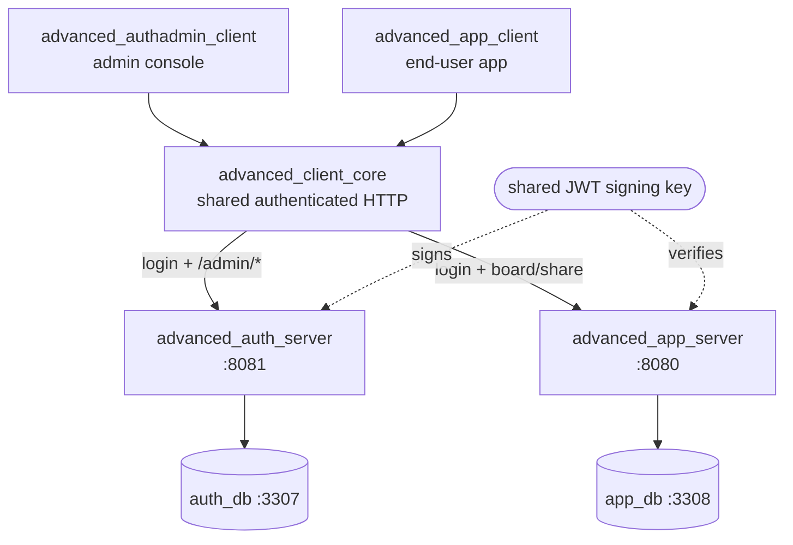
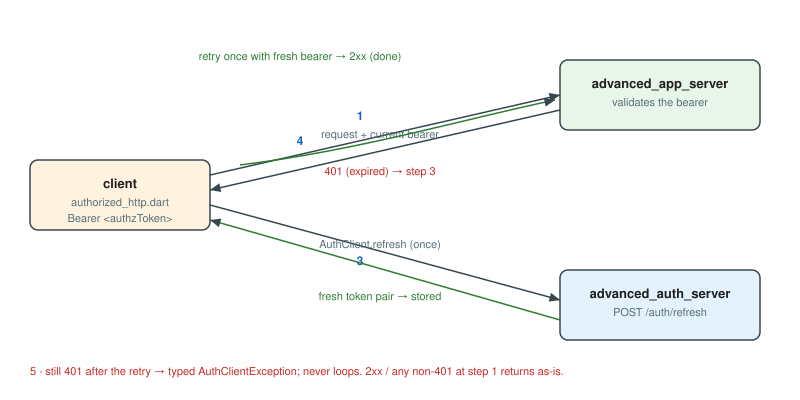
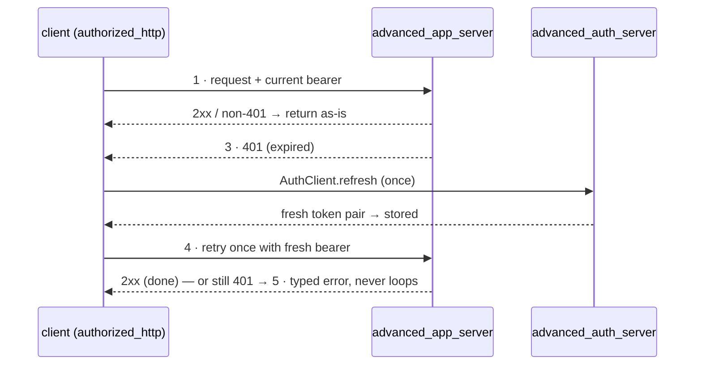
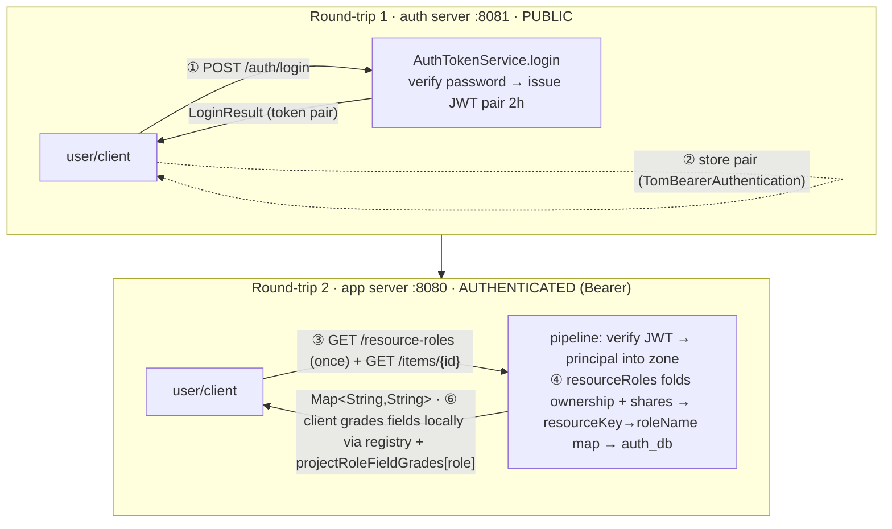

# Full-stack architecture

*Part 01 of the Tom Core advanced-sample user guide — see the [guide index](README_advanced_sample.md#user-guide).*

This part draws the shape of the system: **two HTTP servers, two databases, two
clients**, all agreeing on **one reflected domain** and **one wire contract**. It
shows which package depends on which (and which way the arrows point), why the
two servers can trust each other through a **shared JWT signing key**, and how an
administrator's edit travels all the way to an end-user's screen — the
**grant-propagation loop** the integration test asserts live.

The suite has a third server, `advanced_ops_server`, which serves no HTTP and
owns no database of its own — it runs scheduled work over `app_db`. It is
outside the request-path architecture this part draws; see
[Operations](README_advanced_14_operations.md) for it. Every "two servers" below
means the two HTTP tiers.

## The shape: two HTTP servers, two databases, two clients

The system is split along two seams at once — an **authority seam** (who you are
and what you may do) and an **application seam** (the task data itself) — and each
side of the authority seam gets its own server, database, and Flutter client.

| Node | Role | Runtime |
| --- | --- | --- |
| [`advanced_auth_server`](advanced_auth_server/README.md) | Mints JWTs (`/auth/login\|second-factor\|refresh\|me\|logout`, with an optional TOTP second pass) and owns the **grant matrix** through a role-gated admin API (`/admin/users\|roles\|groups\|grants\|assignments`). | HTTP `:8081`, `auth_db` `:3307` |
| [`advanced_app_server`](advanced_app_server/README.md) | The secured task API. Validates the bearer on every request, resolves ownership + shares + four-state field grades, persists tasks. | HTTP `:8080`, `app_db` `:3308` |
| [`advanced_authadmin_client`](advanced_authadmin_client/README.md) | Administrator console: users, roles, groups, assignments, and the `projectRole` × field grant matrix. | Flutter |
| [`advanced_app_client`](advanced_app_client/README.md) | End-user app: login, a status-column board, a bound item editor with live per-field authorization, and cross-user sharing. | Flutter |

The two databases run on **distinct host ports (3307 vs 3308)** deliberately, so
both servers — and a host-local MariaDB — can run side by side without colliding.
The split is not just operational tidiness: it makes the authority store and the
application store independently ownable, which is exactly the boundary a real
deployment would draw.

### The node that is not on this diagram

A fifth runtime, [`advanced_ops_server`](advanced_ops_server/README.md), runs
scheduled back-office work — a retention purge, a digest, a weekly export, an
audit-anchor publisher — over `app_db`. It appears in none of the figures below
because it participates in **none** of the flows they draw: it has no port, no
database of its own, no client, and no share in the request or grant-propagation
loops. Its only edges are to `app_db` and to the two servers' repositories, which
it reuses rather than re-declares.

That absence is the architectural statement. Recurring work is not a request
without a caller; it is a *different node shape*, with its own identity (a
service account under a deliberately narrow server cap), its own failure
semantics (a retry policy per job rather than a status code), and its own
scheduling boundary. [Part 14](README_advanced_14_operations.md) draws it.

## Layering and dependency arrows

Three library packages sit beneath the four runtimes, and every dependency arrow
points **from a higher-level package down to a lower-level one** — runtimes
depend on contracts, contracts depend on the domain, and nothing lower ever
imports something higher. That is the rule from the architecture guidelines made
literal: *core types don't import from transports; transports import from core.*

<!-- Figure: layering & dependency arrows — four bands with the foundation
(advanced_todo_domain) at the bottom; every arrow points DOWN meaning "depends
on". The four runtimes are on top; the two clients depend on
advanced_client_core (and on contracts), the two servers depend on contracts
directly (and on the domain); advanced_client_core depends on
advanced_todo_contracts; advanced_todo_contracts depends on
advanced_todo_domain. Nothing lower imports anything higher. -->

```mermaid
graph TD
  auth[advanced_auth_server] --> contracts
  app[advanced_app_server] --> contracts
  appc[advanced_app_client] --> core
  admin[advanced_authadmin_client] --> core
  appc --> contracts
  admin --> contracts
  auth --> domain
  app --> domain
  core[advanced_client_core] --> contracts
  contracts[advanced_todo_contracts] --> domain[advanced_todo_domain]
```



<details><summary>Text / mermaid equivalent</summary>



Every edge `A --> B` reads "A depends on B"; the domain is the single source of
truth every layer above it agrees on.

</details>

Read top-to-bottom, the layers are:

1. **`advanced_todo_domain`** — the reflected entities (`@tomReflector`). The
   single source of truth the whole stack agrees on. Depends only on
   `tom_core_kernel` + `tom_reflection`.
2. **`advanced_todo_contracts`** — the over-the-wire surface: the DTOs and the
   typed service interfaces (`AuthApiService`, `AdminApiService`, `AppApiService`)
   the servers implement and the clients call. Depends on the domain.
3. **`advanced_client_core`** — the Flutter-free authenticated HTTP layer shared
   by both clients: it presents and refreshes the bearer token and maps JSON↔DTO.
   Depends on the contracts. Being Flutter-free is what makes it headless-testable.
4. **The two servers** depend on the contracts + domain (plus `tom_core_server`);
   **the two clients** depend on `advanced_client_core` + the contracts (plus
   `tom_flutter_ui` / `tom_core_flutter` for the UI).

The pay-off of this layering is that **the wire contract is defined exactly once**
and consumed from both ends: a server cannot drift from a client, because both
compile against the same `advanced_todo_contracts` interfaces and the same
`advanced_todo_domain` entities. Part [04](README_advanced_04_wire_contracts_dtos.md)
covers the contract surface; part [03](README_advanced_03_domain_reflection.md)
covers the reflected domain beneath it; part
[02](README_advanced_02_project_layout_build.md) shows the pubspec wiring and
build order that realise these arrows.

## The shared JWT signing key

The two servers never call each other. They cooperate through a **shared JWT
signing key** instead: the auth server mints a token signed with that key, and
the app server verifies the bearer it receives against the *same* key. So a token
minted at `:8081` is trusted at `:8080` without a back-channel — the signature is
the proof.

<!-- Figure: the shared JWT signing key. advanced_auth_server (:8081) mints and
signs a token with a shared signing key; the client carries that bearer to
advanced_app_server (:8080), which verifies it against the SAME key. No
server-to-server call — the signature is the proof. -->



<details><summary>Text / mermaid equivalent</summary>



</details>

This is the spine of the authentication story (part
[06](README_advanced_06_authentication.md)): the auth server is the only issuer,
the app server is a pure verifier, and the shared key is the single fact that
binds the two tiers. The grant matrix the app server reads per request is
likewise *sourced from the auth tier* — the app server consumes authority, it
never defines it.

## The end-to-end request + grant-propagation loop

Putting the pieces in motion, the headline scenario is a single loop that crosses
**both** tiers:

1. An **administrator** signs into the admin console and edits the grant matrix
   via `/admin/*` on the auth server — for example, raising a `projectRole`'s
   grade on a field from read-only to editable.
2. An **end-user** (say `alice`) makes their next request to the app server with
   their bearer token. The app server re-reads the grant matrix (sourced from the
   auth tier) and applies the new grade **to that request** — a field graded
   below `full` is refused field-by-field on the write, and what alice may see is
   re-resolved from the same rows. No new token is involved.
3. An owner **shares** a project; on a *second* user's next request the app server
   resolves the new share and reveals the project on their board.

<!-- Figure: end-to-end request + grant-propagation loop. (1) An administrator
edits the grant matrix via /admin/* on the auth server. (2) The auth tier owns
the changed authority; the app server reads the grant matrix (sourced from the
auth tier). (3) alice's next request is re-graded per-field by the app server,
so a field graded below `full` is refused on the write. (4) An owner shares a
project; on a second user's next request the app server reveals it. ANNOTATION:
the two tiers move at different speeds. SERVER — a grant edit binds on the very
next request; the write check re-reads the grant table and read visibility is
resolved per request, neither cached and neither needing a new token. CLIENT —
the field shaping is a login-time snapshot (the resourceKey to roleName map,
fetched once at login), so the rendered grade follows at the next sign-in, not
on a token refresh. -->


<details><summary>Text / mermaid equivalent</summary>



**⚑ Timing — the two tiers move at different speeds.** *Server-side*, a grant
edit binds on the **very next request**: the write check re-reads the grant table
through a stateless store and read visibility is resolved per request, so neither
is cached and neither needs a new token. `TC-37-01` asserts exactly this over the
live stack — the admin regrades `viewer`'s `todo.item.title` and carol's next
write of that field flips from refused to accepted without her re-authenticating.
*Client-side*, the field shaping is a **login-time snapshot**: the app client
fetches the `resourceKey → roleName` map once at login
([A1](README_advanced_A1_authorization_state_machine.md)) and grades every widget
from it, so the rendered grade follows at the next **sign-in**. A token refresh
does not update it — `/auth/refresh` re-mints the bearer inside the HTTP layer,
which holds no reference to the session that owns the map. The bearer carries the
principal's encrypted access data, but it is not what the client grades from, so
client-side timing follows the map rather than the token.

</details>

That admin-edit → field-matrix → share → second-user-sees-it loop is exactly what
the cross-tier integration test asserts live (part
[12](README_advanced_12_testing_integration.md)). The four seeded accounts exist
to exercise it: `admin` (manages roles + grants), `alice` (owns the starter
project, can share), and `bob` / `carol` (an editor and a viewer on alice's
project via seeded shares). The full per-request trace — bearer validation,
principal resolution, ownership + share + grade lookup — is followed end-to-end in
appendix [A3](README_advanced_A3_request_lifecycle.md).

## Architecture diagram

The hub's diagram shows the same system as a wiring diagram rather than a
dependency stack — the two clients on the outside, the two servers in the middle,
and the shared signing key closing the loop underneath:

<!-- Figure: overall architecture as a wiring diagram. Two clients on the
outside (advanced_authadmin_client, advanced_app_client), the shared
advanced_client_core between them, the two servers in the middle
(advanced_auth_server :8081 → auth_db :3307; advanced_app_server :8080 → app_db
:3308), and the shared JWT signing key closing the loop underneath: an
auth-minted token verifies at the app server. The admin console drives /admin/*;
the end-user app logs in then calls the app server with the bearer. -->


<details><summary>Text / mermaid equivalent</summary>



</details>

- The **admin console** logs in at the auth server and drives `/admin/*` to edit
  roles and the grant matrix.
- The **end-user app** logs in at the auth server, then calls the app server with
  the bearer token; the app server reads the grant matrix and grades each field
  per request.
- An admin's grant edit reaches an end-user's field matrix on their next request;
  a project share reveals a project to a second user on theirs — the loop the
  cross-tier test asserts.

## From a client call to a routed service method

The layering pays off in *how a request is issued*: the client never writes a URL
string. It calls a **typed method** on a service interface; the same interface,
plus the API registry, is what the server implements and routes. Because both
ends compile against that one definition, **a server cannot drift from a client**.

<!-- Figure: client-call ↔ API-definition ↔ service-impl ↔ routing. The client
calls a typed AppApiService method (no URL string); advanced_todo_contracts holds
the interface AND the api_registry entry (URI, method, request/response types,
per-endpoint TomAccessControl); the server pipeline matches the incoming HTTP
request to the registered endpoint and enforces its access; the server implements
the same AppApiService method and its return value is reflection-serialized back. -->


<details><summary>Text / mermaid equivalent</summary>

```mermaid
graph LR
  call["client call<br/>appApi.resourceRoles()"] --> def["API definition<br/>contracts interface + api_registry<br/>uri · method · types · access"]
  def --> route["routing<br/>server pipeline: match + enforce access"]
  route --> impl["service impl<br/>server implements AppApiService"]
  impl -. "reflection-serialized result (Map&lt;String,String&gt;)" .-> call
```

The endpoint model and per-endpoint access policy are part
[04](README_advanced_04_wire_contracts_dtos.md); the server side (implementation +
pipeline) is part [10](README_advanced_10_servers_endpoints.md); the client side is
part [11](README_advanced_11_clients_app_admin.md).

## Token refresh (refresh-once-on-401)

The authenticated HTTP layer keeps a request transparently authorized with a
single-retry policy — it never loops.

<!-- Figure: token refresh — the refresh-once-on-401 policy applied by
authorized_http.dart. (1) The client sends the request with the current bearer to
the app server. (2) A 2xx (or any non-401) returns as-is. (3) A 401 triggers
exactly one AuthClient.refresh against the auth server, which re-mints and stores
a fresh token pair. (4) The request is retried exactly once with the fresh bearer.
(5) A still-401 retry surfaces a typed AuthClientException; it never loops. -->



<details><summary>Text / mermaid equivalent</summary>



Full mechanism (the `tomRunWithAuthRetry` policy, G-AUTH-3) is part
[06](README_advanced_06_authentication.md).

## The request lifecycle: two round-trips

A secured read is really **two** requests against **two** servers, the first
producing the credential the second consumes.

<!-- Figure: request lifecycle — two round-trips. Round-trip 1 (auth server :8081,
PUBLIC): POST /auth/login verifies the password and issues a JWT pair
(auth + authz, 2h) → LoginResult; the client stores the pair and, once at login,
fetches GET /resource-roles → the principal's resourceKey→roleName map, installing
it as the global AppResourceRoleAdapter. Round-trip 2 (app server :8080,
AUTHENTICATED, Bearer): GET /items/{id} (list/read) → pipeline verifies the JWT
and puts the principal in the request zone; the client then grades each field
LOCALLY — resolving the item's resource ceiling through the registry and narrowing
it by the shared projectRoleFieldGrades[role] row. The server computes per-field
grades only to enforce the WRITE path. -->


<details><summary>Text / mermaid equivalent</summary>



The full per-request trace is appendix
[A3](README_advanced_A3_request_lifecycle.md); the hinge between the two servers
is the shared JWT signing key above.

## Primary sources

- [`README_advanced_sample.md`](README_advanced_sample.md) — Architecture section + diagram, the suite map, and the quickstart.
- The eight package READMEs, for per-node detail.
- `assets/architecture/` — the nine SVG figures of the suite, seven of them embedded above (`advanced_01_layering`, `advanced_02_jwt_shared_key`, `advanced_03_grant_propagation`, `advanced_04_overall_architecture`, `advanced_05_call_api_service_routing`, `advanced_06_token_refresh`, `advanced_07_request_lifecycle`) and two in sibling chapters (`advanced_08_domain_ownership` in 03, `advanced_09_grade_data_path` in A1). Each SVG opens with an HTML-comment description of what it draws; the mermaid equivalent sits beside the figure in the embedding document, under a `Text / mermaid equivalent` disclosure.

---

← Prev: [00 · Introduction](README_advanced_00_introduction.md) · Next: [02 · Project layout, packages & build](README_advanced_02_project_layout_build.md) →
