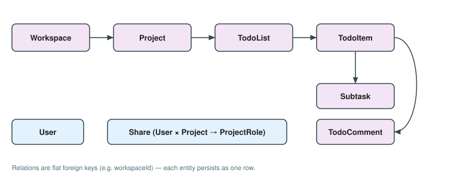
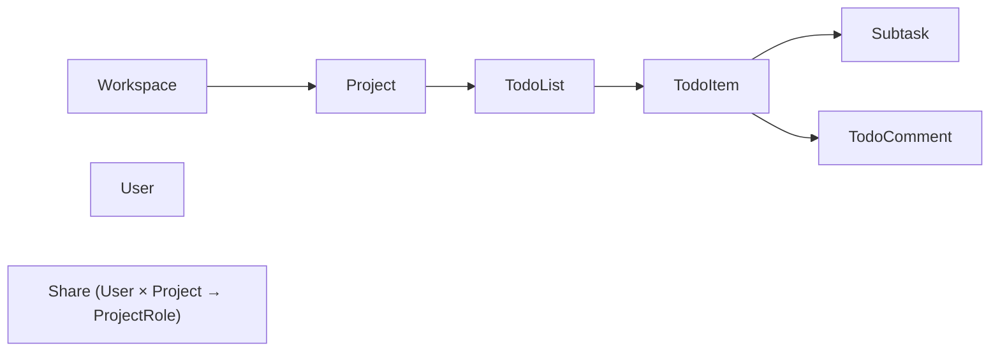

# Domain model & reflection

*Part 03 of the Tom Core advanced-sample user guide — see the [guide index](README_advanced_sample.md#user-guide).*

The domain is the **one source of truth the whole stack agrees on**: the app
server persists these entities, the clients edit them, the wire contract carries
them, and the authorization layer grades their fields. This part covers the
reflected `TomClass` entities and how `@tomReflector` makes them observable and
persistable; the **test-only reflection seed** that reflects them for the domain's
own suite (runtime consumers build their own combined seed); the enums and their
stored-name contract, whose display text resolves
through `global.*` resource keys (G-RES-5); and the **scope + `tomId`
addressing** (G-RES-6, no key catalogue) that the authorization (part
[07](README_advanced_07_authorization.md)) and resource (part
[08](README_advanced_08_resources_texts.md)) stories both build on.

## The reflected entities

Eight entities live in [`advanced_todo_domain`](advanced_todo_domain/README.md),
each a `@tomReflector class … extends TomClass`. They form a strict **ownership
chain** plus two satellites:

<!-- Figure: domain ownership chain of advanced_todo_domain (eight @tomReflector
entities). Chain: Workspace → Project → TodoList → TodoItem; TodoItem owns
Subtask and TodoComment. Satellites: User, and Share (User × Project →
ProjectRole). Relations are flat foreign keys (e.g. workspaceId), not nested
lists, so each entity persists as one row. -->



<details><summary>Text / mermaid equivalent</summary>



Relations are flat foreign keys (e.g. `workspaceId`), not nested lists, so each
entity persists as one row.

</details>

| Entity | Role |
| --- | --- |
| `Workspace` | Root of the ownership chain; an owner's top-level container. |
| `Project` | A project inside a workspace; relations are flat foreign keys (`workspaceId`), not nested lists, so each entity persists as one row. |
| `TodoList` | Middle of the hierarchy; `position` orders lists within a project. |
| `TodoItem` | The core record — a single task; **its fields are the subject of four-state field authorization**. |
| `Subtask` | Lightweight sub-step of an item (`done` toggles, `position` orders). |
| `TodoComment` | A comment in the item-detail thread; `authorId` points at a `User`. |
| `User` | An account; `status` stored as a `UserStatus` name. |
| `Share` | Grants a `User` a `ProjectRole` on a `Project` — the row the app server reads to resolve access and field grades. |

`TodoItem` is the centre of gravity: its gradable fields (`title`, `status`,
`priority`, `assigneeId`, `dueDate`, `estimateHours`/`estimate`, `description`)
are exactly the fields the grant matrix grades per principal — the seven keys the
domain publishes as `gradableItemKeys`.

The item carries one more graded value that is deliberately **not** in that list.
`TodoItem.attachment` holds the *blob-storage key* of an uploaded file, and the
domain grades it under a key of its own, `itemAttachmentGradeKey`
(`'todo.item.attachment'`), with its own per-role row
(`projectRoleAttachmentGrades`: owner and editor `full`, commenter and viewer
`read`). Both live in `authz/field_grade_vocabulary.dart` beside the seven, in
the same four states, read from the same grant matrix — the split exists because
the attachment is a **column moved over the file endpoint**, not a form field
bound to a member, so the form's `gradableFields` loop must not reach it and the
server's writable bindings must not contain it (otherwise a client could mint a
storage key by saving an item). [Part 13](README_advanced_13_file_transfer.md)
follows that key through the stack.

## `@tomReflector` and observable `TomClass`

Every entity extends `TomClass` and holds its state in **`Tom*` observable
fields** rather than plain Dart fields:

```dart
@tomReflector
class TodoItem extends TomClass {
  late final id = TomString('');
  late final title = TomString('');
  late final status = TomString(TodoStatus.backlog.name);
  late final dueDate = TomNDateTime(null);
  late final estimateHours = TomNDouble(null);
  late final tags = TomList<TomString>();
  // …
}
```

The `@tomReflector` annotation marks the class for the reflection generator;
`TomString` / `TomNDateTime` / `TomNDouble` / `TomList` are observable cells with
`get()`/`set()` that the kernel reads and writes **by reflection**. That single
mechanism is what lets the same entity be persisted by the server's repositories,
serialized to a DTO, bound into a `TomForm`, and observed by a Flutter widget —
without any per-entity boilerplate. Forms in particular lean on it: a `TomForm`
is itself a reflected `TomClass`, and `bind`/`save` enumerate a form's fields
through kernel reflection (part [09](README_advanced_09_forms_ui.md)).

## The reflection seed (test-only for the domain)

The generator only processes files that expose a `main()` and follows the import
graph from there. The domain is a **library** — it has no runtime `main()`, so it
ships **no reflection seed in `lib/`** (G-REFL-1/2). Reflection is needed only to
run the domain's own tests, so its single seed lives under `test/`:
`test/run_all_tests.dart` — a file that exists **solely to root the generator**,
never run as a program. Its `main()` simply *touches* each reflected type so the
imports are retained and the generator can reach every entity:

```dart
void main() {
  User(); Workspace(); Project(); TodoList(); TodoItem();
  TodoComment(); Subtask(); Share();
  TodoStatus.values; TodoPriority.values; TodoLabel.values;
  UserStatus.values; ProjectRole.values;
}
```

The generator emits `test/run_all_tests.reflection.dart`, and every domain test
imports that one seed and calls `initializeReflection()` in `setUpAll`. The
**runtime** consumers — the servers and clients — do not depend on this seed:
each builds its own combined `initializeReflection()` (domain entities **plus**
its local DTOs/forms) and calls it once at startup.

> **Last-writer-wins — one seed per program.** The generated
> `initializeReflection()` *assigns* the reflection data, so exactly one seed may
> run per program. The domain library carries **none**; each runnable carries the
> one that covers every type it touches — the clients' seed covers the domain
> entities **plus** the client-local forms (a `TomForm` is itself a reflected
> `TomClass`), which is why those seeds import the domain but do not re-export it.
> The servers' single seed is their `bin/` boot root, and the server tests
> bootstrap through that same seed. This build-time constraint is laid out in part
> [02](README_advanced_02_project_layout_build.md#reflection-generation).

## Enums: stored name vs display-text contract

Five closed-set enums live in `enums.dart`: `TodoStatus`, `TodoPriority`,
`TodoLabel`, `UserStatus`, and `ProjectRole`. Each follows the same two-part
contract:

- **Stored as `Enum.name`.** On its owning entity the enum is held as its
  `.name` in a `TomString` (e.g. `status = TomString(TodoStatus.backlog.name)`),
  so it round-trips to SQL and JSON **without a custom codec**. Typed accessors
  (`statusValue`, `priorityValue`, `labelValue`, …) convert the stored name back
  to the enum and fall back to a sensible default for an unknown stored value.
- **Display text is a resource key (G-RES-5).** The enums carry **no** hardcoded
  display strings. A value's user-facing text is addressed by a
  `global.<enumtype>.<value>` key (`TodoStatus.inReview.resourceKey ==
  'global.todostatus.inreview'`), resolved through the server-delivered resource
  bundle at the point of display — the same externalized-text discipline the
  forms use (part [08](README_advanced_08_resources_texts.md)). The single
  `EnumResourceKey` extension only *derives the key*; the text itself lives in the
  bundle's `global.*` namespace.

`ProjectRole { owner, editor, commenter, viewer }` is special: the effective role
(from ownership or a `Share`) is exactly what the auth server's grant matrix keys
field grades on — `(ProjectRole, resourceKey) → TomAuthState`.

## Scope + `tomId` addressing (no key catalogue)

Per **G-RES-6**, resource keys are **addressed by scope + `tomId`, resolved at
the point of use** — there is *no* class cataloguing them as constants. The
gradable `TodoItem` fields are named by the convention

```
<scope>.<formId>.<field>   ==   todo.item.<field>
```

so the same key means the same field on the server, over the wire, and in the
client without any shared symbol to import. This is the **one-path-two-uses**
convention made concrete. The Flutter UI form layer derives each field's
`basePath` as `<scopePath>.<formId>.<tomId>` and uses that single path two ways —
as the **authorization** key (no suffix), and as the base for the field's
**resource** keys (`<basePath>.label`, `.hint`, `.<errorKey>`, …). The keys are
therefore **derived** from `scope` / `formId` / the field's `tomId` at
construction, and the form must run under `scope = 'todo'` with `formId = 'item'`
for each field to self-address as the key the server graded:

```dart
// TodoItemForm declares scope-relative tomIds; the 'todo' scope is pushed at the
// call site (item_detail_screen.dart), so `title` self-addresses as
// `todo.item.title`.
TomScope.withScope('todo', TodoItemForm.new); // form basePath == 'todo.item'
// field tomId 'title'    -> basePath 'todo.item.title'
// field tomId 'estimate' -> basePath 'todo.item.estimate' (member: estimateHours)
```

One deliberate mismatch is worth flagging: the estimate key is `todo.item.estimate`
even though the entity member is `estimateHours` — **the resource key names the
*concept*, not the storage field**, so the gradable form field carries
`tomId: 'estimate'` while its reflected member stays
`estimateHours`. Appendix [A2](README_advanced_A2_resource_scope_conventions.md)
unpacks the full `basePath` convention and this mismatch; part
[07](README_advanced_07_authorization.md) shows the grant matrix that keys on
these strings, and part [08](README_advanced_08_resources_texts.md) shows the
resource bundles keyed on `<basePath>.<suffix>`.

## Primary sources

- [`advanced_todo_domain/README.md`](advanced_todo_domain/README.md) — per-entity detail.
- `advanced_todo_domain/lib/src/` — the entities and `enums.dart`; the test-only reflection seed is `advanced_todo_domain/test/run_all_tests.dart`.

---

← Prev: [02 · Project layout, packages & build](README_advanced_02_project_layout_build.md) · Next: [04 · Wire contracts & DTOs](README_advanced_04_wire_contracts_dtos.md) →
