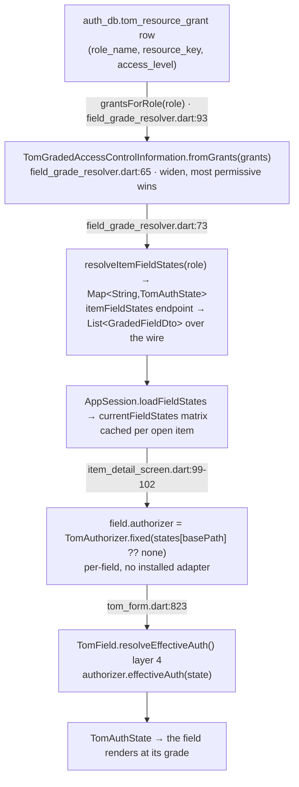

# Appendix A1 · Four-state authorization deep dive

*Appendix A1 of the Tom Core advanced-sample user guide — see the [guide index](README_advanced_sample.md#user-guide).*

[Part 07](README_advanced_07_authorization.md) introduced the four-state model
and named its moving parts. This appendix is the **mechanical** companion: the
state lattice and its `narrow`/`widen` algebra, the exact five-layer resolution
in `TomField.resolveEffectiveAuth()`, the closed-safe default as it actually
falls out of the code, the full grant-matrix → per-field stamp → field data path,
and a **worked resolution trace** of one field for each of the four roles. Where
doc 07 says *what*, this appendix says *exactly how, line by line*.

## The four states as a lattice

`TomAuthState` is a four-value enum declared **most-to-least restrictive**, and
that declaration order *is* the algebra
(`tom_core_kernel/lib/src/tombase/security/tom_authorization.dart:29`):

```
none  <  disabled  <  read  <  full
 0        1            2       3      ← enum index
```

The ordering is load-bearing because two operations are defined directly on the
index (`tom_authorization.dart:55`, `:62`):

- **`narrow(other)`** → the **more** restrictive (lower index) of the two.
- **`widen(other)`** → the **less** restrictive (higher index) of the two.

Three derived predicates read the same lattice (`:48`–`:52`): `isVisible`
(`!= none`), `showsContent` (`read || full`), `isInteractive` (`== full`). So a
field maps to a control by its resolved state alone — `none` collapses it,
`disabled` greys it, `read` shows it read-only, `full` makes it editable — with
no separate visibility flag to keep in sync.

Two facts follow from the lattice that the rest of the system relies on:

1. **Composition by `narrow` can only ever lower a field's reach.** Every
   resolution layer below combines by `narrow`, so a later layer is strictly a
   *restriction* — it can hide or read-only a field but never grant it.
2. **The bottom of the lattice is the safe default.** Because `none` is index 0,
   "we don't know" and "denied" are the same value, and any `narrow` against an
   unknown collapses to it. That is why the closed-safe default below is `none`
   rather than a separate sentinel.

## Resolution order: the five layers

A field's effective state is computed by `TomField.resolveEffectiveAuth()`
(`tom_flutter_ui/lib/src/forms/tom_form.dart:807`). The doc-comment and the
`CRITICAL` note there make the contract explicit: **all layers are evaluated;
skipping one (group auth especially) is a severe bug.** Each layer takes the
running `state` and narrows it:

| # | Layer | Source line | What it contributes |
| --- | --- | --- | --- |
| 1 | **Resource-based** | `:809` `TomAuthorization.resolveAuth(basePath)` | the field's own grade, keyed on its `basePath` |
| 2 | **Group auth** | `:812` `tomGroup!.applyMode(state)` | a `TomAuthorizationGroup`'s collective ceiling/floor (`AuthGroupMode`) |
| 3 | **Form narrow** | `:817` `state.narrow(resolveAuth(formPath))` | the form node's grade narrows every field (always `narrow`) |
| 4 | **Per-field authorizer** | `:823` `authorizer!.effectiveAuth(state)` | an explicit `TomAuthorizer` (e.g. `TomAuthorizer.fixed`) |
| 5 | **UI-state controller** | `:827` `uiStateController!.apply(state)` | a build-time `TomUIStateController` callback |

Layer 1 seeds `state`; layers 2–5 each apply only if their hook is present, and
each can only restrict. Because the sample installs **no** authorization adapter,
layer 1 (`TomAuthorization.resolveAuth(basePath)`) returns the kernel's permissive
no-adapter default (`full`) for every field — the grade a gradable item field
renders at comes from **layer 4** instead: the item detail screen stamps each
gradable field with `field.authorizer = TomAuthorizer.fixed(states[basePath] ??
TomAuthState.none)` (`item_detail_screen.dart:99-102`). So for a graded item
field the effective state is `layer1(full).narrow(layer3(full)).narrow(layer4)`,
which reduces to the **layer-4 fixed grade** the server resolved. The admin
user/role forms also add a **layer 4** `TomAuthorizer.fixed`, there for
create-vs-edit shaping rather than a server matrix (see doc 07).

> The skeleton called this "layers 1–4"; the live `resolveEffectiveAuth` has
> **five** — the build-time `TomUIStateController` is the fifth. The sample's
> forms exercise layers 3 and 4 (layer 1 stays at the permissive default since no
> adapter is installed); layers 2 and 5 are framework capability the sample does
> not need.

### Why `basePath` is the key

Layer 1 keys on `basePath`, and `basePath` is derived structurally when the field
is constructed (`tom_form.dart:614-617`): `scope = form!.basePath`, then
`basePath = scope.isNotEmpty ? '$scope.$tomId' : tomId`. Under
`TomScope.withScope('todo', …)` with `formId: 'item'`, the `title` field
self-addresses as `todo.item.title` — byte-identical to the `todo.item.title`
key the server grades. One scope alignment
makes the field's authorization key equal the wire grade key with no translation
(this is doc 07's headline; the full `basePath` convention is
[A2](README_advanced_A2_resource_scope_conventions.md)).

## The closed-safe default, as it falls out of the code

"Ungraded ⇒ hidden" (D-A4) is enforced at **three** independent points, each
defaulting to `none`, so no single omission can leak an editable control:

1. **Wire codec.** `GradedFieldDto` defaults `access` to `TomAuthState.none`
   (`advanced_todo_contracts/lib/src/graded_field_dto.dart:28`), and decoding an
   unrecognised access token yields `none` (`:53`). The kernel codec agrees —
   `TomAuthStateCodec.fromStored(null)` and `fromStored('bogus')` both return
   `none` (`tom_core_server/test/graded_authorization_test.dart:33`,`:37`).
2. **Server resolver.** `FieldGradeResolver.resolveItemFieldStates` resolves
   **every** gradable `todo.item.*` key, and a field with no grant row
   resolves to `none` via `graded.resolveState(key)`
   (`field_grade_resolver.dart:73-80`). The matrix sent to the client is total
   over the field set — there are no "missing" keys, only explicit `none`s.
3. **Client per-field stamp.** The item screen stamps each gradable field with
   `TomAuthorizer.fixed(states[field.basePath] ?? TomAuthState.none)`
   (`item_detail_screen.dart:99-102`): a gradable key missing from the live matrix
   falls to `none`.

The same value at all three layers is what makes the lattice's "unknown =
denied" property hold end-to-end.

## The grant matrix → per-field stamp → field data path

The grade a field renders at travels a fixed path from a database row to a
widget. Tracing it once makes every other authorization claim in the guide
concrete:

<!-- Figure: the grant matrix → per-field stamp → field data path, tracing the
grade a field renders at from a database row to a widget:
1. auth_db.tom_resource_grant row (role_name, resource_key, access_level) —
   RepositoryGrantStore.grantsForRole(role) [field_grade_resolver.dart:93];
2. TomGradedAccessControlInformation.fromGrants(grants) [field_grade_resolver.dart:65]
   (folds duplicate keys by widen — most permissive wins);
3. resolveItemFieldStates(role) → Map<String,TomAuthState> [field_grade_resolver.dart:73]
   (itemFieldStates endpoint → List<GradedFieldDto> over the wire);
4. AppSession.loadFieldStates → currentFieldStates matrix (cached per open item);
5. item_detail_screen.dart:99-102 — field.authorizer =
   TomAuthorizer.fixed(states[field.basePath] ?? TomAuthState.none) (per-field, no
   installed adapter);
6. TomField.resolveEffectiveAuth() layer 4 [tom_form.dart:823]
   (authorizer.effectiveAuth(state));
7. TomAuthState → the field renders at its grade. -->


<details><summary>Text / mermaid equivalent</summary>



</details>

Two server layers feed the matrix at the top. **Resource access**
(`ResourceRoleResolver`) answers *"may this principal touch this object, and as
what role?"* by folding the principal's C-5 ownership grants and C-6 `share`-mode
delegations through the framework `TomDelegationResolver` into a flat
`resourceKey → role` map, then keeping the strongest role over the containment
chain `item → list → project → workspace`: an `owner` grant on the workspace
flows down to its items, else the **strongest** covering share wins
(`ProjectRole` is declared `owner, editor, commenter, viewer` — most-to-least
privileged, so the lowest index is strongest, `enums.dart:75`), else `null` (no
access → closed/safe 404). **Field grades** (`FieldGradeResolver`) then maps that
role to the per-field matrix above. Both resolvers are pure over a small store
seam (`RepositoryGrantStore` for the grade matrix; the framework grant/delegation
stores plus `RepositoryResourceContainmentStore` for roles — live; `InMemory*`
seeded for tests), which is what lets the socket-free suites reproduce the exact
matrix.

### Why per-field stamping, and why layer 1 stays out of the way

Because no adapter is installed, layer 1 (`TomAuthorization.resolveAuth`) and
layer 3 (the form-node narrow) both resolve to the kernel's permissive default
(`full`) for *every* path — login, board, dialogs, and the gradable item fields
alike. That is deliberately harmless: the grade a gradable field renders at is
applied at **layer 4** instead, by the per-field `TomAuthorizer.fixed` the item
screen stamps on it (`item_detail_screen.dart:99-102`). Two properties fall out:

| Path | Resolves to | Why |
| --- | --- | --- |
| a gradable leaf **present** in the matrix | its grade (layer 4) | `TomAuthorizer.fixed(states[basePath])` |
| a gradable leaf **absent** from the matrix | `none` (layer 4) | `states[basePath] ?? TomAuthState.none` — closed-safe (D-A4) |
| the form node `todo.item` / scope `todo` | `full` (layers 1+3) | no adapter, so the permissive default — the form narrow is a no-op |
| any non-gradable field (login, board, dialogs) | `full` (layers 1+3) | no adapter and no layer-4 stamp — stays untouched |

This is what an earlier design achieved with a single installed
`FieldStateAuthorizationAdapter` that had to special-case a `gradableKeys`
namespace so a closed-safe `none` would not hide the login form. Stamping each
gradable field directly moves the closed-safe `none` onto exactly the fields that
opt into grading, so layers 1 and 3 never need a permissive-ancestor carve-out —
they simply stay at the framework default (D-A5).

## Worked role matrix

Take one field — `assigneeId` (`todo.item.assigneeId`) — and trace its effective
state for each role, using the seeded §A.4 grant matrix (doc 07) and the
resolution layers above. The item field carries one per-field authorizer (layer
4) and no group or controller, and — with no adapter installed — layers 1 and 3
both stay at the permissive default (`full`). So the effective state is
`full.narrow(full).narrow(layer4)`, which reduces to the **layer-4 stamped
grade**:

| Role | grant row `todo.item.assigneeId` | layer-4 stamp `states[basePath]` | effective | renders as |
| --- | --- | --- | --- | --- |
| owner | `full` | `full` | `full` | editable |
| editor | `full` | `full` | `full` | editable |
| commenter | `read` | `read` | `read` | read-only |
| viewer | *(no row → `none`)* | `none` (server sent `none`) | `none` | **hidden** |

The viewer row is the instructive one: the server's `FieldGradeResolver` sent an
explicit `none` for `assigneeId` (it resolves *every* key, `field_grade_resolver.dart:78`),
so the per-field stamp is `TomAuthorizer.fixed(none)` — the field collapses. A
different field tells the rest of the story:

- **`estimate`** is `full / read / none / none` for owner / editor / commenter /
  viewer — the editor reads it, both commenter and viewer lose it entirely. This
  is what TC-30-02/04 assert ([Part 12](README_advanced_12_testing_integration.md)).
- **`status`** is `full / full / full / read` — uniquely, the **commenter** can
  edit status (the one field a commenter changes) while everything else is read.

Crucially the same rendering is **re-checked server-side on write**:
`AppWriteService._enforceFieldWrites` requires every field a payload *changes* to
be graded `full` for the caller's role ([Part 10](README_advanced_10_servers_endpoints.md)).
The client's per-field stamps govern what the UI *shows*; the server independently
governs what it *accepts* — a tampered client that renders `assigneeId` editable
for a commenter still has its write rejected.

## Primary sources

- `tom_core_kernel/lib/src/tombase/security/tom_authorization.dart` (the `TomAuthState` lattice + `narrow`/`widen`)
- `tom_flutter_ui/lib/src/forms/tom_form.dart:614-617` (basePath), `:807` (`resolveEffectiveAuth` five layers)
- `advanced_app_client/lib/screens/item_detail_screen.dart:99-102` (the per-field `TomAuthorizer.fixed` stamp)
- `advanced_app_server/lib/src/access/{field_grade_resolver,resource_role_resolver}.dart`; `advanced_todo_contracts/lib/src/graded_field_dto.dart`
- Companion: [07 · Authorization](README_advanced_07_authorization.md)

---

← Prev: [12 · Testing & cross-tier integration](README_advanced_12_testing_integration.md) · Next: [A2 · Scope, basePath & resource-key conventions](README_advanced_A2_resource_scope_conventions.md) →
