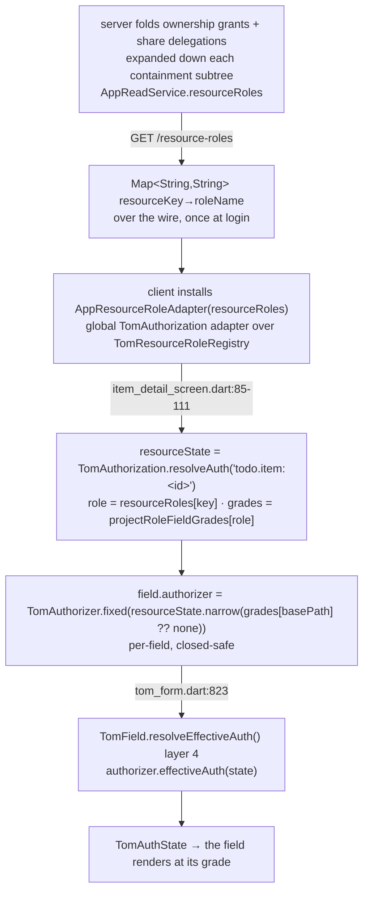

# Appendix A1 · Four-state authorization deep dive

*Appendix A1 of the Tom Core advanced-sample user guide — see the [guide index](README_advanced_sample.md#user-guide).*

[Part 07](README_advanced_07_authorization.md) introduced the four-state model
and named its moving parts. This appendix is the **mechanical** companion: the
state lattice and its `narrow`/`widen` algebra, the exact five-layer resolution
in `TomField.resolveEffectiveAuth()`, the closed-safe default as it actually
falls out of the code, the full grant-matrix → per-field stamp → field data path,
and a **worked resolution trace** of one field for each of the four roles. Where
doc 07 says *what*, this appendix says *exactly how, line by line*.

## The four states as a lattice

`TomAuthState` is a four-value enum declared **most-to-least restrictive**, and
that declaration order *is* the algebra
(`tom_core_kernel/lib/src/tombase/security/tom_authorization.dart:29`):

```
none  <  disabled  <  read  <  full
 0        1            2       3      ← enum index
```

The ordering is load-bearing because two operations are defined directly on the
index (`tom_authorization.dart:55`, `:62`):

- **`narrow(other)`** → the **more** restrictive (lower index) of the two.
- **`widen(other)`** → the **less** restrictive (higher index) of the two.

Three derived predicates read the same lattice (`:48`–`:52`): `isVisible`
(`!= none`), `showsContent` (`read || full`), `isInteractive` (`== full`). So a
field maps to a control by its resolved state alone — `none` collapses it,
`disabled` greys it, `read` shows it read-only, `full` makes it editable — with
no separate visibility flag to keep in sync.

Two facts follow from the lattice that the rest of the system relies on:

1. **Composition by `narrow` can only ever lower a field's reach.** Every
   resolution layer below combines by `narrow`, so a later layer is strictly a
   *restriction* — it can hide or read-only a field but never grant it.
2. **The bottom of the lattice is the safe default.** Because `none` is index 0,
   "we don't know" and "denied" are the same value, and any `narrow` against an
   unknown collapses to it. That is why the closed-safe default below is `none`
   rather than a separate sentinel.

## Resolution order: the five layers

A field's effective state is computed by `TomField.resolveEffectiveAuth()`
(`tom_flutter_ui/lib/src/forms/tom_form.dart:807`). The doc-comment and the
`CRITICAL` note there make the contract explicit: **all layers are evaluated;
skipping one (group auth especially) is a severe bug.** Each layer takes the
running `state` and narrows it:

| # | Layer | Source line | What it contributes |
| --- | --- | --- | --- |
| 1 | **Resource-based** | `:809` `TomAuthorization.resolveAuth(basePath)` | the field's own grade, keyed on its `basePath` |
| 2 | **Group auth** | `:812` `tomGroup!.applyMode(state)` | a `TomAuthorizationGroup`'s collective ceiling/floor (`AuthGroupMode`) |
| 3 | **Form narrow** | `:817` `state.narrow(resolveAuth(formPath))` | the form node's grade narrows every field (always `narrow`) |
| 4 | **Per-field authorizer** | `:823` `authorizer!.effectiveAuth(state)` | an explicit `TomAuthorizer` (e.g. `TomAuthorizer.fixed`) |
| 5 | **UI-state controller** | `:827` `uiStateController!.apply(state)` | a build-time `TomUIStateController` callback |

Layer 1 seeds `state`; layers 2–5 each apply only if their hook is present, and
each can only restrict. Because the sample installs **no** authorization adapter,
layer 1 (`TomAuthorization.resolveAuth(basePath)`) returns the kernel's permissive
no-adapter default (`full`) for every field — the grade a gradable item field
renders at comes from **layer 4** instead: the item detail screen stamps each
gradable field with `field.authorizer = TomAuthorizer.fixed(states[basePath] ??
TomAuthState.none)` (`item_detail_screen.dart:99-102`). So for a graded item
field the effective state is `layer1(full).narrow(layer3(full)).narrow(layer4)`,
which reduces to the **layer-4 fixed grade** the server resolved. The admin
user/role forms also add a **layer 4** `TomAuthorizer.fixed`, there for
create-vs-edit shaping rather than a server matrix (see doc 07).

> The skeleton called this "layers 1–4"; the live `resolveEffectiveAuth` has
> **five** — the build-time `TomUIStateController` is the fifth. The sample's
> forms exercise layers 3 and 4 (layer 1 stays at the permissive default since no
> adapter is installed); layers 2 and 5 are framework capability the sample does
> not need.

### Why `basePath` is the key

Layer 1 keys on `basePath`, and `basePath` is derived structurally when the field
is constructed (`tom_form.dart:614-617`): `scope = form!.basePath`, then
`basePath = scope.isNotEmpty ? '$scope.$tomId' : tomId`. Under
`TomScope.withScope('todo', …)` with `formId: 'item'`, the `title` field
self-addresses as `todo.item.title` — byte-identical to the `todo.item.title`
key the server grades. One scope alignment
makes the field's authorization key equal the wire grade key with no translation
(this is doc 07's headline; the full `basePath` convention is
[A2](README_advanced_A2_resource_scope_conventions.md)).

## The closed-safe default, as it falls out of the code

"Ungraded ⇒ hidden" (D-A4) is enforced at **three** independent points, each
defaulting to `none`, so no single omission can leak an editable control:

1. **Ungranted resource key.** The installed `AppResourceRoleAdapter` gates every
   `<type>:<id>` key through the framework registry; a key the principal holds no
   grant on resolves to `none`, so `TomAuthorization.resolveAuth('todo.item:<id>')`
   returns `none` and the whole item's fields collapse. The kernel codec agrees —
   `TomAuthStateCodec.fromStored(null)` and `fromStored('bogus')` both return
   `none` (`tom_core_server/test/graded_authorization_test.dart:33`,`:37`).
2. **Missing role.** The installed `AppResourceRoleAdapter` resolves an
   ungranted `<type>:<id>` resource key to `none`
   (`app_resource_role_adapter.dart`), and a `roleName` with no matching
   `ProjectRole` also yields `none`. So the item's resource ceiling is `none`
   whenever the principal holds no role on it — the item's fields collapse.
3. **Client per-field narrow.** The item screen stamps each gradable field with
   `TomAuthorizer.fixed(resourceState.narrow(projectRoleFieldGrades[role][field.basePath] ?? TomAuthState.none))`
   (`item_detail_screen.dart:85-111`): a field with no grade in the shared row
   falls to `none`, and the narrow keeps it at or below the resource ceiling.

The same value at all three layers is what makes the lattice's "unknown =
denied" property hold end-to-end.

## The grant matrix → per-field stamp → field data path

The grade a field renders at travels a fixed path from a database row to a
widget. Tracing it once makes every other authorization claim in the guide
concrete:

<!-- Figure: the resource-roles → per-field narrow → field data path, tracing the
grade a field renders at from the server's folded roles to a widget:
1. server folds the principal's ownership grants + share delegations, expanded
   down each containment subtree → a flat resourceKey→roleName map
   (AppReadService.resourceRoles);
2. GET /resource-roles → Map<String,String> over the wire, once at login;
3. client installs AppResourceRoleAdapter(resourceRoles) as the global
   TomAuthorization adapter (over the TomResourceRoleRegistry);
4. item_detail_screen.dart:85-111 — resourceState =
   TomAuthorization.resolveAuth('todo.item:<id>') (ceiling via the registry),
   role = resourceRoles['todo.item:<id>'], grades = projectRoleFieldGrades[role]
   (shared domain);
5. field.authorizer = TomAuthorizer.fixed(resourceState.narrow(grades[basePath]
   ?? TomAuthState.none)) — per-field, closed-safe;
6. TomField.resolveEffectiveAuth() layer 4 [tom_form.dart:823]
   (authorizer.effectiveAuth(state));
7. TomAuthState → the field renders at its grade. -->

![The resource-roles to field data path: the server folds the principal's grants into a flat resourceKey to roleName map, sent once over the wire, installed as the global AppResourceRoleAdapter, from which the item screen resolves the item's resource ceiling through the registry and narrows it by the shared projectRoleFieldGrades[role] row, stamped onto each gradable field as a per-field TomAuthorizer.fixed that TomField resolves into the TomAuthState the field renders at.](assets/architecture/advanced_09_grade_data_path.svg)

<details><summary>Text / mermaid equivalent</summary>



</details>

The top of this path is server-folded resource access. **Resource access**
(`AppReadService.resourceRoles`, reusing `ResourceRoleResolver`) answers *"which
objects may this principal touch, and as what role?"* by folding the principal's
C-5 ownership grants and C-6 `share`-mode delegations through the framework
`TomDelegationResolver` into a flat `resourceKey → roleName` map, expanding each
grant down its containment subtree `item → list → project → workspace`: an `owner`
grant on the workspace surfaces on every contained item, else the **strongest**
covering share wins (`ProjectRole` is declared `owner, editor, commenter, viewer`
— most-to-least privileged, so the lowest index is strongest, `enums.dart:75`),
else the key is absent (no access → closed/safe 404). That flat map is the only
authorization payload the app read ships; the per-role field grades themselves
live in the SHARED DOMAIN (`projectRoleFieldGrades`), so the client narrows the
resource ceiling by them locally — no `GradedFieldDto` on the read. The
server-side `FieldGradeResolver` (over `RepositoryGrantStore`, the framework
grant/delegation stores plus `RepositoryResourceContainmentStore` — live;
`InMemory*` seeded for tests) still resolves the per-field matrix, but only to
**enforce writes** (below), which is what lets the socket-free suites reproduce
the exact matrix on both sides.

### Why a resource adapter plus a per-field narrow, and why the registry stays load-bearing

The installed `AppResourceRoleAdapter` gates only `<type>:<id>` resource keys
(those containing `:`); any dotted path (login, board, dialogs, and the gradable
`todo.item.<field>` keys alike) stays permissive (`full`) — matching the pre-RCC2
no-adapter behaviour for everything except the item's resource ceiling. The grade
a gradable field renders at is the item's resource ceiling — layer 1
(`TomAuthorization.resolveAuth('todo.item:<id>')`, resolved through the registry
via the adapter) — **narrowed** by the shared `projectRoleFieldGrades[role]` row
and stamped at **layer 4** by the per-field `TomAuthorizer.fixed` the item screen
sets (`item_detail_screen.dart:85-111`). Two properties fall out:

| Path | Resolves to | Why |
| --- | --- | --- |
| a gradable leaf, principal holds a role | `resourceState.narrow(grade)` (layer 4) | `TomAuthorizer.fixed(resourceState.narrow(grades[basePath]))` |
| a gradable leaf, **no** role on the item | `none` | resource ceiling is `none` (adapter), and the narrow can only restrict — closed-safe (D-A4) |
| a gradable leaf **absent** from the shared row | `none` (layer 4) | `grades[basePath] ?? TomAuthState.none` — closed-safe (D-A4) |
| any non-gradable dotted field (login, board, dialogs) | `full` | the adapter leaves dotted paths permissive; no layer-4 stamp |

This keeps the framework registry load-bearing: a principal with no role on the
item resolves the resource ceiling to `none`, so every field collapses closed-safe
without any per-field payload. Because every role's field grades sit at or below
its resource ceiling, the narrow reproduces the §A.4 matrix exactly. An earlier
(pre-RCC2) design shipped the per-field matrix over the wire and stamped it
directly; folding the read down to a flat `resourceRoles` map and narrowing the
registry-resolved ceiling by the shared grades removes the read-time matrix while
preserving the same closed-safe outcomes (D-A5).

## Worked role matrix

Take one field — `assigneeId` (`todo.item.assigneeId`) — and trace its effective
state for each role, using the seeded §A.4 field-grade rows (doc 07) and the
resolution layers above. The item field carries one per-field authorizer (layer
4) and no group or controller; the dotted `todo.item.assigneeId` path stays at
the adapter's permissive default at layers 1 and 3 (only the `todo.item:<id>`
resource key is gated). The per-field authorizer holds
`resourceState.narrow(grade)`, where `resourceState` is the item's ceiling and
`grade` is `projectRoleFieldGrades[role][todo.item.assigneeId]`:

| Role | field grade `todo.item.assigneeId` | resourceState (ceiling) | `resourceState.narrow(grade)` | renders as |
| --- | --- | --- | --- | --- |
| owner | `full` | `full` | `full` | editable |
| editor | `full` | `full` | `full` | editable |
| commenter | `read` | `read` | `read` | read-only |
| viewer | *(no row → `none`)* | `read` | `none` | **hidden** |

The viewer row is the instructive one: the shared `projectRoleFieldGrades[viewer]`
row carries no entry for `assigneeId`, so `grades[basePath] ?? none` is `none`,
and `resourceState.narrow(none)` collapses the field. A
different field tells the rest of the story:

- **`estimate`** is `full / read / none / none` for owner / editor / commenter /
  viewer — the editor reads it, both commenter and viewer lose it entirely. This
  is what TC-30-02/04 assert ([Part 12](README_advanced_12_testing_integration.md)).
- **`status`** is `full / full / full / read` — uniquely, the **commenter** can
  edit status (the one field a commenter changes) while everything else is read.

Crucially the same rendering is **re-checked server-side on write**:
`AppWriteService._enforceFieldWrites` requires every field a payload *changes* to
be graded `full` for the caller's role ([Part 10](README_advanced_10_servers_endpoints.md)).
The client's per-field stamps govern what the UI *shows*; the server independently
governs what it *accepts* — a tampered client that renders `assigneeId` editable
for a commenter still has its write rejected.

## Primary sources

- `tom_core_kernel/lib/src/tombase/security/tom_authorization.dart` (the `TomAuthState` lattice + `narrow`/`widen`)
- `tom_flutter_ui/lib/src/forms/tom_form.dart:614-617` (basePath), `:807` (`resolveEffectiveAuth` five layers)
- `advanced_app_client/lib/screens/item_detail_screen.dart:99-102` (the per-field `TomAuthorizer.fixed` stamp)
- `advanced_app_server/lib/src/access/{field_grade_resolver,resource_role_resolver}.dart`; `advanced_todo_contracts/lib/src/graded_field_dto.dart`
- Companion: [07 · Authorization](README_advanced_07_authorization.md)

---

← Prev: [13 · File transfer under the authorization matrix](README_advanced_13_file_transfer.md) · Next: [A2 · Scope, basePath & resource-key conventions](README_advanced_A2_resource_scope_conventions.md) →
