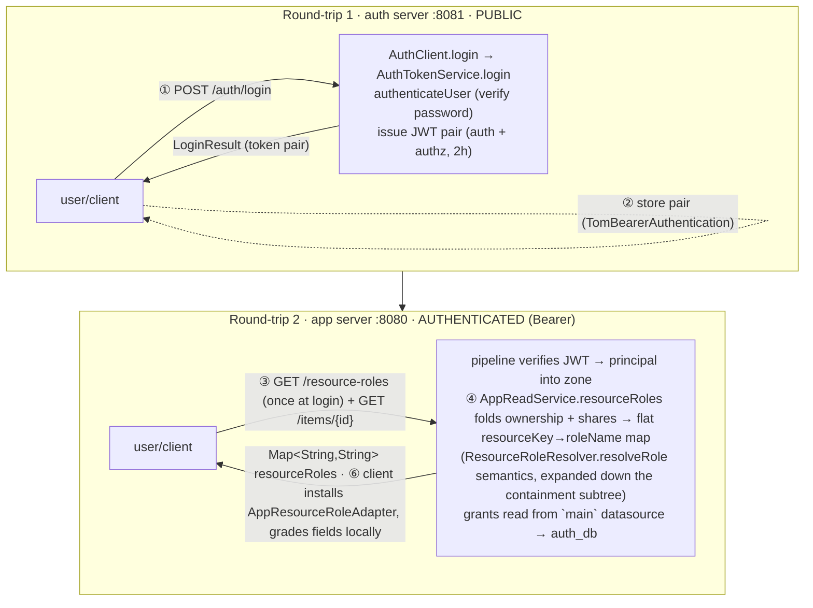

# Appendix A3 · A secured request, end to end

*Appendix A3 of the Tom Core advanced-sample user guide — see the [guide index](README_advanced_sample.md#user-guide).*

The spine parts each describe one tier in isolation:
[06](README_advanced_06_authentication.md) issues the token,
[07](README_advanced_07_authorization.md) defines the four-state grade,
[10](README_advanced_10_servers_endpoints.md) lists the endpoints, and
[11](README_advanced_11_clients_app_admin.md) wires the client. This appendix
threads them onto **one principal opening one item** and follows the bytes the
whole way: from the keystroke that mints a token, across the second server's
bearer check, through the resource-role resolution folded into a flat
`resourceKey → roleName` map fetched once at login, into the global
`AppResourceRoleAdapter`, and finally onto each gradable field — graded *locally*
through the framework registry as a per-field `TomAuthorizer.fixed` — the field
the user sees. It is *synthesized* from the endpoint, access, and client-http sources —
a single trace, not a transcription of any one file — so the two headline rules
([server-delivered texts](README_advanced_08_resources_texts.md),
[name-driven authorization](README_advanced_07_authorization.md)) can be watched
acting together on a real request.

The worked request: **`val` (a viewer shared into Alice's board) opens an item
and sees the field grid.** `val` can read most fields, has a *disabled* status
control, and `estimate` is hidden — exactly the TC-30-02 matrix
([Part 12](README_advanced_12_testing_integration.md)). A3 explains *why* the
client renders that, byte by byte.

## The two round-trips at a glance

A secured read is really **two** requests against **two** servers, the first
producing the credential the second consumes:

<!-- Figure: request lifecycle — two round-trips. Round-trip 1 (auth server :8081,
PUBLIC): ① POST /auth/login → AuthClient.login → AuthTokenService.login →
authenticateUser (verify password) → issue JWT pair (auth + authz, 2h) →
LoginResult; ② client stores the pair (TomBearerAuthentication) AND, once at
login, fetches GET /resource-roles → the principal's resourceKey→roleName map,
installing an AppResourceRoleAdapter as the global TomAuthorization adapter.
Round-trip 2 (app server :8080, AUTHENTICATED, Authorization: Bearer): ③ GET
/items/{id} (list/read) → pipeline verifies the JWT → principal into the request
zone; ④ ResourceRoleResolver.resolveRole (ownership-or-share → ProjectRole)
already folded into the resourceRoles map; the client then grades each field
LOCALLY — the item screen resolves the item's resource ceiling through the
registry and narrows it by the shared projectRoleFieldGrades[role] row, with no
per-field round-trip. The server computes per-field grades only to ENFORCE the
WRITE path. -->


<details><summary>Text / mermaid equivalent</summary>



</details>

The hinge between the two servers is the **shared JWT signing key**
([Part 06](README_advanced_06_authentication.md)): the app server validates a
token the auth server minted, *offline*, with no callback. The hinge between the
two layers inside the app server is that the grant matrix lives in `auth_db` but
is read by the app server through the framework's `main` datasource
([Part 05](README_advanced_05_persistence_database.md)).

## 1. Login at the auth server → token

The user submits credentials; `AuthClient.login` POSTs them to the **public**
`/auth/login` and, on success, stores the returned token pair
(`advanced_client_core/lib/src/auth/auth_client.dart:68`):

```dart
final response = await _transport.send(
  method: 'POST', uri: _uri('/auth/login'), body: dtoToJsonString(request));
final result = _requireLogin(response, 'auth.login.failed');
_store(result);   // → TomBearerAuthentication.setTokens(authToken, authzToken, …)
```

The request body is serialized by `dtoToJsonString` — the reflection-first DTO
helper ([Part 04](README_advanced_04_wire_contracts_dtos.md)) that runs
`LoginRequest` through the same kernel reflection path as every other DTO — not a
hand-written `LoginRequest.toJson()`, which does not exist. Symmetrically,
`_requireLogin` decodes the response with `dtoFromJson<LoginResult>`
(`auth_client.dart:139`).

On the server, `login` is one of the endpoints whose contract declares
`TomPublicAccess()` (`TomApiEndpoint.access`) —
it *must* be reachable without a bearer, because it is how a bearer is obtained
(`advanced_todo_contracts/lib/src/api_registry.dart`, `authApi['authLogin']`). It
delegates to `AuthTokenService.login` (`:59`), which verifies the password
through `AdvancedAuthenticationService.authenticateUser` and then issues the
**pair** of JWTs in `_issueFor` (`:95-121`): a public *authentication* token and
an *authorization* token carrying the encrypted access-control payload, both with
the 2-hour `tokenLifetime` (`:45`). A rejected login throws `TomLoginException`,
which `LoginUnauthorizedErrorHandler` (`:148`) maps to a bare **401** carrying
only the opaque key — never *which* of username/password was wrong (no
account-existence leak).

The client stores the pair via `_store` → `TomBearerAuthentication.setTokens`
(`auth_client.dart:145`). `decryptTokens` is `false` for this Flutter-free
sample (`:62`): the authorization token is held as an **opaque bearer**, identity
is read from `LoginResult.user`, and field grades come from the app API — so no
RSA key is configured client-side. The bytes that matter downstream are now in
the singleton token store.

> **The two stores are not the same store.** `TomBearerAuthentication` here is
> the **client-side** token holder. The server never populates it; it recovers
> the principal from the request *zone* (§2). Conflating the two is the bug the
> RC-15 green gate caught (zone principal resolution) — see
> [A1](README_advanced_A1_authorization_state_machine.md) and the five-fix note
> in [Part 12](README_advanced_12_testing_integration.md).

## 2. App-server bearer validation

The client now reads the item (and, once at login, the principal's
`resourceRoles` map). Every app call goes through
`AuthorizedHttp.send`, which injects the stored bearer **fresh on each attempt**
and delegates the self-heal decision to the framework's pluggable policy
(`tom_core_kernel`'s `tomRunWithAuthRetry`, G-AUTH-3) — the endpoint carries no
hand-written 401→refresh→retry sequence of its own
(`advanced_client_core/lib/src/http/authorized_http.dart`):

```dart
return tomRunWithAuthRetry<HttpJsonResponse>(
  send: () => _sendWithBearer(method, uri, headers, body), // bearer fresh each try
  statusOf: (r) => r.statusCode,
  errorKeyOf: _errorKey,
  refresher: _refresher,        // AuthClient.refresh() re-mints the pair, ONCE
);
```

`_sendWithBearer` re-reads `TomBearerAuthentication.authorizationToken` on every
call, so the post-refresh retry automatically picks up the freshly minted token.
The kernel coordinator refreshes once and replays once; a single token expiry is
therefore invisible to the caller, while a genuinely dead session surfaces as the
kernel's typed `TomAuthExpiredException` rather than an infinite loop.

On the server, the target endpoint's contract declares `TomAuthenticatedAccess()`
(`advanced_todo_contracts/lib/src/api_registry.dart`, `appApi`). The
pipeline ([Part 10](README_advanced_10_servers_endpoints.md)) validates the JWT
signature against the shared key, decodes the principal, and places it in the
**Dart request zone** *before* the handler runs. The component reads it from
there — never from the client singleton:

```dart
int get _principalId =>
    int.tryParse('${getFromCurrentZone<TomPrincipal>()?.user.id}') ?? -1;   // :981
```

The library doc at `:973-979` is explicit about *why*: the zone value is
request-scoped (safe under concurrency), whereas `TomBearerAuthentication`'s
static singleton is a client-side store the server middleware never fills. If
the bearer is missing or invalid, the pipeline rejects the request *before*
invocation with `endpoint_handler.handle_method_call.access_denied`
(`app_endpoints.dart:904`), which the server-level `appForbiddenOrNotFound`
handler maps to **403** (`:935-939`). Past this point the principal id — `val`'s
auth-user surrogate key — is the only identity the rest of the trace uses.

## 3. Ownership / share resolution

At login the client also calls `AppReadService.resourceRoles(userId)`
(via `GET /resource-roles`, `AppApiClient.resourceRoles()`,
`advanced_client_core/lib/src/api/app_api_client.dart:247`), which folds the
principal's ownership grants + share delegations and expands each down its
containment subtree into a flat `resourceKey → roleName` map (a workspace/project
grant surfaces on every contained list/item). That fold reuses the app server's
resource-role authorization layer, `ResourceRoleResolver.resolveRole`
(`advanced_app_server/lib/src/access/resource_role_resolver.dart:117`), whose
per-item logic resolves *whether `val` may touch this item at all, and as what
role*:

1. **Fold the principal's effective roles.** The framework
   `TomDelegationResolver.resolveEffectiveRoles(userId, now)` folds the
   principal's C-5 ownership grants (`tom_principal_resource_grant`) and C-6
   `share`-mode delegations (`tom_principal_delegation`) into one flat
   `resourceKey → roleName` map — the same enforcement path the whole framework
   uses. Ownership is now an explicit `owner` grant, not an implicit
   `workspace.owner_id` chain; a share is a delegation, not a bespoke row.
2. **Walk the containment chain.** `_ancestry` walks parent foreign keys
   `item → list → project → workspace`, with the target itself always first so a
   direct grant/share still matches even if a parent link is broken.
3. **Strongest role over the chain wins.** The resolver keeps the strongest
   `ProjectRole` whose `resourceKey` matches the target *or any ancestor* in the
   folded map — so an `owner` grant on the workspace flows down to its items, and
   a `share` on the project covers its lists and items (`ProjectRole` is declared
   strongest-first, so the lowest index wins). `val` was shared in as `viewer`,
   so the result is `ProjectRole.viewer`.
4. **No match → `null`.** With neither an owning grant nor a covering share in
   the folded map the result is `null` = **no access**.

For our request the resolver returns `ProjectRole.viewer`, and `val`'s
`resourceRoles` map carries `todo.item:<id> → viewer`. A resource the caller
cannot reach simply does not appear in the folded map (and a direct read of it is
reported *missing* — **404**, not 403 — never leaking that it exists,
[A1](README_advanced_A1_authorization_state_machine.md), closed-safe).

## 4. Field grades — resolved locally on the client

The read path no longer ships a per-field grade matrix. Instead the client
grades each field **locally**, from two pieces already in hand: the item's
resource-level ceiling (resolved through the framework registry via the installed
`AppResourceRoleAdapter`) and the shared per-role field-grade rows,
`projectRoleFieldGrades[role]` — which live in the SHARED DOMAIN, not in the
client. The item detail screen's `_resolveForm()` is fully **synchronous** (no
backend round-trip, `advanced_app_client/lib/screens/item_detail_screen.dart:85-111`):

```dart
final itemKey = 'todo.item:$id';                              // ResourceRoleKeys.itemType
final resourceState = TomAuthorization.resolveAuth(itemKey);   // ceiling via the registry
final role = ProjectRole.values.asNameMap()[session.resourceRoles[itemKey]];
final grades = projectRoleFieldGrades[role];                   // shared-domain per-role row
for (final field in form.gradableFields) {
  field.authorizer =
      TomAuthorizer.fixed(resourceState.narrow(grades[field.basePath] ?? TomAuthState.none));
}
```

Three facts keep this closed-safe *and* keep the registry load-bearing:

- **The ceiling comes through the registry.** `TomAuthorization.resolveAuth`
  routes the `todo.item:<id>` key through the installed `AppResourceRoleAdapter`
  (`advanced_app_client/lib/app/app_resource_role_adapter.dart`); a key with no
  role resolves to `none`, so the item's fields collapse — closed-safe.
- **The grades reuse the shared domain verbatim.** `projectRoleFieldGrades[role]`
  is the *same* per-role field-grade table the domain declares once, so client and
  server agree on grade semantics by construction.
- **The narrow reproduces the matrix.** Because every role's field grades sit at
  or below its resource ceiling, `resourceState.narrow(grades[basePath] ?? none)`
  reproduces the §A.4 matrix exactly; a missing grade or a missing role collapses
  the field to `none` (`:85-111`).

**The server still computes per-field grades — but only to ENFORCE writes**
(§"The write path", below), never as a read payload. For the `viewer` role the
shared field-grade row yields: `title`/`description`/`priority`/`assigneeId`/
`dueDate` → `read`, `status` → `disabled`, `estimate` → `none`, keyed by
`todo.item.<field>` ([A2](README_advanced_A2_resource_scope_conventions.md)).

## 5. The resourceRoles map over the wire

The only authorization payload the app server ships on a read is the flat
`resourceRoles` map, served by `AppReadService.resourceRoles(userId)` at
`GET /resource-roles` (`appResourceRoles`). It is a plain
`Map<String, String>` — `resourceKey → roleName` — with no `GradedFieldDto`,
no per-field grade, and no envelope. On the client, `AppApiClient.resourceRoles`
decodes it (`advanced_client_core/lib/src/api/app_api_client.dart:247`):

```dart
Future<Map<String, String>> resourceRoles() async { … } // GET /resource-roles → resourceKey→roleName
```

Fetched once at login, that map is snapshotted on the session and wrapped in the
global `AppResourceRoleAdapter` (§6). The closed-safe defaults now live entirely
on the client resolution path: the adapter resolves an ungranted resource key to
`none`, a `roleName` with no matching `ProjectRole` yields `none`, and a field
with no grade in `projectRoleFieldGrades[role]` falls to `none` (§4). So a
corrupt or missing entry fails *hidden*, not *open* — the same three independent
`none`-defaulting points [A1](README_advanced_A1_authorization_state_machine.md)
enumerates, now resolved locally rather than over the wire.

## 6. Client field rendering

At login the session snapshots the principal's `resourceRoles` map (field
`_resourceRoles`) and installs an `AppResourceRoleAdapter(resourceRoles)` as the
**global** `TomAuthorization` adapter; on logout it resets the adapter
(`advanced_app_client/lib/app/app_session.dart`, doc lines 10-14). The adapter
(`advanced_app_client/lib/app/app_resource_role_adapter.dart`) wraps a
`TomResourceRoleAdapter` over the map and the `TomResourceRoleRegistry`: it gates
only `<type>:<id>` resource keys (those containing `:`); any dotted path
(`todo.item.title`, `todo.item.save`, chrome) stays permissive (`full`), matching
the pre-RCC2 no-adapter behaviour.

When the item detail screen opens an item, `_resolveForm()`
(`advanced_app_client/lib/screens/item_detail_screen.dart:85-111`) grades each
gradable field **synchronously** — resolving the item's resource ceiling through
the registry and narrowing it by the shared `projectRoleFieldGrades[role]` row
(§4):

```dart
final resourceState = TomAuthorization.resolveAuth('todo.item:$id'); // via the installed adapter
final grades = projectRoleFieldGrades[role];                          // shared-domain row
for (final field in form.gradableFields) {
  field.authorizer =
      TomAuthorizer.fixed(resourceState.narrow(grades[field.basePath] ?? TomAuthState.none));
}
```

There is no per-field installed adapter — the global `AppResourceRoleAdapter`
plus the fixed per-field authorizer do the work. From here the form takes over:
each `TodoItemForm` field self-addresses as `todo.item.<field>`
([A2](README_advanced_A2_resource_scope_conventions.md)) and runs
`resolveEffectiveAuth`, whose **layer-4** step
(`authorizer.effectiveAuth(state)`) applies the fixed grade just stamped
([A1](README_advanced_A1_authorization_state_machine.md)). The four states paint
the widget:

| Field | `val`'s grade | Renders as |
| --- | --- | --- |
| `title`, `description`, `priority`, `assigneeId`, `dueDate` | `read` | visible, read-only |
| `status` | `disabled` | visible, greyed, non-interactive |
| `estimate` | `none` | absent — the field collapses |

No Save button (a viewer is below `editor`), and every label resolved from the
server bundle keyed by the *same* `basePath`
([Part 08](README_advanced_08_resources_texts.md)) — the two headline rules
acting on one screen. The form holds **no** authorization state of its own; swap
the principal and the *same* widget renders Alice's full editor purely because a
different matrix was installed (the TC-30 matrix proof,
[Part 12](README_advanced_12_testing_integration.md)).

## The write path: the server is the backstop

The read trace ends at a rendered grid; a **write** adds one more enforcement
point that proves the grades are not merely cosmetic. When `val` (or a more
privileged `bob`) saves, `AppApiClient.updateItem` PUTs the item
(`app_api_client.dart:229`) and the server re-runs *both* layers, then enforces
the grade a second time in `AppWriteService.updateItem`
(`app_endpoints.dart:564`) via `_enforceFieldWrites` (`:663`):

```dart
for (final field in _gradableItemFields) {
  final changed = field.read(incoming) != field.read(baseline);
  if (changed && grades[field.resourceKey] != TomAuthState.full) {
    throw TomEndpointHandlerException('app.item.field_forbidden', …);   // → 403
  }
}
```

A change to any field the caller is not `full` on rejects the **whole** write,
and the persisted row overlays *only* the `full`-graded fields (`:677-683`). A
well-behaved client never sends a field its grade hides, so this never fires for
the app client — but it is the backstop for a client that ignores its grade.
**Authorization is enforced where the data lives, not only where it is drawn**
— the client grade is a UX convenience; the server grade is the guarantee
([A1](README_advanced_A1_authorization_state_machine.md), TC-30-03).

## The same loop, executed live

This whole trace is exactly what the cross-tier integration runner drives
end-to-end against a freshly booted stack — `advanced_client_core/tool/run_cross_tier_integration.sh`
+ `cross_tier_integration_test.dart` (TC-37-01,
[Part 12](README_advanced_12_testing_integration.md)). Its first scenario proves
an admin grant edit reaches the end-user **write enforcement**: the `viewer`'s
`todo.item.title` write is rejected at `read`, then accepted after the `admin`
regrades the `viewer` role's `todo.item.title` grant to `full` through the auth
server — proving the `main`→`auth_db` binding of the write path (§"The write
path") carries an admin write all the way to the server's field-write check. The
runner exiting `0` ("All tests passed!") is the live proof that these steps hold
against sockets, not just on paper.

## Primary sources

- `advanced_client_core/lib/src/auth/auth_client.dart:68`,`:145`;
  `advanced_client_core/lib/src/http/authorized_http.dart:56`,`:82-99`
- `advanced_auth_server/lib/src/endpoints/auth_endpoints.dart:59`,`:95-121`,`:193-200`,`:148`
- `advanced_app_server/lib/src/endpoints/app_endpoints.dart:564`,`:663`,`:904`,`:981`
- `advanced_app_server/lib/src/access/resource_role_resolver.dart:117`;
  `advanced_app_server/lib/src/access/field_grade_resolver.dart:65`,`:73` (WRITE-path enforcement)
- `advanced_client_core/lib/src/api/app_api_client.dart:229`,`:247` (`resourceRoles`);
  `advanced_app_client/lib/app/app_session.dart` (`_resourceRoles`);
  `advanced_app_client/lib/app/app_resource_role_adapter.dart`;
  `advanced_app_client/lib/screens/item_detail_screen.dart:85-111`
- `run_cross_tier_integration.sh` (the same loop, executed live)
- Companions: [06](README_advanced_06_authentication.md) ·
  [07](README_advanced_07_authorization.md) ·
  [10](README_advanced_10_servers_endpoints.md) ·
  [A1](README_advanced_A1_authorization_state_machine.md) ·
  [A2](README_advanced_A2_resource_scope_conventions.md)

---

← Prev: [A2 · Scope, basePath & resource-key conventions](README_advanced_A2_resource_scope_conventions.md) · Next: [A4 · Implementation-rules cheat-sheet](README_advanced_A4_implementation_rules_checklist.md) →
