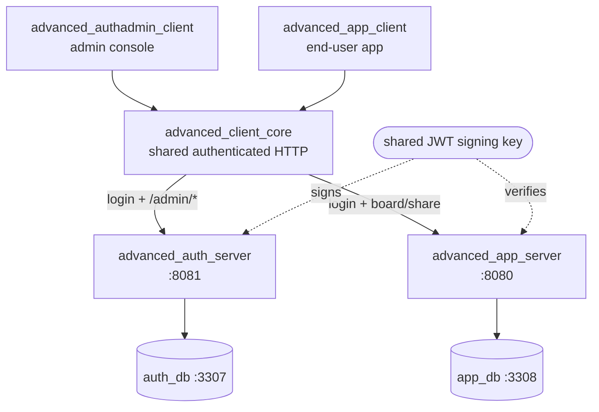

# Advanced Tom Core Full-Stack Sample — the whole secured system

> **Attribution.** The Tom Framework is developed by Peter Nicolai Alexis Kyaw.
> These sample projects are BSD-3-Clause licensed and internal (`publish_to: none`).

This is the **secured, full-stack successor** to the basic
[`core_server_sample`](core_server_sample/README.md) /
[`core_client_sample`](core_client_sample/README.md) pair. Where those teach one
server and one client in isolation, this suite is **three servers, two databases,
and two Flutter clients** wired together end-to-end: a JWT auth/admin server, a
secured task-manager app server, an end-user app, an administrator console, and a
back-office operations server running scheduled work over the app database — all
sharing one reflected domain and one wire contract, with live four-state field
authorization and cross-user sharing.

> **Reading this map.** This document links the nine packages, draws the
> architecture, and gives the one quickstart that stands the whole system up.
> Every package ships its own article-grade `README.md` with the depth — nothing
> about a package's internals is re-documented here.

---

## User guide

This suite map is the **index**. The long-form **Tom Core user guide** below uses
this sample as the worked example to teach how to build a full-scale, secured,
full-stack application on `tom_core` — its architecture *and* the implementation
rules the framework imposes (texts externalized into server-delivered resources;
UI authorization driven by scope/form/field names). Read the parts top to
bottom; each links to the next.

### Main spine

| Part | Document | Covers |
| --- | --- | --- |
| 00 | [Introduction & how to read this guide](README_advanced_00_introduction.md) | What the sample is and is *not*; who it is for; the nine packages at a glance; reading order; conventions. |
| 01 | [Full-stack architecture](README_advanced_01_architecture.md) | Two HTTP servers / two databases / two clients; layering; dependency arrows; the shared JWT key; the request + grant-propagation loop. |
| 02 | [Project layout, packages & build](README_advanced_02_project_layout_build.md) | The nine pubspecs and their wiring; `publish_to: none`; build order; reflection generation; running build_runner; local run. |
| 03 | [Domain model & reflection](README_advanced_03_domain_reflection.md) | The reflected `TomClass` entities; `@tomReflector`; the single reflection seed; enums; scope + `tomId`/`formId` addressing resolved by convention (no key catalogue). |
| 04 | [Wire contracts & DTOs](README_advanced_04_wire_contracts_dtos.md) | The contracts package: DTOs, the typed service interfaces, the api registry, the domain↔wire boundary. |
| 05 | [Persistence & the two databases](README_advanced_05_persistence_database.md) | Persistence mapping; CRUD repositories; the two-database design; datasources config; the schema vs sample-data migration split. |
| 06 | [Authentication (JWT)](README_advanced_06_authentication.md) | Token issuance; password hashing; the bearer token and signing keys; **two-factor login (TOTP)**; the client auth layer and token refresh. |
| 07 | [Authorization](README_advanced_07_authorization.md) | The four-state field authorization model; scope/form/field → `basePath` → grade; the per-field `TomAuthorizer.fixed` stamping (no installed adapter); closed-safe default; route gating. |
| 08 | [Resources & text externalization](README_advanced_08_resources_texts.md) | The no-hard-coded-labels rule; server-delivered resources; `<basePath>.<suffix>` keying; the scope/form/field JSON files; bundle bootstrap. |
| 09 | [Forms & UI](README_advanced_09_forms_ui.md) | `TomForm`/`TomField`; `basePath` derivation; bound reflected forms; scoped vs unscoped; the `tom_flutter_ui` components and screens. |
| 10 | [Servers & the secured endpoint pipeline](README_advanced_10_servers_endpoints.md) | The endpoint pipeline; per-endpoint access policies; bearer validation; ownership/share resolution; health; boot order. |
| 11 | [The two Flutter clients](README_advanced_11_clients_app_admin.md) | App client vs admin console; sessions; the in-memory vs live backend seam; bootstrap; the share flow and grant-matrix editor. |
| 12 | [Testing & cross-tier integration](README_advanced_12_testing_integration.md) | Test strategy; why Flutter suites need no concurrency flag; the sentinel render proof; the four-role matrix; the cross-tier runner; the green gate. |
| 13 | [File transfer under the authorization matrix](README_advanced_13_file_transfer.md) | One feature across every layer: the three column declarations; slots from annotations; the per-row C-4 grade; the three refusal layers; the client field; cascade delete; how it is proved. |
| 14 | [Operations: scheduled work over live data](README_advanced_14_operations.md) | Scheduling, audit, messaging and export in one artifact: the retention purge through the repository chokepoint; the digest named as a template key and handed to the outbox; the weekly export; why the anchor publisher is *not* a job; `min(user, server)` as a test; two schedulers over one store; one migration chain, two packages; a user's erasure and subject-access export across both databases. |

### Appendices (deep dives)

| Part | Document | Covers |
| --- | --- | --- |
| A1 | [Four-state authorization deep dive](README_advanced_A1_authorization_state_machine.md) | The four states; resolution layers 1–4; the closed-safe default; the grant matrix → adapter → field path; the worked role matrix. |
| A2 | [Scope, `basePath` & resource-key conventions](README_advanced_A2_resource_scope_conventions.md) | `basePath` derivation; one-path-two-uses; the estimate mismatch; scoped vs unscoped; the JSON-tree ↔ scope mirroring. |
| A3 | [A secured request, end to end](README_advanced_A3_request_lifecycle.md) | One end-user request traced across both tiers, from login to graded field rendering. |
| A4 | [Implementation-rules cheat-sheet](README_advanced_A4_implementation_rules_checklist.md) | The consolidated, copy-pasteable rule list for building a new tom_core app, each with its enforcement anchor. |
| A5 | [Glossary & cross-reference](README_advanced_A5_glossary_crossref.md) | Term glossary; a map from each package README and planning doc to the guide section that summarizes it. |

---

## The nine packages

| # | Package | What it is | Runtime |
| --- | --- | --- | --- |
| 1 | [`advanced_todo_domain`](advanced_todo_domain/README.md) | The shared, reflected domain model (`User`, `Project`, `TodoList`, `TodoItem`, label/priority/state enums). Single source of truth for the whole stack. | library |
| 2 | [`advanced_todo_contracts`](advanced_todo_contracts/README.md) | The over-the-wire surface: DTOs plus the typed `AuthApiService` / `AdminApiService` / `AppApiService` interfaces, implemented by the servers and called by the client core. | library |
| 3 | [`advanced_client_core`](advanced_client_core/README.md) | Flutter-free `dart:io` authenticated HTTP layer shared by both Flutter clients — presents a bearer token, refreshes it, parses JSON↔DTO. Headless-testable (no sockets in tests). | library |
| 4 | [`advanced_auth_server`](advanced_auth_server/README.md) | JWT **authentication** issuer (`/auth/login\|second-factor\|refresh\|me\|logout`, incl. a TOTP second pass) + role-gated **administration** API (`/admin/users\|roles\|groups\|grants\|assignments`). The grant-mutating admin endpoints are a primary deliverable. | HTTP `:8081`, `auth_db` `:3307` |
| 5 | [`advanced_app_server`](advanced_app_server/README.md) | The secured task-manager API. Trusts the JWT signing key shared with the auth server, validates the bearer token on every request, resolves ownership + shares + four-state field grades, and persists `app_db`. | HTTP `:8080`, `app_db` `:3308` |
| 6 | [`advanced_app_client`](advanced_app_client/README.md) | The end-user Flutter app: login, a status-column task board, a bound item-detail editor with per-field four-state authorization driven live over the wire, and cross-user sharing. | Flutter |
| 7 | [`advanced_authadmin_client`](advanced_authadmin_client/README.md) | The administrator Flutter console: manages users, roles, groups, role assignments, and the `projectRole` × field grant matrix via the auth server's `/admin/*` API. | Flutter |
| 8 | [`advanced_ops_server`](advanced_ops_server/README.md) | Back-office scheduled work over the app database — a nightly retention purge, a morning digest rendered from a localised text bundle into the messaging outbox, a weekly export into the blob store, and an audit-anchor publisher on its own timer; also where the sample's personal data is registered for erasure and subject access across both databases. No HTTP surface and no database of its own. | timers, `app_db` `:3308`, `auth_db` `:3307` |
| 9 | [`advanced_openapi_client`](advanced_openapi_client/README.md) | Typed Dart clients for the two HTTP servers, **generated** by `tom_core_openapi` from the OpenAPI documents the servers publish at `GET /openapi.json`. They depend on `package:http` alone — no Tom package, no reflection — and show the system called from code that shares nothing with it. | library (generated) |

**Four of the five runtime packages carry no `example/` directory, and that
is deliberate.** Each is run directly — `flutter run` for the two clients,
`dart run bin/…` for the app and auth servers — so an `example/` beside them
would duplicate the entry point. The ops server is the exception because its
entry point needs both databases while its most adaptable seam needs none:
[`advanced_ops_server/example/digest_composition_example.dart`](advanced_ops_server/example/digest_composition_example.dart)
runs the real digest pass into a memory outbox and prints one German and one
English mail.

The three libraries are a different case, because a library's surface is what
a reader calls, and each ships an `example/`. `advanced_client_core` ships
[`example/authenticated_call_example.dart`](advanced_client_core/example/authenticated_call_example.dart):
one authenticated call, from the config bean through login to the app API.
`advanced_todo_contracts` ships two: reading an endpoint's route, method and
access from the registry, and a DTO's round trip through the reflection path.
`advanced_todo_domain` ships one that builds the entity chain, reads the typed
enums, and grades an item's fields for every role — the resource-level ceiling
narrowed by the field grade, as the item screen computes it.

Each package without one names what to read instead in its README: its own run section, the
`curl` or screen tour beside it, and — for the whole stack at once —
[`advanced_client_core/tool/run_cross_tier_integration.sh`](advanced_client_core/tool/run_cross_tier_integration.sh),
which boots both databases and both servers, runs the live suites against them
and tears everything down.

That is the one thing a reader cannot infer from an absent folder, so each
package's README says it too — the three libraries and `advanced_ops_server` in
this family, and
`core_server_sample` and `todo_domain` elsewhere in `tom_core_samples`, *do*
ship `example/`, and a missing folder and a deliberately absent one look
identical.

`advanced_openapi_client` ships no `example/` either, for a third reason: its
two libraries are generated, and the runnable demonstration of them is
`test/generated_client_integration_test.dart`, which the cross-tier runner
below executes against both live servers.

**Nor does any of the nine carry a `doc/` folder or a `doc/api/` summary**, and
that is deliberate and decided once for the whole sample
suite — see [the suite map](README.md). A sample has no consumers who need its
surface indexed: these nine are `publish_to: none`, and the three hand-written
libraries among them are imported only by the other packages. The `## Current API` content an
API summary would carry is in each package's own README, in context, and the
fourteen guide documents beside this one carry the rest.

---

## Architecture

One reflected domain (`advanced_todo_domain`) flows into one wire contract
(`advanced_todo_contracts`); both servers implement the contract, both clients
call it through the shared `advanced_client_core`. The two servers share a JWT
signing key, so a token minted by the auth server verifies at the app server.

<!-- Figure: overall architecture as a wiring diagram. Two clients on the
outside (advanced_authadmin_client, advanced_app_client), the shared
advanced_client_core between them, the two servers in the middle
(advanced_auth_server :8081 → auth_db :3307; advanced_app_server :8080 → app_db
:3308), and the shared JWT signing key closing the loop underneath: an
auth-minted token verifies at the app server. Full walk-through in
[part 01](README_advanced_01_architecture.md). -->


<details><summary>Text / mermaid equivalent</summary>



</details>

- The **admin console** logs in at the auth server and drives `/admin/*` to edit
  roles and the grant matrix.
- The **end-user app** logs in at the auth server, then calls the app server with
  the bearer token; the app server reads the grant matrix (sourced from the auth
  tier) and grades each field hidden / read-only / disabled / editable per
  request.
- An admin's grant edit reaches an end-user's field matrix on their next
  request; a project share reveals a project to a second user on theirs. That
  full loop is exactly what the cross-tier integration test asserts.

---

## Run the whole thing

**Requirements:** Docker (+ Compose v2) and the Dart/Flutter SDK on `PATH`. Host
ports **3307** / **3308** (databases) and **8080** / **8081** (servers) must be
free.

### 1 — Bring up both databases

Each server bundles its own MariaDB. The default ports differ (3307 vs 3308) so
both — and a host-local MariaDB — can run side by side without colliding.

```sh
# Auth database (auth_db) on host port 3307
cd tom_core_samples/advanced_auth_server
cp .env.example .env
docker compose up -d auth-db

# App database (app_db) on host port 3308
cd ../advanced_app_server
cp .env.example .env
docker compose up -d app-db
```

Each `docker compose` above mounts the database's
`database_migrations/<db>/<schema>/` tree into MariaDB's
`docker-entrypoint-initdb.d`, so first boot runs that tree's `[<version>]-<desc>.sql`
files in order — schema-creation (`[0NN]`) first, then the idempotent sample-data
seed (`[1NN]`). The same tree is re-read at runtime by `TomDbMigrations`, so the
seed is the demo cast on first run: the auth server lands the demo accounts and
the grant matrix, the app server a starter workspace with shared projects.

### 2 — Start both servers

Start the auth server first (it mints tokens and owns the grant matrix), then the
app server (it verifies those tokens and reads grants). Each runs from its own
package root so relative migration/asset paths resolve.

```sh
# Auth server — from advanced_auth_server/
dart run bin/auth_server_start.dart      # HTTP :8081

# App server — from advanced_app_server/ (in a second shell)
dart run bin/app_server_start.dart       # HTTP :8080  (GET /health → 200)
```

### 3 — Run both clients

Neither client ships platform folders, so generate one per client before its
first run — see each client README's *Before the first run*, which also names
the macOS network entitlement the live stack needs:

```sh
# End-user app — from advanced_app_client/
flutter create --empty --platforms=macos .   # once; or linux, windows, web
flutter run                                  # or: flutter run -d chrome --web-port 8090

# Admin console — from advanced_authadmin_client/
flutter create --empty --platforms=macos .   # once; or linux, windows
flutter run
```

With **no dart-defines** both clients target the local servers above by default,
reading their URLs from the `AdvancedClientConfig` config bean. Launch with
`--dart-define=TEST_MODE=true` to boot on a **seeded in-memory backend** instead
— the opt-in offline mode, and the same fake the socket-free widget tests inject.

**Seeded live accounts** (sample only — never ship them):

<!-- account-roster: auth-db -->

| Username | Password | Global role | Seeded project access |
| --- | --- | --- | --- |
| `admin` | `admin-pass` | `admin` | manages roles + the grant matrix |
| `alice` | `alice-pass` | — | owns the starter workspace + project; can share |
| `bob` | `bob-pass` | — | editor on alice's project (seeded share) |
| `carol` | `carol-pass` | — | viewer on alice's project (seeded share) |
| `dave` | `dave-pass` | `two_factor_required` | none — exists for the TOTP challenge (part [06](README_advanced_06_authentication.md)) |
| `erin` | `erin-pass` | `two_factor_optional` | none — exists for the enrolment offer (part [06](README_advanced_06_authentication.md)) |

<!-- /account-roster -->

Sign into the **admin console** as `admin` to edit roles and the grant matrix;
sign into the **end-user app** as `alice` / `bob` / `carol` to see how each
principal's project access and four-state field grades follow the same ownership
+ share model the in-memory fake mirrors.

### One-command end-to-end check

To stand the entire stack up, run the scripted scenario, and tear it all down
again in a single command (fresh database volumes each run):

```sh
tom_core_samples/advanced_client_core/tool/run_cross_tier_integration.sh
```

It boots both databases and both servers, runs every live suite in
`advanced_client_core/test/` — and the generated-client suite in
`advanced_openapi_client/test/` — against them, and tears the stack down on
exit:

| Suite | What it walks |
| --- | --- |
| `cross_tier_integration_test.dart` | an admin grant edit → the end-user's field matrix reflects it → a share reveals a project to a second user → the same kind of edit reaches the **file endpoint**, taking the upload away from the owner of the row |
| `auth_client_integration_test.dart` | a real login, including the two-pass 2FA exchange |
| `file_transfer_integration_test.dart` | bytes through both blob stores, the closed-column and anonymous refusals, and a `read`-graded principal who gets the download but not the upload |
| `app_api_client_integration_test.dart` | one end-user call over the wire — health, then `alice` listing her workspaces through the typed app client |
| `admin_api_client_integration_test.dart` | the same, one tier down — `admin` signing in and listing users through the typed admin client |
| `advanced_openapi_client/test/generated_client_integration_test.dart` | the clients **generated** from the servers' OpenAPI documents: a login through the generated `AuthApi`, reads and a write through the generated `AppApi` carrying its token, an unauthenticated call refused with the bare `404` the document states, and each server serving the document its client was generated from |

A green run is a genuine live-stack pass — the runner converts a
server-unreachable skip into a failure.

The back-office server has its own runner, because its assertions need a database
but no server: it boots `app_db` and `auth_db` (which the boot's datasource
initialization insists on, and against which the privacy suite erases a user),
applies the migration this package contributes to the app chain, and runs the two
live suites and then the connection-free ones.

```sh
tom_core_samples/advanced_ops_server/tool/run_ops_integration.sh
```

### A real passkey from a browser

The end-user app builds for the web, and in a browser `erin`'s enrolment offer
includes a **passkey** the browser itself creates. One run exercises everything
the suites prove only in parts — the web build, the browser's WebAuthn, the
live auth server's relying party (`localhost`, origin `http://localhost:8090`)
and its CORS:

```sh
# from advanced_auth_server/ and advanced_app_server/: fresh databases, both servers
docker compose down -v && docker compose up -d auth-db   # (app-db likewise)
dart run bin/auth_server_start.dart env=dev               # and app_server_start.dart

# from advanced_app_client/
flutter create --empty --platforms=web .                  # once
flutter build web
dart run tool/drive_passkey_web.dart
```

`tool/drive_passkey_web.dart` is a manual check, never scheduled. It serves the
build on port 8090, starts headless Chrome with a CDP virtual authenticator —
a platform authenticator as far as the page and the server can tell — and
drives the canvas-rendered page through Flutter's semantics tree: sign in as
`erin`, choose **Passkey**, **Create passkey**, sign out, sign in again, **Use
passkey**. It asserts the credential was made for relying party `localhost`,
that the second sign-in was challenged with it, and that the authenticator's
signature counter moved. A person can run the same steps by hand in Chrome at
`http://localhost:8090` with `flutter run -d chrome --web-port 8090`.

Run on 2026-10-11 against the live stack: `PASS` — credential created for
`localhost`, the board loaded, the second sign-in challenged with the passkey,
and the signature counter went from 1 to 2.

### Checking the generated API pages

The API pages of every `advanced_*` package are built by the `tom_ai/core`
gate `tool/check_dartdoc_build.py`, which runs with the rest of the gate suite:

```sh
python3 tool/check_dartdoc_build.py                                   # all gated packages
python3 tool/check_dartdoc_build.py tom_core_samples/advanced_app_client  # one
```

It fails on any `dart doc` warning, and on a doc-comment link that lands in a
package this one does not depend on. The second matters because a reference
can resolve to the wrong thing silently: `dart doc` resolves a `[name]` by
walking outward until something answers, so a bare `[hash]` meant for a record
field became a link to another package's library with no warning at all.
Record fields, extension members and parameters of a function type have no
page to link to; write them in backticks.

### Checking that the generated reflection is current

After changing anything a reflector sees — a field, a method, or a parameter
**type** — verify that the package's committed `*.reflection.dart` still matches:

```sh
cd tom_core_samples/todo_domain
./reflection_generation.sh --check
```

It exits non-zero and names any generated file that has drifted, without
modifying it. The remedy is to drop `--check` and commit the result.

This matters more than it looks. Widening `TodoFieldMatrixDto.parseState` from
`String?` to `Object?` changed a type index in `todo_domain`'s seed and another
in `advanced_todo_contracts`; neither was regenerated, and both were committed
stale. **Nothing caught it**: `dart analyze` was clean and both suites fully
green, with identical test counts before and after regeneration, because the
stale part is metadata the tests never read. The mismatch surfaced only because
somebody ran the generator for an unrelated reason.

So a reflected signature change is a source edit with a second half, and this is
what confirms the second half was done. Reproduced deliberately while building
the check: adding one unreferenced field to a reflected DTO left `dart analyze`
clean and the suite at 18/18, and `--check` still failed.

---

## Documentation index

| Topic | Document |
| --- | --- |
| Basic samples map (the predecessor series) | [`README.md`](README.md) |
| Server stack | [`../tom_core_server/README.md`](../tom_core_server/README.md) |
| Kernel (foundation) | [`../tom_core_kernel/README.md`](../tom_core_kernel/README.md) |
| Flutter integration | [`../tom_core_flutter/README.md`](../tom_core_flutter/README.md) |
| Endpoints module | [`../tom_core_server/doc/endpoints.md`](../tom_core_server/doc/endpoints.md) |
| OpenAPI document and generated clients | [`../tom_core_openapi/README.md`](../tom_core_openapi/README.md) |

---

## Repository layout

```text
tom_core_samples/
  README_advanced_sample.md      this map (the secured, full-stack suite)
  advanced_todo_domain/          shared reflected model (User, Project, TodoList, TodoItem)
  advanced_todo_contracts/       wire DTOs + typed service interfaces
  advanced_client_core/          Flutter-free authenticated HTTP client core (+ e2e runner)
  advanced_auth_server/          JWT auth issuer + /admin/* API        (HTTP 8081, auth_db 3307)
  advanced_app_server/           secured task-manager API              (HTTP 8080, app_db 3308)
  advanced_app_client/           end-user Flutter app (board + sharing + field grades)
  advanced_authadmin_client/     administrator Flutter console (users/roles/groups/grants)
  advanced_ops_server/           scheduled back-office work           (no port, app_db 3308, auth_db 3307)
  advanced_openapi_client/       Dart clients generated from the servers' OpenAPI documents
  tool/                          suite-wide runners (dart doc over every package)
```

## License

BSD 3-Clause licensed. Each package carries the same
[`LICENSE`](../tom_core_kernel/LICENSE) as the rest of Tom Core; see any package
folder for the full text.
