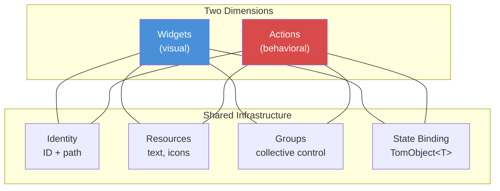
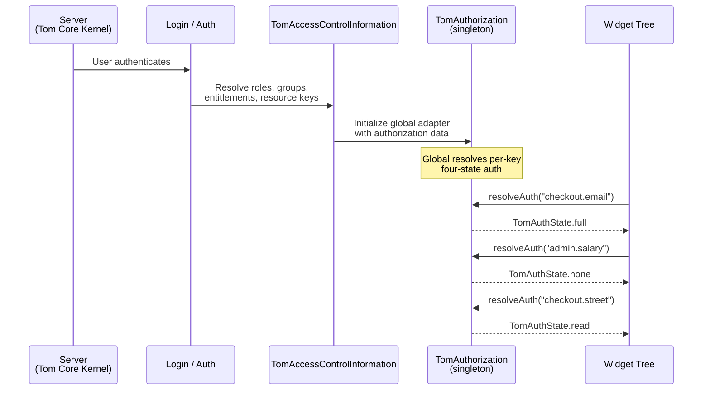
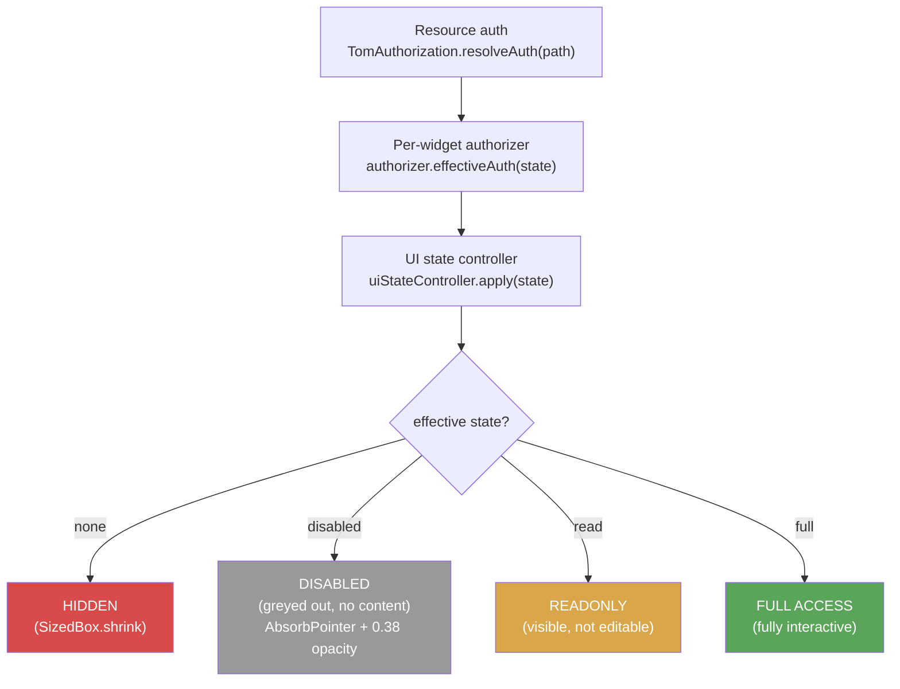
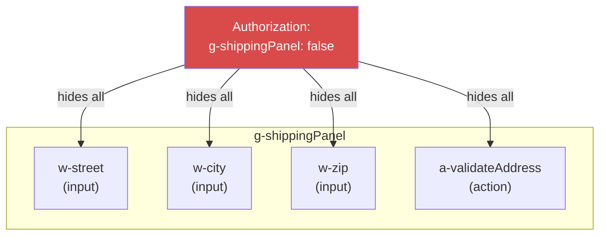
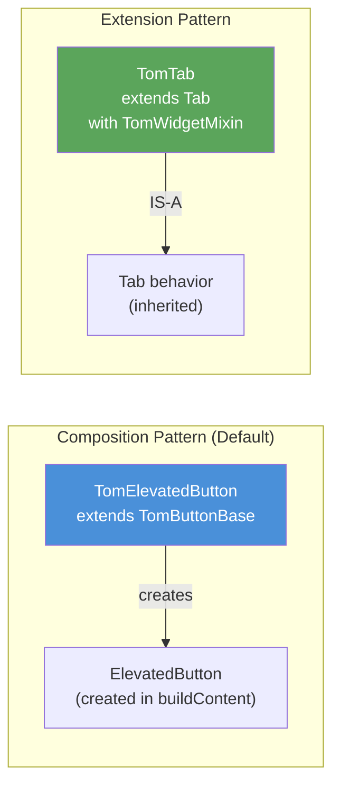
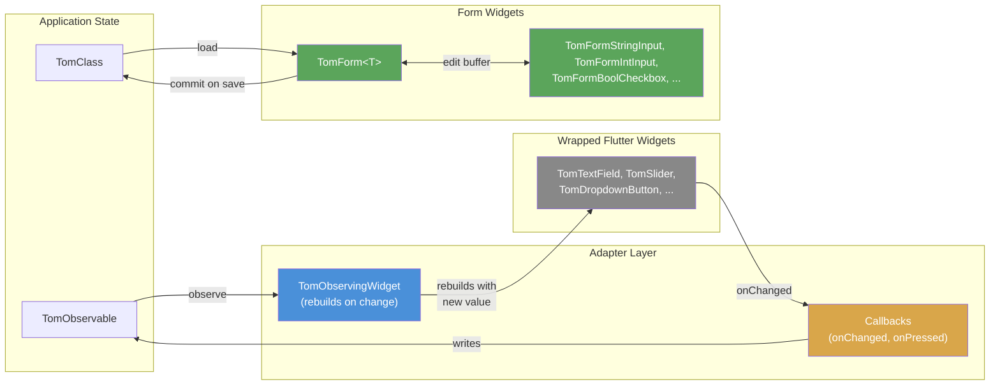
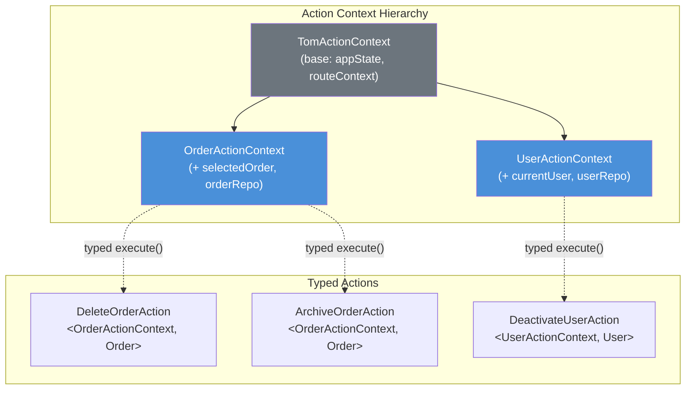
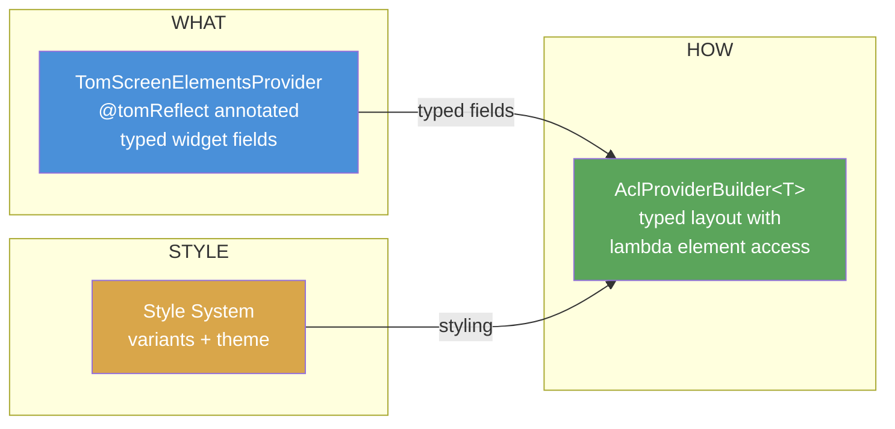
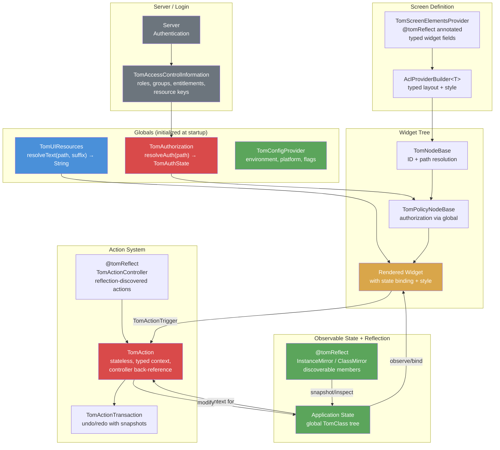

# Tom UI Design Architecture

*Part of the [Tom Flutter UI documentation set](README.md).*

**Date:** 2026-03-20 (updated 2026-04-07)
**Status:** Architecture Reference (core infrastructure implemented)
**Package:** tom_flutter_ui

---

## Table of Contents

1. [Overview](#1-overview)
2. [Observable State and Reflection — The Foundation](#2-observable-state-and-reflection--the-foundation)
3. [Identity System](#3-identity-system)
4. [Authorization — From Server to Widget](#4-authorization--from-server-to-widget)
5. [Resources — Text, Icons, Configuration](#5-resources--text-icons-configuration)
6. [Groups — Collective Visibility Control](#6-groups--collective-visibility-control)
7. [Widget Architecture](#7-widget-architecture)
8. [State Binding Modes](#8-state-binding-modes)
9. [Form System — TomForm\<T\>](#9-form-system--tomformt)
10. [Action System](#10-action-system)
11. [Screen Definition and Layout](#11-screen-definition-and-layout)
12. [Data Sources — Lists, Trees, Master-Detail](#12-data-sources--lists-trees-master-detail)
13. [Theming and Style System](#13-theming-and-style-system)
14. [Debug Tooling](#14-debug-tooling)

---

## 1. Overview

The Tom UI architecture has two dimensions:

1. **Widgets** — the visual dimension. Everything the user sees and interacts with.
2. **Actions** — the behavioral dimension. Everything the application does in response to user intent or system events.

Both dimensions share four concerns:

- **Identity** — unique IDs for authorization, resource lookup, and debug inspection.
- **Resources** — text, icons, and configuration loaded by path.
- **Groups** — optional membership for collective visibility control.
- **State binding** — connection to the observable application state.

All shared concerns are accessed through Tom globals — no `InheritedWidget` providers or widget context required. Application state, authorization, and resources are globally available singletons, initialized at app startup.



The system cleanly separates:

- **Screen element definition** — what is on screen, with typed widget instances and `@tomReflect`-annotated element providers.
- **Layout arrangement** — how elements are positioned (AclProviderBuilder or JSON-ACL).
- **Theming** — visual styling that can be changed independently.

---

## 2. Observable State and Reflection — The Foundation

All UI data flow builds on the Tom observable state system (`tom_core_kernel`). Understanding this layer is essential before anything else in the architecture.

> **Full reference:** See [tom_observable_state_management.md](tom_observable_state_management.md) for the complete observable state documentation — observer/observable core, value types, `TomClass`, collections, Flutter integration patterns, class hierarchy, and reflection dependency.

### Summary

The Tom observable system uses a classic Observer pattern with weak-reference-based listener storage, preventing memory leaks without requiring manual unsubscription. Observable values (`TomObject<T>`), domain objects (`TomClass`), and collections (`TomList<E>`, `TomMap<K,V>`) notify registered observers when their state changes. `TomClass` supports hierarchical change propagation — observing a parent notifies you of any descendant change.

| Type | Purpose |
|------|---------|
| `TomObservable` | Base class — any object that notifies observers of state changes |
| `TomObject<T>` | Single observable value of type T |
| `TomClass` | Observable domain object with named members — child changes propagate upward |
| `TomList<E>` | Observable list — `add`, `remove`, `reorder` all notify |
| `TomMap<K, V>` | Observable map |

Application state is a **global variable** — accessed directly, no providers or context lookups:

```dart
late final AppState appState;

@tomReflect
class AppState extends TomClass {
  late final username = TomString('username');
  late final email = TomString('email');
  late final isAdmin = TomBool('isAdmin', initialValue: false);
}
```

### How the UI connects to state

Every widget, form field, and action connects to state through `TomObject<T>` bindings — the single mechanism for displaying live values, editing values, form field binding, action preconditions, and dynamic configuration.

### Reflection as architectural pillar

The `tom_reflection` package provides compile-time code generation for runtime reflection (`InstanceMirror`, `ClassMirror` — no `dart:mirrors`). Reflection is a core architectural pillar, not an implementation detail. It powers:

- **Undo/redo** — snapshot and restore state subtrees without per-class copy logic
- **Form-to-state validation** — verify field mappings against `TomClass` declarations at startup
- **Debug inspection** — enumerate members, values, and annotations without custom debug code
- **Semantic annotations** — `@currency('EUR')`, `@precision(2)` give widgets automatic formatting hints
- **Screen element discovery** — element providers have their widget fields discovered automatically
- **ActionController discovery** — action fields in controllers are discovered and wired automatically

> See [Part 7 — Reflection Dependency](tom_observable_state_management.md#part-7--reflection-dependency) in the observable state document for the full reflection integration details.

---

## 3. Identity System

Every widget, container, form, and action can have a unique ID. IDs serve three purposes:

1. **Authorization target** — controls visibility and access.
2. **Resource base path** — locates text, icons, and configuration.
3. **Debug identification** — enables inspection and tracing.

### ID convention

Developers set plain IDs. In the current implementation:

- **Widget and scope paths** use plain IDs joined by dots — `TomNodeBase._resolveBasePath()` builds `<scopePath>.<tomId>` without prefixes.
- **Action and controller paths** use plain IDs — `TomAction.canonicalPath` produces `<controllerId>.<actionId>`.

| Scope | Set as | Resolved as |
|-------|--------|-------------|
| Scope provider | `'checkout'` | `checkout` |
| Element provider | `'shipping'` | `shipping` |
| Form | `'addressForm'` | `addressForm` |
| Widget | `'street'` | `street` |
| Action | `'submitOrder'` | `submitOrder` |
| Controller | `'orderMgmt'` | `orderMgmt` |
| Group | `'shippingPanel'` | `shippingPanel` |

> **Design note:** All IDs are plain strings — no automatic prefixes are applied. Disambiguation is achieved through hierarchical scope paths (e.g., `checkout.addressForm.street`).

### Canonical path

IDs compose into a canonical path that describes the element’s position in the scope hierarchy:

```
<scope1>.<scope2>.<form>.<widget>
<controllerId>.<actionId>
```

Segments are omitted when not present (no scope, no form, etc.).

```
checkout.shipping.addressForm.street
orderMgmt.submitOrder
admin.orderMgmt.delete
```

---

## 4. Authorization — From Server to Widget

Authorization controls what each user can see and do. The flow spans from server-side role resolution through to individual widget visibility.

### End-to-end flow



### Server-side: kernel security layer

The kernel (`tom_core_kernel`) provides the data and checks that the UI consumes.

**TomPrincipal** — authenticated user context, available zone-scoped:

```dart
var principal = TomBearerAuthentication.getPrincipal();
// principal.aci  → TomAccessControlInformation
```

**TomAccessControlInformation (ACI)** — all authorization data resolved at login:

```dart
principal.aci.roles         // List<String> — job functions
principal.aci.groups        // List<String> — organizational units
principal.aci.entitlements  // List<String> — fine-grained permissions
principal.aci.resourceKeys  // List<String> — field-level access keys
```

**TomAccessControl hierarchy** — annotation-style access control:

- `TomPublicAccess`, `TomAuthenticatedAccess`, `TomGuestAccess`
- `TomRoleAccess(['admin', 'manager'])`
- `TomGroupAccess(['finance'])`
- `TomEntitlementAccess(['feature.reports.*'])`
- `TomResourceKeyAccess('user.salary')`
- `TomCustomAccess(handler: 'name', resourceId: 'id')`

Each provides `checkAccessibility(TomPrincipal?)` → `bool`.

**TomAccessControlDefinition** resolves complete effective permissions from role/group inheritance hierarchies at login time.

### Four authorization states

Authorization controls four states (implemented as `TomAuthState` enum in `tom_core_kernel`):

| State | Effect |
|-------|--------|
| **none** | Widget is hidden (as if it doesn't exist) |
| **disabled** | Widget is visible but greyed out, no content shown. Indicates data may exist but cannot be accessed. |
| **read** | Widget shows current value/state in read-only mode |
| **full** | Widget is fully interactive and editable |

State ordering from most to least restrictive: `none` < `disabled` < `read` < `full`.

### Per-widget authorization modifier

Each widget can have optional authorization modifiers:

- **`TomAuthorizer authorizer`** — per-widget callback modifying resolved auth state
- **`TomAuthorizerStrategy authorizerStrategy`** — `authorizerDecides` or `authorizerNarrowsOnly` (default)
- **`TomUIStateController uiStateController`** — build-time narrowing for business rules (e.g., disabling a button when a list is empty). Can only narrow, never widen.

### Final visibility rules



### UI authorization adapter

The adapter bridges the kernel's access checks to the four-state model (all types in `tom_core_kernel`):

```dart
enum TomAuthState {
  none, disabled, read, full;

  bool get isVisible => this != none;
  bool get isInteractive => this == full;
  TomAuthState narrow(TomAuthState other) => index <= other.index ? this : other;
}

abstract class TomAuthorizationAdapter {
  TomAuthState resolveAuth(String resourceKeyPath);
}
```

The `TomAuthorization` singleton resolves auth state globally — initialized at app startup, accessible anywhere without `BuildContext`:

```dart
// App startup — set global authorization adapter
TomAuthorization.adapter = TomKernelAuthorizationAdapter();

// Usage anywhere — no context needed
TomAuthorization.resolveAuth('checkout.email');
```

### Authorization examples

```yaml
# Full access to email field
checkout.shipping.addressForm.email: true

# Visible but readonly
checkout.shipping.addressForm.email: true
checkout.shipping.addressForm.email.readonly: true

# Hidden entirely
checkout.shipping.addressForm.email: false

# Entire form hidden
checkout.shipping.addressForm: false

# Entire scope hidden
checkout.shipping: false
```

### Authorization lookup hierarchy

For a widget `street` inside scope `checkout.shipping`:

```
1. checkout.shipping.street          ← most specific
2. shipping.street                   ← parent scope + widget
3. checkout.street                   ← outer scope + widget
4. street                            ← global widget
```

For actions, the hierarchy respects controller scope:

```
1. admin.orderMgmt.delete             ← scope + controller + action
2. orderMgmt.delete                   ← controller + action
3. admin.delete                       ← scope + action
4. delete                             ← global action
```

**Override rule:** If a global key is `false` (hidden), it cannot be enabled at a more specific scope. Global denial is absolute. Authorization can restrict but never loosen what a higher scope has denied.

---

## 5. Resources — Text, Icons, Configuration

Resources provide all user-facing text, icons, and configuration for widgets and actions. They are loaded by path and resolved through a fallback chain.

### Locale and process context

Resources are locale-aware (language + region) and process-context-aware (e.g., "self-service" vs. "back-office"). The correct resource set is resolved during application initialization and login. Widgets simply look up keys and receive pre-resolved values — no locale handling needed in the widget layer.

### Resource path and suffixes

The widget's canonical ID path (§3) forms the base. The widget appends internal suffixes for each piece it needs:

```
checkout.mainForm.emailField.label
checkout.mainForm.emailField.hint
checkout.mainForm.emailField.error.required
checkout.submitOrder.tooltip
orderMgmt.cancelOrder.label
```

### Fallback strategy

To avoid duplicate resource entries while allowing precise overrides, resources resolve through a fallback chain. For key `<scope1>.<scope2>.<form>.<widget>.<suffix>`:

1. **Exact** — `<scope1>.<scope2>.<form>.<widget>.<suffix>`
2. **Drop outer scope** — `<scope2>.<form>.<widget>.<suffix>`
3. **Drop inner scope** — `<scope1>.<form>.<widget>.<suffix>`
4. **Form + widget** — `<form>.<widget>.<suffix>`
5. **Widget only** — `<widget>.<suffix>`

> **Implementation note:** The current `TomUIResources.resolveText()` does a direct `basePath.suffix` lookup. The multi-level fallback chain described above is the target design; it will be implemented when resource management is built out.

If all lookups miss, the full key string becomes the visible value. This guarantees a widget is never blank — it shows the key path as a visual indicator that a resource is missing.

### Resource adapter

```dart
abstract class TomUIResourceAdapter {
  String resolveText(String basePath, String suffix);
  bool resourceExists(String basePath, String suffix);
}
```

The resource adapter is a global singleton, consuming `TomTextResourceProvider` from the kernel internally. Initialized at app startup, accessed directly by widgets — no `InheritedWidget` or `BuildContext` needed.

```dart
// App startup — set global resource adapter
TomUIResources.adapter = TomKernelResourceAdapter();

// Usage anywhere
TomUIResources.resolveText('checkout.email', 'label');
```

### Configuration — environment and platform

In addition to text resources, the system supports **technical configuration** that varies by environment (development, staging, production) and platform (mobile, web, desktop).

Configuration is a separate concern from user-facing text resources. It covers:

- **API endpoints** — base URLs differ per environment.
- **Feature flags** — capabilities enabled per environment or rollout stage.
- **Platform behavior** — touch vs. mouse input, screen density, safe areas.
- **Device-specific widget selection** — a compact date picker on mobile, a full calendar on desktop.

Configuration is globally accessible via `TomConfigProvider` and resolved at startup based on the deployment context. Widgets that need platform-adaptive behavior query configuration directly — no conditional logic scattered through the widget tree.

```dart
// Global configuration access
final config = TomConfigProvider.current;
config.environment;          // Environment.production
config.platform;             // Platform.mobile
config.feature('darkMode');  // true
```

This is mentioned for completeness — configuration may become increasingly important as the architecture supports device-specific widget variants and multi-platform deployment.

---

## 6. Groups — Collective Visibility Control

Groups provide semantic control over entire UI regions without requiring individual IDs on every leaf widget. The group system is implemented in `tom_flutter_ui/lib/src/groups/`.

### Rules

- A widget or action can belong to **zero or one** group (set via `authorizationGroup`).
- Groups can contain **both widgets and actions**.
- Parent containers can add inherited group influence.
- If any member with an ID controls the group's visibility, all members follow.

### Group ID patterns

Group IDs follow the canonical path pattern, extending from scopes:

```
<scope>.<groupId>
<scope1>.<scope2>.<groupId>
```

**Examples:**
- `orders.orderForm.shippingPanel`
- `settings.profileCard.avatarSection`
- `dashboard.quickActions` (scope-level group)

### Group scope definition

**ACL containers with IDs are implicit group scopes.** Any container that sets a `containerId` in `AclScope` creates a potential group boundary. Widgets inside inherit the scope path.

For **explicit group scope** (without a container ID), use `TomGroupScope`:

```dart
final shippingGroup = TomAuthorizationGroup('shippingPanel');

TomGroupScope(
  groupId: 'shippingPanel',
  child: Column(children: [
    TomTextField(tomId: 'street', authorizationGroup: shippingGroup, ...),
    TomTextField(tomId: 'city', authorizationGroup: shippingGroup, ...),
    TomTextField(tomId: 'zip', authorizationGroup: shippingGroup, ...),
  ]),
)
```

### TomAuthorizationGroup (was TomGroup)

The group system uses `TomAuthorizationGroup` (in `tom_core_kernel`) for registration and lookup:

```dart
/// Single group with member tracking.
class TomAuthorizationGroup {
  final String groupId;
  final Set<TomAuthorizable> _members = {};

  TomAuthorizationGroup(this.groupId);

  void register(TomAuthorizable member) => _members.add(member);
  void unregister(TomAuthorizable member) => _members.remove(member);
  Iterable<TomAuthorizable> get members => _members;
}
```

### Widget registration

Widgets with an `authorizationGroup` register on mount and unregister on dispose. The mixin provides the registration hook:

```dart
mixin TomWidgetMixin on Widget implements TomAuthorizable {
  String? get tomId;
  TomAuthorizationGroup? get authorizationGroup => null;

  void registerWithGroup() {
    authorizationGroup?.register(this);
  }

  void unregisterFromGroup() {
    authorizationGroup?.unregister(this);
    }
  }

  /// Called by State.dispose() or StatelessWidget unmount.
  void unregisterFromGroup() {
    authorizationGroup?.unregister(this);
  }
}
```

For **StatefulWidgets**, registration happens in `initState()`:

```dart
class _TomPopupMenuItemState<T>
    extends PopupMenuItemState<T, TomPopupMenuItem<T>> {
  @override
  void initState() {
    super.initState();
    widget.registerWithGroup();
  }

  @override
  void dispose() {
    widget.unregisterFromGroup();
    super.dispose();
  }
}
```

### Why groups matter

When a group is hidden by authorization, **all** members are hidden — both visual elements and their action triggers. A user cannot trigger an action whose associated UI region is not visible.



### Typical setup

- One controller widget with ID and group assignment.
- Related widgets in the same group (with or without their own IDs).
- Associated actions in the same group.
- A single authorization key controls the entire functional unit.

---

## 7. Widget Architecture

### Two wrapping patterns

Tom widgets use **two patterns** depending on whether Flutter's type system requires type preservation:

| Pattern | When to Use | Type Identity |
|---------|-------------|---------------|
| **Composition wrapper** (default) | Most widgets — no `is`-checks from parents | `TomElevatedButton` is NOT `ElevatedButton` |
| **Extension with mixin** | Widgets with `is`-checks or hard type constraints | `TomTab` IS `Tab` — passes all type checks |



### Composition wrapper pattern (default)

Tom widgets extend family-specific base classes (`TomButtonBase`, `TomInputBase`, etc.) that inherit from `TomFamilyBase`. The base class handles authorization checks and readonly styling; the widget only implements `buildContent()`:

```dart
class TomElevatedButton extends TomButtonBase {
  final VoidCallback? onPressed;
  final Widget? child;
  final String? label;
  // ... other ElevatedButton properties

  const TomElevatedButton({
    super.key,
    super.tomId,
    super.authorizationGroup,
    this.onPressed,
    this.child,
    this.label,
  });

  @override
  Widget buildContent(BuildContext context) {
    // Resolve resources using base class method
    final resolvedLabel = label ?? resolveResource('label');
    final buttonChild = child ?? Text(resolvedLabel);

    // Create the underlying Flutter widget
    return ElevatedButton(
      onPressed: onPressed,
      child: buttonChild,
    );
  }
}
```

**Key points:**
- `tomId` and `authorizationGroup` are inherited from `TomFamilyBase` via `super`
- Authorization (`checkHidden`) and auth state styling are handled by the base class `build()` method
- Use `resolveResource(suffix)` for resource lookup (uses `basePath` resolved at construction from `TomScope`)
- Only `buildContent()` needs implementation — returns the Flutter widget

**Family base classes:**
| Base Class | Widget Family | Examples |
|------------|--------------|----------|
| `TomButtonBase` | Buttons | ElevatedButton, TextButton, IconButton |
| `TomInputBase` | Text inputs | TextField, TextFormField |
| `TomSelectBase` | Selection | DropdownButton, PopupMenuButton |
| `TomToggleBase` | Toggles | Switch, Checkbox, Radio |
| `TomSliderBase` | Sliders | Slider, RangeSlider |
| `TomContainerBase` | Containers | Card, ExpansionTile |
| `TomDialogBase` | Dialogs | AlertDialog, BottomSheet |
| `TomTableBase` | Tables | DataTable, Table |
| `TomLabelBase` | Labels | Text, Badge |
| `TomImageBase` | Images | Icon, Image, CircleAvatar |
| `TomNavigationBase` | Navigation | NavigationBar, TabBar |
| `TomListBase` | Lists | ListView, AnimatedList |
| `TomProgressBase` | Progress | CircularProgressIndicator |
| `TomChipBase` | Chips | FilterChip, ActionChip |
| `TomTreeBase` | Trees | TreeView |
| `TomSliverBase` | Slivers | SliverList, SliverGrid |
| `TomAnimatedBase` | Animated | AnimatedContainer, Hero |
| `TomEffectBase` | Effects | BackdropFilter, ShaderMask |
| `TomInteractionBase` | Interactions | GestureDetector, InkWell |
| `TomBuilderBase` | Builders | FutureBuilder, StreamBuilder |

**When to use:** Any widget where the parent does NOT perform `is`-checks or require specific types. This is the default for most widgets.

### Extension with mixin pattern

The Tom widget **extends** the Flutter widget directly and adds `TomWidgetMixin` to preserve type identity. Required when:

1. **Hard type constraints** — Parent requires exact type: `NavigationBar(destinations: List<NavigationDestination>)`
2. **Runtime `is` checks** — Parent checks type at runtime: `TabBar` does `tab is Tab`
3. **ParentDataWidget checks** — Layout widgets check child types: `Flex` checks `child is Flexible`

```dart
class TomTab extends Tab with TomWidgetMixin {
  @override
  final String tomId;

  @override
  final TomAuthorizationGroup? authorizationGroup;

  TomTab({
    required this.tomId,
    this.authorizationGroup,
    super.text,
    super.icon,
    super.child,
    super.key,
  });

  @override
  Widget build(BuildContext context) {
    // Check authorization — return immediately if hidden
    final hidden = checkHidden();
    if (hidden != null) return hidden;

    // Apply auth state styling, delegate to original build
    return applyAuthState(context, super.build(context));
  }
}

// Type checks pass
widget is Tab;              // true
widget is StatelessWidget;  // true

// List constraints satisfied
List<Tab> tabs = [TomTab(tomId: 'home', text: 'Home')]; // ✓
```

**Note:** Extension widgets pass placeholder values to `super()` and resolve resources in `build()`, since canonical paths are only known at build time.

### Widgets requiring extension pattern

These widgets MUST use the extension pattern due to Flutter's type constraints:

| Widget | Reason | Base Class |
|--------|--------|------------|
| `FilterChip`, `ChoiceChip`, `ActionChip`, `InputChip`, `RawChip` | Hard type constraints in chip parents | StatelessWidget |
| `Tab` | `TabBar` does `is Tab` to extract icon/text | StatefulWidget |
| `NavigationDestination` | `NavigationBar(destinations: List<NavigationDestination>)` | StatelessWidget |
| `NavigationDrawerDestination` | `NavigationDrawer` does `is NavigationDrawerDestination` | StatelessWidget |
| `SnackBarAction` | `SnackBar(action: SnackBarAction?)` | StatelessWidget |
| `PopupMenuItem`, `CheckedPopupMenuItem` | `showMenu(items: List<PopupMenuEntry<T>>)` | StatefulWidget |
| `PopupMenuDivider` | Extends `PopupMenuEntry<Never>` | StatelessWidget |
| `DropdownMenuEntry` | `DropdownMenu(dropdownMenuEntries: List<DropdownMenuEntry<T>>)` | Data class |
| `Flexible`, `Expanded`, `Spacer` | `Flex` checks `child is Flexible` | ParentDataWidget |
| `Positioned`, `PositionedDirectional` | `Stack` checks `child is Positioned` | ParentDataWidget |
| `AnimatedPositioned`, `AnimatedPositionedDirectional` | Extends `Positioned` | ImplicitlyAnimatedWidget |
| `TableCell` | `Table` may check `child is TableCell` | ParentDataWidget |
| `RefreshProgressIndicator` | Extends `CircularProgressIndicator` | StatelessWidget |
| `CupertinoTabView` | `CupertinoTabScaffold` may check internally | StatefulWidget |

### TomWidgetMixin — for extension pattern only

Widgets using the **extension pattern** add `TomWidgetMixin` to get Tom infrastructure (auth, resources, groups). The composition pattern uses `TomFamilyBase` instead — it provides similar functionality through inheritance.

```dart
mixin TomWidgetMixin on Widget implements TomAuthorizable {
  /// Local widget ID (plain string).
  String? get tomId;

  /// Optional group membership.
  TomAuthorizationGroup? get authorizationGroup => null;

  /// Optional per-widget authorizer.
  TomAuthorizer? get authorizer => null;

  /// Authorizer strategy (default: narrows only).
  TomAuthorizerStrategy get authorizerStrategy =>
      TomAuthorizerStrategy.authorizerNarrowsOnly;

  /// Optional build-time state controller.
  TomUIStateController? get uiStateController => null;

  /// Gets effective authorization state combining resource auth, authorizer, and UI state.
  TomAuthState getAuth() {
    var state = (basePath != null)
        ? TomAuthorization.resolveAuth(basePath!)
        : TomAuthState.full;
    if (authorizer != null) state = authorizer!.effectiveAuth(state);
    if (uiStateController != null) state = uiStateController!.apply(state);
    return state;
  }

  /// Returns SizedBox.shrink() if authorization says hidden, null otherwise.
  Widget? checkHidden() {
    final auth = getAuth();
    if (auth == TomAuthState.none) return const SizedBox.shrink();
    return null;
  }

  /// Applies the appropriate visual treatment based on auth state.
  Widget applyAuthState(BuildContext context, Widget child) {
    final auth = getAuth();
    switch (auth) {
      case TomAuthState.none:
        return const SizedBox.shrink();
      case TomAuthState.disabled:
        return AbsorbPointer(child: Opacity(opacity: 0.38, child: child));
      case TomAuthState.read:
        final style = TomThemeScope.readonlyStyleOf(context);
        return style.apply(child);
      case TomAuthState.full:
        return child;
    }
  }
}
```

The mixin provides:

| Member | Purpose |
|--------|---------|
| `tomId` | Abstract — each widget declares its ID |
| `authorizationGroup` | Optional group membership (defaults to `null`) |
| `authorizer` | Optional per-widget auth modifier |
| `authorizerStrategy` | How authorizer interacts with resource auth |
| `uiStateController` | Build-time narrowing callback |
| `getAuth()` | Returns effective `TomAuthState` (four states) |
| `checkHidden()` | Returns `SizedBox.shrink()` if `none`, else `null` |
| `applyAuthState(context, child)` | Applies visual treatment for all four states |

### Widget categories (extension pattern)

The following patterns apply to widgets that **require extension** (see table above). For widgets using the **composition pattern** (the default), extend the appropriate `Tom*Base` class and implement `buildContent()`.

Flutter widgets requiring extension fall into three categories by base class. Each category uses the mixin differently:

| Category | Base Class | Build Method | Auth Enforcement |
|----------|------------|--------------|------------------|
| **StatelessWidget** | `StatelessWidget` | `build()` in Widget | Override `build()`, check visibility |
| **StatefulWidget** | `StatefulWidget` | `build()` in State | State accesses `widget.checkHidden()` |
| **ParentDataWidget** | `ParentDataWidget` | No build — parent reads properties | Parent container filters children |

### StatelessWidget extension pattern

For widgets like `Tab`, `NavigationDestination`, chips — the widget overrides `build()`, checks visibility, applies auth state styling, and delegates to `super.build()`:

```dart
class TomTab extends Tab with TomWidgetMixin {
  TomTab({
    required this.tomId,
    this.authorizationGroup,
    super.text,
    super.icon,
    super.child,
    super.key,
  });

  @override
  final String tomId;

  @override
  final TomAuthorizationGroup? authorizationGroup;

  @override
  Widget build(BuildContext context) {
    // Check authorization — return immediately if hidden
    final hidden = checkHidden();
    if (hidden != null) return hidden;

    // Apply auth state styling, delegate to original build
    return applyAuthState(context, super.build(context));
  }
}
```

**Examples:** `Tab`, `NavigationDestination`, most simple widgets.

### StatefulWidget extension pattern

For widgets like `PopupMenuItem`, `SnackBarAction` — the widget has the mixin and `tomId`. The State overrides `build()` and accesses the mixin methods through `widget`:

```dart
class TomPopupMenuItem<T> extends PopupMenuItem<T> with TomWidgetMixin {
  TomPopupMenuItem({
    required this.tomId,
    this.authorizationGroup,
    required super.child,
    super.value,
    super.onTap,
    super.key,
  });

  @override
  final String tomId;

  @override
  final TomAuthorizationGroup? authorizationGroup;

  @override
  PopupMenuItemState<T, TomPopupMenuItem<T>> createState() =>
      _TomPopupMenuItemState<T>();
}

class _TomPopupMenuItemState<T>
    extends PopupMenuItemState<T, TomPopupMenuItem<T>> {
  @override
  Widget build(BuildContext context) {
    // Access mixin methods via widget reference
    final hidden = widget.checkHidden();
    if (hidden != null) return hidden;

    return widget.applyAuthState(context, super.build(context));
  }
}
```

**Examples:** `PopupMenuItem`, `CheckedPopupMenuItem`, `SnackBarAction`, `PopupMenuDivider`.

### ParentDataWidget extension pattern

For `Expanded`, `Flexible`, `Positioned` — these have no `build()` method — they apply parent data during layout. The mixin adds `tomId` for identification, but visibility is controlled by the **parent container** or by authorization on the **child widget**:

```dart
class TomExpanded extends Expanded with TomWidgetMixin {
  TomExpanded({
    required this.tomId,
    this.authorizationGroup,
    required super.child,
    super.flex,
    super.key,
  });

  @override
  final String tomId;

  @override
  final TomAuthorizationGroup? authorizationGroup;

  // No build override needed — parent handles visibility
}
```

**Parent container filtering:**

```dart
class TomRow extends Row with TomWidgetMixin {
  TomRow({required this.tomId, required List<Widget> children, ...})
      : super(children: children, ...);

  @override
  final String tomId;

  @override
  Widget build(BuildContext context) {
    // Filter out hidden Tom children
    final visibleChildren = children.where((child) {
      if (child is TomWidgetMixin) {
        return child.getAuth() != TomAuthState.none;
      }
      return true; // Non-Tom widgets always visible
    }).toList();

    // Build with filtered children
    return Row(
      children: visibleChildren,
      mainAxisAlignment: mainAxisAlignment,
      crossAxisAlignment: crossAxisAlignment,
      // ... other properties
    );
  }
}
```

**Examples:** `Expanded`, `Flexible`, `Positioned`, `PositionedDirectional`, `Spacer`.

### Scope-based ID resolution

Widget identity paths are resolved at **construction time** using `TomScope` — a Zone-based hierarchical scoping system from `tom_core_kernel`. There is no InheritedWidget involved in path resolution.

```dart
abstract class TomScope {
  String get id;
  TomScope? get parent;

  /// Returns the current scope from the Zone, or the default scope.
  static TomScope get current => getFromCurrentZone<TomScope>() ?? defaultScope;

  /// Runs [body] in a child scope with the given [scope] ID.
  static T withScope<T>(String scope, T Function() body);

  /// Runs [body] within this scope's Zone.
  T runInScope<T>(T Function() body);

  /// Returns the dot-separated path (walks parent chain).
  String getScopePath();
}
```

**Path resolution** happens in `TomNodeBase` and `TomWidgetMixin` constructors:

```dart
// In TomNodeBase constructor:
constructionScope = scope ?? TomScope.current;
basePath = _resolveBasePath(tomId, scope);

static String? _resolveBasePath(String? tomId, TomScope? scope) {
  if (tomId == null) return null;
  final effectiveScope = scope ?? TomScope.current;
  final scopePath = effectiveScope.getScopePath();
  if (scopePath.isNotEmpty) return '$scopePath.$tomId';
  return tomId;
}
```

**Example:** A widget with `tomId='submit'` constructed inside scope `'checkout.order'` gets `basePath = 'checkout.order.submit'`.

### Scope propagation

Scopes are set up in two ways:

1. **Zone-based** — `TomScope.withScope('myScope', () { ... })` creates a child scope for all widgets constructed inside the callback.
2. **Explicit** — Widgets accept an optional `scope` parameter that overrides `TomScope.current`.

`TomStatelessWidget` and `TomStatefulWidget` capture scope at construction and re-enter it during `build()`:

```dart
abstract class TomStatelessWidget extends StatelessWidget {
  final TomScope _constructionScope;
  TomStatelessWidget({super.key}) : _constructionScope = TomScope.current;

  @override
  Widget build(BuildContext context) {
    return _constructionScope.runInScope(() => buildContent(context));
  }
}
```

**Callback wrapping** — `InScopeBuilder` wraps all callbacks (`onPressed`, `onChanged`, etc.) so widgets created inside callbacks see the correct scope:

```dart
class InScopeBuilder {
  final TomScope _scope;
  R Function(A) wrap1<R, A>(R Function(A) fn) =>
      (a) => _scope.runInScope(() => fn(a));
}
```

### TomScreenElementsProvider — reusable scoped widget groups

`TomScreenElementsProvider` is a marker interface for reflection-based widget discovery. Its base class `TomScreenElementsProviderBase` **is itself a TomScope**:

```dart
abstract interface class TomScreenElementsProvider {
  TomScope get scope;
}

class TomScreenElementsProviderBase with TomScopeMixin
    implements TomScreenElementsProvider {
  TomScreenElementsProviderBase([String? scopeId,
      TomScreenElementsProvider? parent]) {
    final parentScope = parent?.scope ?? TomScope.current;
    initScope(scopeId: scopeId ?? parentScope.id, parentScope: parentScope.parent);
  }

  @override
  TomScope get scope => this; // the provider IS a scope
}
```

**Usage pattern:**

```dart
class OrderScreenProvider extends TomScreenElementsProviderBase {
  OrderScreenProvider([TomScreenElementsProvider? parent])
      : super('order', parent);

  late final submitButton = TomButton(tomId: 'submit', scope: this);
  late final details = OrderDetailsProvider(this); // nested provider
}
```

With an outer zone `'demo'`, resulting paths:
- `demo.order.submit`
- `demo.order.details.nameField`

### Form scoping

`TomForm` implements `TomScreenElementsProvider` and captures `TomScope.current` at construction. It creates a child scope for its fields:

```dart
abstract class TomForm extends TomClass implements TomScreenElementsProvider {
  late final TomScope scope;

  TomForm({required this.formId}) {
    scope = TomScope.current;
  }

  void prepareForSelfObservation() {
    TomScope.withScope(formId, () => createFormElements());
  }
}
```

Fields inside the form get paths like `checkout.orderForm.email`.

### AclScope — layout container metadata

For ACL layout containers, `AclScope` (an InheritedWidget) propagates container-specific metadata down the widget tree. This is **separate** from `TomScope` — it provides `containerId`, `componentId`, `rowId`, `groupName`, and `fullIdPath` for layout purposes:

```dart
class AclScope extends InheritedWidget {
  final String? containerId;
  final String? componentId;
  final String? rowId;
  final String? groupName;
  final String? fullIdPath;

  static AclScope? of(BuildContext context) =>
      context.dependOnInheritedWidgetOfExactType<AclScope>();
}
```

### Auth state treatment

**Auth styling is separated from enforcement.** The mixin's `applyAuthState()` handles all four states:

- **Enforcement:** `AbsorbPointer` blocks input events
- **Styling:** Opacity reduction, color changes, background tinting

`TomReadonlyStyle` from `TomThemeScope` provides the visual treatment. Family-specific widgets can override for custom readonly behavior (e.g., inputs show a non-editable text field with distinct background instead of opacity reduction).

### Widget families

Widgets are organized into families with common behavior:

| Family | Purpose |
|--------|---------|
| **Button** | Action triggers with press/tap callbacks |
| **Input** | Text and value entry with editing callbacks |
| **Select** | Selection from options (dropdown, segmented, etc.) |
| **Toggle** | Boolean/multi-state switches |
| **Slider** | Continuous value selection |
| **Container** | Layout, grouping, and structural wrappers |
| **Dialog** | Modal overlays, sheets, tooltips |
| **Table** | Tabular data display |
| **Label** | Text display, badges, tiles |
| **Image** | Image display, icons, avatars |
| **Navigation** | Tabs, bars, drawers, steppers |
| **Progress** | Progress indicators, refresh controls |
| **Chip** | Compact action/filter/selection chips |
| **List** | Scrollable lists, reorderable lists |
| **Tree** | Hierarchical tree display |

Family membership is informational (for debug tooling, documentation) — it doesn't affect the mixin pattern.

### TomFamilyBase (composition pattern base)

`TomFamilyBase` is the primary base class for the **composition pattern** — the default wrapping approach for most Tom widgets. It extends `TomPolicyNodeBase` (which extends `TomNodeBase` → `StatelessWidget`) and provides family metadata plus the authorization-aware build chain:

```dart
abstract class TomFamilyBase extends TomPolicyNodeBase {
  TomWidgetFamily get family;
  Set<TomWidgetFamily> get families => {family};
  bool isFamily(TomWidgetFamily type) => families.contains(type);
}
```

Each family has a specific base class (e.g., `TomButtonBase`, `TomInputBase`) that extends `TomFamilyBase` with family-specific behavior. Concrete widgets extend these family bases and implement `buildContent()`.

### Widget family mappings

Families derived from Flutter widgets. **Wrapped widgets have no direct state binding** — they expose the same callback-based API as their Flutter originals (`onChanged`, `onPressed`, `value`, `controller`). Connection to observable state is handled externally through adapters (see §8).

| Family | Flutter Widgets |
|--------|----------------|
| Button | `ElevatedButton`, `FilledButton`, `FilledButton.tonal`, `TextButton`, `OutlinedButton`, `IconButton`, `FloatingActionButton`, `MenuItemButton`, `SubmenuButton`, `SegmentedButton`, `DropdownMenuEntry` (as action), `BackButton`, `CloseButton` |
| Input | `TextField`, `TextFormField`, `EditableText`, `Autocomplete`, `SearchBar`, `SearchAnchor`, `CupertinoTextField` |
| Select | `DropdownButton`, `DropdownButtonFormField`, `DropdownMenu`, `PopupMenuButton`, `MenuAnchor`, `CupertinoSlidingSegmentedControl` |
| Toggle | `Switch`, `SwitchListTile`, `Checkbox`, `CheckboxListTile`, `Radio`, `RadioListTile`, `CupertinoSwitch`, `ToggleButtons` |
| Slider | `Slider`, `RangeSlider`, `CupertinoSlider` |
| Container | `Container`, `Card`, `ExpansionTile`, `ExpansionPanelList`, `Column`, `Row`, `Wrap`, `Stack`, `IndexedStack`, `SizedBox`, `ConstrainedBox`, `Padding`, `Center`, `Align`, `AspectRatio`, `FittedBox`, `FractionallySizedBox`, `IntrinsicHeight`, `IntrinsicWidth`, `Material`, `Ink`, `DecoratedBox`, `ClipRRect`, `ClipOval`, `ClipRect`, `Divider`, `Spacer`, `Scaffold`, `AppBar`, `SliverAppBar`, `BottomAppBar`, `SliverToBoxAdapter`, `SliverList`, `SliverGrid`, `SliverFillRemaining`, `CustomScrollView` |
| Dialog | `AlertDialog`, `SimpleDialog`, `Dialog`, `BottomSheet`, `ModalBottomSheet`, `showDialog`, `showModalBottomSheet`, `SnackBar`, `MaterialBanner`, `showDatePicker`, `showTimePicker`, `showDateRangePicker`, `showMenu`, `showSearch`, `Tooltip`, `CupertinoAlertDialog`, `CupertinoActionSheet` |
| Table | `DataTable`, `PaginatedDataTable`, `Table`, `GridView`, `SliverGrid`, `ReorderableListView` |
| Label | `Text`, `RichText`, `SelectableText`, `DefaultTextStyle`, `Badge`, `ListTile` (as display), `Chip` (as label) |
| Image | `Image`, `CircleAvatar`, `Icon`, `ImageIcon`, `FadeInImage`, `DecoratedBox` (as image container), `Ink.image`, `NetworkImage`, `AssetImage`, `FileImage` |
| Navigation | `TabBar`, `TabBarView`, `NavigationBar`, `NavigationRail`, `NavigationDrawer`, `Drawer`, `BottomNavigationBar`, `Stepper`, `PageView`, `IndexedStack` (as pager), `CupertinoTabBar`, `CupertinoNavigationBar`, `Breadcrumb` (custom) |
| Progress | `CircularProgressIndicator`, `LinearProgressIndicator`, `RefreshIndicator`, `CupertinoActivityIndicator` |
| Chip | `FilterChip`, `ChoiceChip`, `ActionChip`, `InputChip`, `RawChip` |
| List | `ListView`, `ListTile`, `SliverList`, `AnimatedList`, `ReorderableListView`, `Dismissible`, `ListWheelScrollView`, `CupertinoListTile` |
| Tree | `TreeView` (custom), `ExpansionTile` (as tree node) |

### Extended widget set

Remaining Flutter SDK widgets not yet wrapped, grouped by the same family taxonomy. These are candidates for future wrapping to enable Tom Authorization and Resources. Scanned from Flutter 3.41.4 (`widgets/`, `material/`, `cupertino/` libraries) using **transitive subclass analysis** (includes widgets that extend other widgets, not just direct `Widget`/`StatelessWidget`/`StatefulWidget` subclasses). Excludes theme widgets (`*Theme extends InheritedTheme`), framework infrastructure (`Builder`, `Navigator`, `Router`, `Focus`, etc.), `State` classes, `Raw*` low-level variants, and debug/platform-specific widgets.

| Family | Flutter Widgets (not yet wrapped) |
|--------|----------------------------------|
| Button | `CupertinoButton`, `CupertinoActionSheetAction`, `CupertinoDialogAction`, `CupertinoContextMenuAction`, `CheckboxMenuButton`, `RadioMenuButton`, `MenuBar`, `ExpandIcon`, `SnackBarAction`, `MaterialButton`, `ButtonBar` (deprecated) |
| Input | `CalendarDatePicker`, `CupertinoDatePicker`, `CupertinoSearchTextField`, `CupertinoTimerPicker`, `CupertinoTextFormFieldRow` (extends FormField), `DropdownMenuFormField` (extends FormField), `InputDatePickerFormField`, `YearPicker`, `Form` |
| Select | `CupertinoPicker`, `CupertinoSegmentedControl`, `RadioGroup`, `PopupMenuItem` (extends PopupMenuEntry), `PopupMenuDivider` (extends PopupMenuEntry), `CheckedPopupMenuItem` (extends PopupMenuItem) |
| Toggle | `CupertinoCheckbox`, `CupertinoRadio` |
| Container | `SafeArea`, `SingleChildScrollView`, `NestedScrollView`, `Scrollbar`, `CupertinoScrollbar` (extends RawScrollbar), `DraggableScrollableSheet`, `InteractiveViewer`, `CarouselView`, `Expansible`, `Expanded` (extends Flexible), `ClipPath`, `ClipRSuperellipse`, `ColoredBox`, `Opacity`, `Offstage`, `Visibility`, `Transform`, `RotatedBox`, `Flex`, `Flexible`, `Positioned`, `PositionedDirectional`, `OverflowBar`, `OverflowBox`, `SizedOverflowBox`, `UnconstrainedBox`, `ConstraintsTransformBox`, `LimitedBox`, `Baseline`, `ListBody`, `Flow`, `CustomMultiChildLayout`, `CustomSingleChildLayout`, `CustomPaint`, `PhysicalModel`, `PhysicalShape`, `MergeableMaterial`, `FractionalTranslation`, `GridTile`, `GridTileBar`, `TableCell`, `CupertinoPageScaffold`, `CupertinoTabScaffold`, `CupertinoTabView`, `CupertinoFormRow`, `CupertinoFormSection`, `CupertinoExpansionTile` |
| Dialog | `AboutDialog`, `CupertinoContextMenu`, `DatePickerDialog`, `DateRangePickerDialog`, `TimePickerDialog`, `DialogWindow`, `PopupWindow`, `SimpleDialogOption`, `LicensePage` |
| Label | `AboutListTile`, `VerticalDivider`, `CupertinoListTileChevron`, `MenuAcceleratorLabel`, `FlutterLogo`, `Placeholder`, `Banner` |
| Image | `AnimatedIcon`, `ImageFiltered` |
| Navigation | `CupertinoNavigationBarBackButton`, `CupertinoSliverNavigationBar`, `FlexibleSpaceBar`, `NavigationDestination`, `NavigationDrawerDestination`, `Tab`, `TabPageSelector`, `TabPageSelectorIndicator`, `DrawerHeader`, `UserAccountsDrawerHeader` |
| Progress | `CupertinoLinearActivityIndicator`, `CupertinoSliverRefreshControl`, `RefreshProgressIndicator` (extends CircularProgressIndicator) |
| List | `CupertinoListSection`, `ReorderableList`, `SliverReorderableList` |
| Tree | `TreeSliver` |
| Sliver | `DecoratedSliver`, `PinnedHeaderSliver`, `SliverConstrainedCrossAxis`, `SliverCrossAxisExpanded`, `SliverCrossAxisGroup`, `SliverFillViewport`, `SliverFixedExtentList`, `SliverFloatingHeader`, `SliverMainAxisGroup`, `SliverOffstage`, `SliverOpacity`, `SliverPadding`, `SliverPersistentHeader`, `SliverPrototypeExtentList`, `SliverResizingHeader`, `SliverSafeArea`, `SliverVariedExtentList`, `SliverVisibility` |
| Animated | `AnimatedAlign`, `AnimatedBuilder` (extends ListenableBuilder), `AnimatedContainer`, `AnimatedCrossFade`, `AnimatedDefaultTextStyle`, `AnimatedFractionallySizedBox`, `AnimatedOpacity`, `AnimatedPadding`, `AnimatedPhysicalModel`, `AnimatedPositioned`, `AnimatedPositionedDirectional`, `AnimatedRotation`, `AnimatedScale`, `AnimatedSize`, `AnimatedSlide`, `AnimatedSwitcher`, `Hero`, `RotationTransition` (extends MatrixTransition), `ScaleTransition` (extends MatrixTransition) |
| Effect | `BackdropFilter`, `BackdropGroup`, `ColorFiltered`, `ShaderMask`, `ImageFiltered`, `SelectableRegion`, `SelectionArea`, `SensitiveContent` |
| Interaction | `GestureDetector`, `InkResponse`, `InkWell` (extends InkResponse), `TableRowInkWell` (extends InkResponse), `Draggable`, `LongPressDraggable` (extends Draggable), `DragTarget`, `AbsorbPointer`, `IgnorePointer`, `MouseRegion`, `ReorderableDragStartListener`, `ReorderableDelayedDragStartListener` (extends ReorderableDragStartListener) |
| Builder | `StatefulBuilder`, `StreamBuilder` (extends StreamBuilderBase), `FutureBuilder`, `ValueListenableBuilder`, `ListenableBuilder`, `TweenAnimationBuilder`, `OrientationBuilder`, `LayoutBuilder` |

### Form widgets

Form widgets are a **separate widget set**, purpose-built for the `TomForm<T>` system (§9). They are NOT wrapped Flutter widgets — they are custom implementations with:

- **Internal edit buffer** — the widget owns its typed value (e.g., `int?`, `String`, `bool`), not an observable
- **Validation** — field-level validation with error display (label, hint, error, description, action icons)
- **No observable binding** — form widgets never read from or write to Tom observables directly
- **Form-only mode** — on save, `TomForm<T>` collects all field values, validates, and pushes them into the target `TomClass`

Each value type needs its own widget subclass because rendering, input method, parsing, and validation differ per type.

| Form Widget | Field Type | Value Type (Dart) | Description |
|------------|-----------|-------------------|-------------|
| **Text / numeric** | | | |
| `TomFormStringInput` | `TomFormStringField` | `String` / `String?` | Single-line text input with validation |
| `TomFormMultilineStringInput` | `TomFormStringField` | `String` / `String?` | Multi-line text area with validation |
| `TomFormIntInput` | `TomFormIntField` | `int` / `int?` | Integer input — numeric keyboard, `int.tryParse` |
| `TomFormDoubleInput` | `TomFormDoubleField` | `double` / `double?` | Decimal input — numeric keyboard, `double.tryParse` |
| **Boolean / selection** | | | |
| `TomFormBoolCheckbox` | `TomFormBoolField` | `bool` / `bool?` | Boolean toggle with label |
| `TomFormBoolSwitch` | `TomFormBoolField` | `bool` / `bool?` | Switch-style boolean toggle |
| `TomFormEnumRadioGroup<T>` | `TomFormEnumField<T>` | `T` / `T?` | Mutually exclusive single selection from options |
| `TomFormEnumDropdown<T>` | `TomFormEnumField<T>` | `T` / `T?` | Dropdown single selection |
| `TomFormEnumChoiceChips<T>` | `TomFormEnumField<T>` | `Set<T>` | Multi-select via filter chips |
| `TomFormEnumSegmented<T>` | `TomFormEnumField<T>` | `T` | Segmented button single selection |
| **Date / time** | | | |
| `TomFormDatePicker` | `TomFormDateField` | `ZonedDate` / `ZonedDate?` | Timezone-aware date-only picker |
| `TomFormTimePicker` | `TomFormTimeField` | `ZonedTime` / `ZonedTime?` | Timezone-aware time-only picker |
| `TomFormDateTimePicker` | `TomFormDateTimeField` | `ZonedDateTime` / `ZonedDateTime?` | Combined date and time picker |
| `TomFormDateRangePicker` | `TomFormDateRangeField` | `TomDateRange` | From-date / to-date pair |
| `TomFormTimeRangePicker` | `TomFormTimeRangeField` | `TomTimeRange` | From-time / to-time pair |
| `TomFormDateTimeRangePicker` | `TomFormDateTimeRangeField` | `TomDateTimeRange` | From-datetime / to-datetime pair |
| **Search / lookup** | | | |
| `TomFormSearchInput<T>` | `TomFormSearchField<T>` | `T` / `T?` | Type-ahead search with datasource, returns selected item |
| `TomFormLookupDialog<T>` | `TomFormLookupField<T>` | `T` / `T?` | Lookup via dialog/panel with datasource, returns selected item |
| **File** | | | |
| `TomFormFileUpload` | `TomFormFileField` | `FileRef` / `FileRef?` | File selection with upload |
| **Slider** | | | |
| `TomFormDoubleSlider` | `TomFormDoubleField` | `double` | Continuous value selection |
| `TomFormIntSlider` | `TomFormIntField` | `int` | Integer value selection |

All form widgets share the standard form field anatomy (label row, error slots, input row, description row) and support resource resolution via `tomId` suffixes — see §9.

### API compatibility rules

#### Composition pattern (default — ~90% of widgets)

Each Tom widget class must:

- **Extend** the appropriate `Tom*Base` family class (e.g., `TomButtonBase`, `TomInputBase`).
- **Declare** constructor properties matching the underlying Flutter widget's public API.
- **Implement** `buildContent(BuildContext context)` — create and return the Flutter widget.
- **Use** `resolveResource(suffix)` for resource lookup (label, tooltip, etc.).

Authorization, auth-state styling, and `tomId`/`authorizationGroup` are inherited from `TomFamilyBase` via the family base class.

#### Extension pattern (~18 constrained widgets)

Each Tom widget class must:

- **Extend** the original Flutter widget (not compose it).
- **Mix in** `TomWidgetMixin` for Tom functionality.
- **Inherit** the original widget's full public API via `super`.
- **Add** `tomId` (required) and `authorizationGroup` (optional) properties.
- **Override** `build()` (or State's `build()`) to enforce authorization.

This pattern is required only for widgets listed in the "Widgets requiring extension pattern" table above.

> **Widget reference:** See [tom_ui_flutter_widgets.md](tom_ui_flutter_widgets.md) for the complete Flutter SDK widget inventory with wrapping recommendations and type constraint analysis.

---

## 8. State Binding — Adapter Pattern

Wrapped Flutter widgets have **no built-in observable bindings**. They expose the standard Flutter callback API (`value`, `onChanged`, `controller`, `onPressed`). Connection to Tom observable state is handled through **external adapters**.



### Reading from observables — TomObservingWidget

`TomObservingWidget<T extends TomObservable>` (from `tom_core_flutter`) subscribes to one or more observables and rebuilds its child tree when any of them change. The wrapped widget receives the current value as a plain Dart value via its normal constructor.

```dart
TomObservingWidget(
  observable: appState.user.name,  // TomString
  builder: (context, name) => TomText(text: name.value),
);
```

### Writing to observables — callbacks

The write direction uses standard Flutter callbacks. Application code in the callback updates the observable:

```dart
TomObservingWidget(
  observable: appState.settings.volume,  // TomDouble
  builder: (context, volume) => TomSlider(
    value: volume.value,
    onChanged: (v) => volume.value = v,
  ),
);
```

This keeps wrapped widgets completely decoupled from the Tom observable system. They remain pure Flutter-compatible widgets that happen to carry Tom extras (ID, group, ACL, readonly, resources).

### Form widgets — no observable binding

Form widgets operate exclusively within `TomForm<T>` (§9). They hold typed Dart values as their internal edit buffer and never interact with observables directly. `TomForm<T>` loads initial values from a `TomClass` and commits validated results back to it.

### Action widgets

Buttons and other trigger widgets have no state binding. They trigger actions through `TomActionTrigger<TContext, TUndo>` and delegate to the action system (§10). The action's `canExecute()` state drives enabled/disabled automatically.

---

## 9. Form System — TomForm\<T\>

Forms provide validated, coordinated editing of application state. The form system integrates with the observable state system (§2) — forms ARE observable objects.

> **Full specification:** [tom_ui_widgets_forms.md](tom_ui_widgets_forms.md) is the authoritative reference for the forms system. This section is a summary.

### Core design principles

1. **`TomField<T>` extends `TomObject<T>`** — each field is an observable with a typed value, and implements `TomAuthorizable` for authorization integration
2. **`TomForm<T>` extends `TomClass`** — fields are discovered via reflection (`@tomReflector`), form itself is observable
3. **Initial + current values** — fields track both original and edited state for dirty detection
4. **Async validation** — all validation is async with `ValidationPristine` → `ValidationSuccess`/`ValidationError` states
5. **Form is a `TomScreenElementsProvider` and `TomActionController`** — contributes widgets, actions, and resources

### TomField — the base form field

All form fields extend `TomField<T>`, which extends `TomObject<T>`:

```dart
abstract class TomField<T> extends TomObject<T> implements TomAuthorizable {
  final String fieldId;
  T _initialValue;

  // Authorization (5-layer resolution: resource → group → form → authorizer → uiStateController)
  final String? basePath;
  final TomAuthorizationGroup? tomGroup;
  final TomAuthorizer? authorizer;
  final TomUIStateController? uiStateController;

  // Validation
  final List<Validator<T>> validators;
  ValidationResult _validationState = const ValidationPristine();

  bool get isDirty => value != _initialValue;
  bool get isEditable => effectiveAuthState == TomAuthState.full;
  bool get isVisible => effectiveAuthState != TomAuthState.none;

  void commit() => _initialValue = value;
  void reset() => value = _initialValue;
  Future<ValidationResult> validate();

  /// Returns the concrete Flutter widget for this field.
  Widget get widget;
}
```

### Two-layer field type system

Fields use a two-layer abstraction:

1. **Abstract field types** — declare field intent (e.g., `TomFormStringField`, `TomFormIntField`, `TomFormBoolField`)
2. **Concrete implementations** — bind to a specific Flutter widget (e.g., `TomFormStringInput`, `TomFormIntSlider`, `TomFormBoolSwitch`)

Naming convention: Abstract = `TomForm{Type}Field`, Concrete = `TomForm{Format}{Type}{Widget}`.

```dart
// Abstract: declares "this is a string field"
abstract class TomFormStringField extends TomField<String> { ... }

// Concrete: "this string field renders as a text input"
class TomFormStringInput extends TomFormStringField { ... }

// Concrete: "this string field renders as a dropdown"
class TomFormStringDropdown extends TomFormStringField { ... }
```

### TomForm — extends TomClass

Forms extend `TomClass` and use `@tomReflector` for reflection-based field discovery:

```dart
@tomReflector
abstract class TomForm<T extends TomClass> extends TomClass
    implements TomScreenElementsProvider, TomActionController, TomFormEventSource {
  final String formId;
  T? _binding;

  void bind(T target) {
    _binding = target;
    setValues(target.getValues());
    for (final field in fields.values) field.commit();
  }

  Future<bool> save() async {
    final errors = await validate();
    if (errors.isNotEmpty) return false;
    _binding?.setValues(getValues());
    for (final field in fields.values) field.commit();
    return true;
  }

  void discard() {
    for (final field in fields.values) field.reset();
  }

  Future<List<FormValidationError>> validate() async {
    final fieldResults = await Future.wait(fields.values.map((f) => f.validate()));
    final errors = <FormValidationError>[];
    // Collect field errors, then run cross-field validation
    if (errors.isEmpty) errors.addAll(await validateForm());
    return errors;
  }

  /// Override for cross-field validation.
  Future<List<FormValidationError>> validateForm() async => [];

  bool get isValid => fields.values.every((f) => f.validationState is ValidationSuccess);
  bool get isDirty => fields.values.any((f) => f.isDirty);
}
```

### Value transfer with bindings

State integration uses `getValues()` / `setValues()`, which propagate through the hierarchy because both `TomForm` and the bound `TomClass` share the same member structure:

```dart
// Load from state
form.bind(appState.order.billingAddress);

// Save to state (validate + commit)
if (await form.save()) {
  // Values written to bound state, fields committed
}

// Discard edits
form.discard();
```

### Typed form example

```dart
@tomReflector
class AddressForm extends TomForm<Address> {
  AddressForm() : super(formId: 'address');

  late final street = TomFormStringInput('street', '');
  late final city = TomFormStringInput('city', '');
  late final zip = TomFormStringInput('zip', '',
    validators: [Validators.required(), Validators.pattern(RegExp(r'^\d{5}$'))],
  );
  late final country = TomFormStringDropdown('country', null,
    source: countrySource,
  );
}
```

### Nested forms

Since `TomForm` extends `TomClass`, nested forms work via field declarations. The `formId` of each nested form must match the member name in the parent `TomClass` for `setValues()`/`getValues()` propagation:

```dart
@tomReflector
class OrderForm extends TomForm<Order> {
  OrderForm() : super(formId: 'order');

  late final orderNumber = TomFormStringInput('orderNumber', '');
  late final billing = AddressForm();   // formId matches state member name
  late final shipping = AddressForm();
}
```

### Validation

Validation is always async with four states: `ValidationPristine` (initial — no errors shown), `ValidationSuccess`, `ValidationError(errorKey, params?)`, and `ValidationPending` (slow async validation in progress). Fields start pristine and only show errors after user interaction or an explicit `validate()` call.

### Form as an implicit action controller

Forms provide standard actions:

```
orderForm.save       — validates + commits (undoable)
orderForm.discard    — resets edit state
orderForm.validate   — validates without committing
```

### Field anatomy and styling

All new field implementations use `TomFieldDecorationMixin` for a standard anatomy (label, error, description rows). Styling is configured via `TomFormStyle` and delivered through `TomFormStyleScope` (InheritedWidget). See [tom_ui_widgets_forms.md](tom_ui_widgets_forms.md) §10 for full anatomy specification.

```
┌────────────────────────────────────────────┐
│  [label]                        [info] [?] │  label row
├────────────────────────────────────────────┤
│  ┌─────────────────────────┐ [action-icon] │  input row
│  │  [placeholder / hint]   │               │
│  └─────────────────────────┘               │
├────────────────────────────────────────────┤
│  [error message]                           │  error row
├────────────────────────────────────────────┤
│  [description / helper text]               │  description row
└────────────────────────────────────────────┘
```

Resource suffixes per form field: `label`, `hint`, `description`, `error.required`, `error.format`, `info.title`, `info.body`, `help.title`, `help.body`, `action.<name>.tooltip`.

---

## 10. Action System

Actions are the behavioral counterpart to widgets. An action is a named, authorized, stateless unit of business logic.

### Core properties

| Property | Description |
|----------|-------------|
| ID | Plain string (no prefix). Used for authorization, resources, and debug. |
| Resources | Label, tooltip, icon, confirmation text — same adapter/fallback as widgets. |
| Group | Optional — shared with widgets for collective visibility. |
| Authorization | 3-state: `full` (triggerable), `disabled` (visible but greyed out), `none` (hidden). No `read` state — actions treat `read` as `disabled`. See [tom_action_integration.md](tom_action_integration.md) §3 for details. |

### Stateless requirement

**Actions must be stateless.** No mutable instance state survives between invocations. If an action needs working state, it creates a transient object for that invocation. This guarantees repeated invocations never carry stale data.

### Typed action context

Each action declares two type parameters: `TContext` (what it needs) and `TUndo` (what it returns for undo).



```dart
abstract class TomAction<TContext extends TomActionContext,
    TUndo extends TomActionUndo> implements TomAuthorizable {
  final String actionId;
  final TomActionController controller;

  bool canExecute(TContext context);
  TUndo? execute(TContext context, TomActionTransaction tx);

  bool get isUndoable => false;
  void undo(TUndo undoState) {
    throw UnsupportedError('Action $actionId does not support undo');
  }
}
```

Base context — always available:

```dart
class TomActionContext {
  final TomScope scope;

  TomActionContext({TomScope? scope}) : scope = scope ?? TomScope.current;
}
```

> **Note:** The architecture diagrams show extended context fields (`appState`, `routeContext`, `widgetContext`). The current implementation provides only `scope`. Additional context fields will be added as the action system matures.

Specific context — declares the state subtree the action operates on:

```dart
class OrderActionContext extends TomActionContext {
  final Order selectedOrder;
  final OrderRepository orderRepo;
}
```

### Action UI flows

Actions can trigger user interactions during execution. This ensures consistency — the same confirmation dialog appears whether triggered by a button, keyboard shortcut, or context menu:

```dart
class ArchiveOrderAction extends TomAction<OrderActionContext, Order> {
  @override
  Order? execute(OrderActionContext context, TomActionTransaction tx) {
    final confirmed = tx.requestUi(TomConfirmation(
      title: 'Archive Order',
      message: 'Archive order ${context.selectedOrder.id}?',
    ));
    if (!confirmed) return null;

    context.orderRepo.archive(context.selectedOrder.id);
    return context.selectedOrder;
  }
}
```

| UI Flow Type | Purpose | Returns |
|-------------|---------|---------|
| `TomConfirmation` | Yes/no dialog | `bool` |
| `TomFilePicker` | File/directory selection | `List<File>?` |
| `TomInputField` | Single text input | `String?` |
| `TomChoiceList` | Selection from options | `T?` |

UI flows are testable — in tests, they can be stubbed to return predetermined values.

### Action controllers

Controllers group related actions. With `@tomReflect`, the action list and parent-child links are discovered automatically via reflection — no manual `actions` list, no manual wiring:

```dart
@tomReflect
class OrderController extends TomActionController {
  @override
  final String controllerId = 'orderMgmt';

  final create = CreateOrderAction();
  final update = UpdateOrderAction();
  final delete = DeleteOrderAction();
  final archive = ArchiveOrderAction();

  // Register actions in the constructor or via reflection
  OrderController() {
    registerAction(create);
    registerAction(update);
    registerAction(delete);
    registerAction(archive);
  }
}
```

**What reflection does at registration time:**

1. Discovers all fields of type `TomAction` on the controller.
2. Sets each action's `controller` back-reference to the parent controller.
3. Builds the `actions` list automatically.
4. Validates that action IDs are unique within the controller.

Usage remains compile-time safe — no dynamic lookup:

```dart
final orderCtrl = OrderController();
orderCtrl.delete.canExecute(context);  // type: DeleteOrderAction
orderCtrl.delete.controller;           // orderCtrl
```

### Action triggers — type-safe connection

Triggers connect actions to user or system events. `TomActionTrigger<TContext, TUndo>` encapsulates the action reference and context assembly, providing compile-time safety:

```dart
class TomActionTrigger<TContext extends TomActionContext,
    TUndo extends TomActionUndo> {
  final TomAction<TContext, TUndo> action;
  final TContext Function() contextBuilder;
  final TomUndoHistory? undoHistory;

  void trigger() { ... }
}
```

| Trigger Type | Examples |
|-------------|---------|
| UI | Button tap, menu entry, keyboard shortcut, swipe |
| Timed | Scheduled, delay, periodic |
| Event | Push notification, WebSocket, file change |
| Conditional | Action B fires after Action A, within a transaction |

Authorization controls trigger visibility: `none` hides all triggers; `disabled` shows them greyed out. `canExecute()` provides additional business-logic disabling (e.g., "can't delete a shipped order").

```dart
TomElevatedButton(
  tomId: 'submitBtn',
  onPressed: TomActionTrigger(
    action: submitAction,
    contextBuilder: () => OrderActionContext(
      selectedOrder: appState.currentOrder.value!,
      orderRepo: orderRepo,
    ),
  ).trigger,
  // enabled/disabled derived from action's canExecute()
)
```

**Why typed triggers instead of string IDs:** The `contextBuilder` callback is the natural location to collect the action's context — the specific state subtree, repository references, and parameters the action needs. With string-based `actionId`, this context assembly has nowhere to live. The trigger makes context construction explicit, type-checked, and co-located with the usage.

### Transactions and undo/redo

A transaction groups sub-actions into one atomic undo unit:

```dart
class TomActionTransaction {
  final String transactionId;

  void run<TCtx extends TomActionContext, TUndo extends TomActionUndo>(
    TomAction<TCtx, TUndo> action, TCtx context,
  ) { ... }

  T requestUi<T>(TomUiRequest<T> request) { ... }

  bool get isUndoable => _entries.every((e) => e.action.isUndoable);
}
```

**Undo rules:**

1. Each action declares whether it is undoable (default: no).
2. A transaction is undoable only if **all** sub-actions are undoable — no partial undo.
3. If any sub-action is non-undoable (e.g., "send email"), the entire transaction cannot be undone.
4. Undo reverses all sub-actions in reverse order.
5. Redo stack clears on any new action.

`TomActionHistory` provides undo/redo with configurable depth (default: 50).

### Registration tiers

| Tier | Registration Point | Scope |
|------|-------------------|-------|
| Global | App startup | Available everywhere (logout, navigate, theme) |
| Screen | Screen element provider | Available on that screen (CRUD, screen actions) |
| Form | Form mount | Available while form is active (save, discard, validate) |

The action registry merges all tiers. Lookup checks most specific scope first (form → screen → global).

---

## 11. Screen Definition and Layout

### Separation principle



- **Screen element definition** — what is on screen, with typed widget instances as class fields, discovered via reflection.
- **Layout** — how elements are arranged (`AclProviderBuilder<T>` with typed accessors, or JSON-ACL).
- **Style** — visual styling applied during layout or via style system (§13).

### TomScreenElementsProvider

The element provider declares all widgets for a screen as typed fields. Annotated with `@tomReflect`, reflection discovers the fields automatically — no manual element list, no wrapping in `TomScreenElement`, no string-based lookup.

```dart
@tomReflect
class LoginScreenElements extends TomScreenElementsProviderBase {
  TomText greeting = TomText(id: 'login_greeting');
  TomForm loginForm = LoginForm(binding: appState.loginForm);
  TomElevatedButton loginButton = TomElevatedButton(
    tomId: 'login_button',
    onPressed: TomActionTrigger(
      action: loginAction,
      contextBuilder: () => LoginContext(form: appState.loginForm),
    ).trigger,
  );
  TomElevatedButton cancelButton = TomElevatedButton(
    tomId: 'cancel_button',
    onPressed: TomActionTrigger(
      action: cancelAction,
      contextBuilder: () => TomActionContext(),
    ).trigger,
  );
}
```

**Key characteristics:**

- Each field is a concrete Tom widget instance — not wrapped in a helper class.
- Forms are instantiated directly with their state binding (e.g., `LoginForm(binding: appState.loginForm)`).
- Buttons use `TomActionTrigger` with typed `contextBuilder` for compile-time safety.
- All state references use the global `appState` directly.
- Resource text (greeting, labels, tooltips) is resolved from the widget's ID via the resource system (§5) — not hardcoded.

### Layout with AclProviderBuilder\<T\>

`AclProviderBuilder<T>` provides type-safe element access via lambda expressions. No string lookups, no `!` null assertions, no `operator[]`:

```dart
Widget buildLoginScreen() {
  return AclProviderBuilder<LoginScreenElements>(
    id: 'loginScreen',
    elementProvider: LoginScreenElements(),
  )
    .append((p) => p.greeting)
    .newRow(dist: 24)
    .appendForm((p) => p.loginForm)
    .newRow(dist: 16)
    .append((p) => p.cancelButton..style(TomButton.secondary))
    .append((p) => p.loginButton..style(TomButton.primary))
    .build();
}
```

**Builder API:**

| Method | Purpose |
|--------|---------|
| `.append((p) => p.widget)` | Add a widget to the current row |
| `.appendForm((p) => p.form)` | Add a form (with its sub-fields) |
| `.newRow(dist: n)` | Start a new row with spacing |
| `.gap()` | Add flexible gap in current row |
| `.expandX()` | Expand previous element horizontally |
| `..style(variant)` | Apply a style variant to the element (cascade notation) |
| `.build()` | Produce the final widget tree |

**Style application during layout:** Style variants are applied via Dart cascade notation (`..style()`) at the point where the element is added to the builder. This keeps style decisions in the layout — co-located with positioning, separate from element definition.

### JSON-ACL as alternative

JSON layout feeds directly into `AclProviderBuilder`. The JSON references elements by field name; reflection resolves them:

```json
{
  "containerId": "loginScreen",
  "rows": [
    { "elements": [{ "ref": "greeting" }] },
    { "elements": [{ "ref": "loginForm", "type": "form" }], "dist": 24 },
    {
      "elements": [
        { "ref": "cancelButton", "style": "secondary" },
        { "ref": "loginButton", "style": "primary" }
      ],
      "dist": 16
    }
  ]
}
```

```dart
return AclProviderBuilder<LoginScreenElements>(
    id: 'loginScreen',
    elementProvider: LoginScreenElements(),
).buildFromJson(layoutJson);
```

JSON is layout-only — it never defines widget types, bindings, or action triggers. Element references in JSON correspond to field names on the `@tomReflect`-annotated provider class.

---

## 12. Data Sources — Lists, Trees, Master-Detail

Form fields bind to `TomClass` / `TomObject` for single-record editing. List and tree views displaying many records use a separate data source abstraction.

### Data source interfaces

```dart
abstract class TomListDataSource<T> {
  int get totalCount;
  Future<List<T>> loadPage(int offset, int limit);
  Future<T?> loadById(String id);
  ValueNotifier<int> get revision;
}

abstract class TomTreeDataSource<T> {
  Future<List<T>> loadRoots();
  Future<List<T>> loadChildren(T parent);
  bool hasChildren(T node);
  ValueNotifier<int> get revision;
}
```

### Master-detail pattern

```
┌──────────────────┬────────────────────────┐
│  List / Tree     │  Detail Form           │
│  ▸ Record A      │  [firstName] [lastName] │
│  ● Record B ←    │  [email]               │
│  ▸ Record C      │  [Save] [Cancel]       │
└──────────────────┴────────────────────────┘
```

When a record is selected, a **`TomEditBuffer`** is created — a `TomClass` populated from the selected record. The form binds to the edit buffer, not the data source directly. On save, values are sent back to the data source (API call, local storage). The data source fires a revision notification; the list reloads.

This keeps the application state lean — only the currently-edited record has observable state.

### Embedding data sources in typed screens

Data source views integrate into screens using the same `AclProviderBuilder<T>` pattern as other elements:

```dart
@tomReflect
class OrderManagementElements extends TomScreenElementsProviderBase {
  TomListView<Order> orderList = TomListView<Order>(
    id: 'order_list',
    dataSource: orderDataSource,
    columns: [
      TomColumn<Order>('name', (o) => o.name),
      TomColumn<Order>('status', (o) => o.status.label),
      TomColumn<Order>('total', (o) => o.total.formatted),
    ],
  );
  TomForm detailForm = OrderDetailForm(binding: appState.editBuffer);
  TomElevatedButton saveButton = TomElevatedButton(
    tomId: 'save_button',
    onPressed: TomActionTrigger(
      action: saveAction,
      contextBuilder: () => OrderActionContext(
        editBuffer: appState.editBuffer,
      ),
    ).trigger,
  );
  TomElevatedButton deleteButton = TomElevatedButton(
    tomId: 'delete_button',
    onPressed: TomActionTrigger(
      action: deleteAction,
      contextBuilder: () => OrderActionContext(
        selectedOrder: appState.selectedOrder,
      ),
    ).trigger,
  );
  TomElevatedButton addButton = TomElevatedButton(
    tomId: 'add_button',
    onPressed: TomActionTrigger(
      action: createAction,
      contextBuilder: () => TomActionContext(),
    ).trigger,
  );
}
```

Layout with master-detail arrangement:

```dart
Widget buildOrderManagement() {
  return AclProviderBuilder<OrderManagementElements>(
    id: 'orderManagement',
    elementProvider: OrderManagementElements(),
  )
    .appendMasterDetail(
      master: (p) => p.orderList,
      detail: (p) => p.detailForm,
    )
    .newRow(dist: 16)
    .append((p) => p.addButton..style(TomButton.secondary))
    .gap()
    .append((p) => p.deleteButton..style(TomButton.auxiliary))
    .append((p) => p.saveButton..style(TomButton.primary))
    .build();
}
```

### Authorization for list views

- The list widget itself has an ID and can be hidden/readonly.
- Individual columns can have resource keys for field-level protection.
- Action buttons (add, delete) have IDs and can be individually authorized.
- Server-side filtering is the data source's responsibility — UI authorization handles client-side display only.

---

## 13. Theming and Style System

### Design principle — Flutter-first, extend only what's missing

Tom UI does **not** build a parallel theming system. Flutter's `ThemeData`, `ColorScheme`, and per-widget theme classes (`ElevatedButtonThemeData`, `InputDecorationTheme`, `CardThemeData`, etc.) are the styling engine. Tom widgets delegate to Flutter widgets, which already resolve their styles from `ThemeData`.

Tom adds only what Flutter's theming does not cover:

| Tom Concern | Why Flutter doesn't cover it |
|-------------|------------------------------|
| **Readonly style** | Authorization-driven visual treatment (§4) — not a Material concept |

Everything else — colors, typography, shapes, elevation, disabled styling, dark/light mode, per-widget theme data — is handled by Flutter's `Theme` widget and `ThemeData`.

### How Flutter theming already works (recap)

Flutter provides a layered theming system that Tom widgets inherit automatically:

```dart
MaterialApp(
  theme: ThemeData(
    colorScheme: ColorScheme.fromSeed(seedColor: Colors.blue),
    elevatedButtonTheme: ElevatedButtonThemeData(
      style: ElevatedButton.styleFrom(
        padding: EdgeInsets.symmetric(horizontal: 24, vertical: 12),
      ),
    ),
    inputDecorationTheme: InputDecorationTheme(
      border: OutlineInputBorder(),
      filled: true,
    ),
    cardTheme: CardThemeData(elevation: 2, margin: EdgeInsets.all(8)),
    // ... per-widget themes for every Material widget
  ),
  darkTheme: ThemeData.dark().copyWith(/* ... */),
)
```

Because Tom widgets (e.g., `TomElevatedButton`) delegate to Flutter widgets (e.g., `ElevatedButton`), the inner widget resolves its style from the nearest `Theme`. This means:

- **Colors, shapes, elevation** → `ThemeData` / `ColorScheme`
- **Per-widget defaults** → `ElevatedButtonThemeData`, `InputDecorationTheme`, `CardThemeData`, etc.
- **Disabled styling** → handled natively by Material widgets (greyed out, non-interactive)
- **Dark/light mode** → `ThemeData` + `MediaQuery.platformBrightnessOf`
- **User-customizable base colors** → `ColorScheme.fromSeed(seedColor: userColor)`

### What Tom adds on top

Tom's `TomThemeScope` layers Tom-specific concerns over Flutter's `Theme`:

1. **`TomReadonlyStyle`** — configurable visual treatment for authorization-readonly widgets.

#### `TomThemeScope` — delivering the readonly layer

`TomThemeScope` is an `InheritedWidget` placed alongside (typically just inside) Flutter's `Theme`. It carries a `TomTheme` which holds only Tom-specific extensions — not a replacement for `ThemeData`.

```dart
TomThemeScope(
  theme: TomTheme(
    readonlyStyle: TomReadonlyStyle(opacity: 0.5),
  ),
  child: MaterialApp(theme: themeData, home: MyApp()),
)
```

**Why InheritedWidget for theming (but globals for auth/resources)?**

Authorization and resources are application-wide singletons — they don't vary by subtree. Theming naturally varies by subtree (different sections of an app may use different themes, e.g., a dark sidebar with a light main area). `InheritedWidget` is the standard Flutter mechanism for this.

### Style variant helpers

Widgets — especially buttons — often need to express semantic roles (primary action, destructive action, etc.). Tom provides convenience factory classes that produce **standard Flutter style objects** from the current `ColorScheme`. There is no new enum or mapping system — these are simply helpers that derive styles and let callers pass them directly to the widget's existing `style` / `decoration` parameter.

| Variant | Purpose | Typical Use |
|---------|---------|-------------|
| **Primary** | Main action, one per screen region | `TomButtonVariants.of(context).primary` |
| **Secondary** | Supporting action | `TomButtonVariants.of(context).secondary` |
| **Auxiliary** | Tertiary or utility action | `TomButtonVariants.of(context).auxiliary` |
| **Destructive** | Dangerous action (delete, discard) | `TomButtonVariants.of(context).destructive` |

#### `TomButtonVariants`

```dart
class TomButtonVariants {
  final ColorScheme _colors;

  factory TomButtonVariants.of(BuildContext context) =>
      TomButtonVariants._(Theme.of(context).colorScheme);

  ButtonStyle get primary => ElevatedButton.styleFrom(
        backgroundColor: _colors.primary,
        foregroundColor: _colors.onPrimary,
      );

  ButtonStyle get secondary => OutlinedButton.styleFrom(
        foregroundColor: _colors.primary,
      );

  ButtonStyle get auxiliary => TextButton.styleFrom(
        foregroundColor: _colors.onSurfaceVariant,
      );

  ButtonStyle get destructive => ElevatedButton.styleFrom(
        backgroundColor: _colors.error,
        foregroundColor: _colors.onError,
      );
}
```

#### Usage

```dart
// Pass a variant style directly — no new concept, just a ButtonStyle
TomElevatedButton(
  tomId: 'save',
  style: TomButtonVariants.of(context).primary,
  onPressed: () => save(),
)

// No variant — uses the widget's explicit style, or Flutter theme default
TomElevatedButton(
  tomId: 'cancel',
  style: OutlinedButton.styleFrom(/* custom */),
  onPressed: () => cancel(),
)
```

### `TomTheme` — Tom-specific extensions only

```dart
class TomTheme {
  /// Human-readable name for this theme.
  final String name;

  /// Global readonly style applied when no per-family override exists.
  final TomReadonlyStyle readonlyStyle;

  const TomTheme({
    this.name = 'default',
    this.readonlyStyle = const TomReadonlyStyle(),
  });
}
```

### Readonly style

Readonly is an authorization state (§4), but its visual treatment is a theming concern. The theme system owns how readonly widgets look:

```dart
class TomReadonlyStyle {
  final double opacity;
  final bool absorbPointers;
  final Color? colorOverlay;
  final Widget Function(Widget content)? builder;

  const TomReadonlyStyle({
    this.opacity = 0.6,
    this.absorbPointers = true,
    this.colorOverlay,
    this.builder,
  });

  Widget apply(Widget content) { /* ... */ }
}
```

`TomPolicyNodeBase.buildReadonly()` resolves the style from the nearest `TomThemeScope`. Family base classes can override `buildReadonly()` for family-specific readonly behavior (e.g., inputs switching to a non-editable text display).

**Examples:**

```dart
// Minimal — just change opacity
TomTheme(readonlyStyle: TomReadonlyStyle(opacity: 0.4))

// Grey tint instead of opacity
TomTheme(readonlyStyle: TomReadonlyStyle(opacity: 1.0, colorOverlay: Color(0x33888888)))

// Fully custom builder
TomTheme(
  readonlyStyle: TomReadonlyStyle(
    builder: (content) => AbsorbPointer(
      child: DecoratedBox(
        decoration: BoxDecoration(color: Colors.grey.shade100),
        child: content,
      ),
    ),
  ),
)
```

### Disabled styling — no Tom code needed

Flutter's Material widgets handle disabled state natively. When `onPressed` is `null`, buttons grey out; when `enabled: false` is set, inputs grey out. Tom does **not** wrap or override this behavior.

The distinction is:
- **Disabled** = widget-level state (no callback, no enabled flag). Handled by Flutter.
- **Readonly** = authorization-level state (user lacks write permission). Handled by Tom via `TomReadonlyStyle`.

Both result in a non-interactive widget, but readonly is enforced by authorization and styled by theme, while disabled is a standard Flutter widget state.

### Complete app setup example

```dart
class MyApp extends StatelessWidget {
  @override
  Widget build(BuildContext context) {
    final themeData = ThemeData(
      colorScheme: ColorScheme.fromSeed(seedColor: Colors.indigo),
      elevatedButtonTheme: ElevatedButtonThemeData(
        style: ElevatedButton.styleFrom(
          padding: EdgeInsets.symmetric(horizontal: 24, vertical: 12),
        ),
      ),
      inputDecorationTheme: InputDecorationTheme(
        border: OutlineInputBorder(),
        filled: true,
      ),
    );

    return TomThemeScope(
      theme: TomTheme(
        readonlyStyle: TomReadonlyStyle(opacity: 0.5),
      ),
      child: MaterialApp(
        theme: themeData,
        home: MyHomePage(),
      ),
    );
  }
}
```

### Separation from resources

- **Resources** (§5) define text and semantic content.
- **Flutter ThemeData** defines visual rendering (colors, typography, shapes, per-widget defaults).
- **TomTheme** adds authorization readonly styling.
- **Style variant helper** (`TomButtonVariants`) is a convenience factory that derives `ButtonStyle` objects from `ColorScheme` — it doesn't introduce new theming concepts.
- **Configuration** (§5) defines environment/platform behavior.

They remain separate but compose in the same build path. A widget's label comes from resources, its visual appearance from Flutter's theme, its readonly treatment from `TomReadonlyStyle`, and its behavior adaptations from configuration.

---

## 14. Debug Tooling

The debug view is a development-only tool for validating authorization, resources, groups, and actions at runtime.

### Reflection-powered inspection

With `tom_reflection`, debug tooling can inspect far more than the widget tree alone. Reflection enables deep analysis of **any** `@tomReflect`-annotated class — including controllers, element providers, state trees, and form definitions — without those classes implementing debug-specific methods.

**What reflection gives debug tooling:**

| Target | Inspection |
|--------|------------|
| **State tree** | All members, current values, types, annotations — traversable without manual code |
| **Element providers** | All declared widgets, their IDs, types, bindings — discovered from field declarations |
| **Action controllers** | All registered actions, their types, controller back-references — discovered from fields |
| **Forms** | Field-to-member mappings, validation rules, current edit state |
| **Resource keys** | Static member names following naming patterns (e.g., `r_checkout_shipping`) expose resource keys without runtime lookup |

**Example — discovering resource keys from static members:**

```dart
@tomReflect
class AppResourceKeys {
  static const checkout_shipping = 'checkout.shipping';
  static const checkout_billing = 'checkout.billing';
  static const admin_users = 'admin.users';
}

// Debug tooling uses reflection to enumerate all static const fields:
final classMirror = tomReflect.reflectType(AppResourceKeys) as ClassMirror;
final keys = classMirror.staticMembers.keys
    .map((name) => classMirror.invokeGetter(name))
    .whereType<String>()
    .toList();
// → ['checkout.shipping', 'checkout.billing', 'admin.users']
```

This approach can find non-widget classes and analyze them more thoroughly than widget tree walking — resource key classes, configuration objects, and domain models are all inspectable through the same reflection mechanism.

### Data collection

All data is collected from live instances via the base class hierarchy and reflection. Collection is **pull-based** — no runtime overhead when inactive.

- `TomNodeBase` → ID, path, group, family type.
- `TomPolicyNodeBase` → authorization state, raw auth result (from global `TomAuthorization`).
- `TomAction` → action ID, controller, group, authorization, `canExecute()`, undoable flag.
- `TomActionController` → controller ID, registered actions (via reflection), group.
- `TomScreenElementsProvider` → all widget fields (via `InstanceMirror.type.declarations`), their types, IDs, bindings.
- `TomClass` state → all members, values, types, annotations (via `invokeGetter` + `declarations.metadata`).

### Seven debug views

| View | Purpose |
|------|---------|
| **Authorization** | ID, full path, effective auth state, source, lookup hierarchy per widget/action |
| **Resources** | Key root segments, requested suffixes, fallback chain with hit/miss, resolved values |
| **Auth Trace** | Full resolution flow for a selected widget — raw result, group effect, context restrictions, reason chain |
| **Resource Trace** | Full resolution flow — each fallback key attempted, hit/miss, resolved source |
| **ID Structure** | Hierarchical ID tree (route → containers → forms → widgets), group membership, warnings for duplicates and orphaned actions |
| **Action Registry** | All actions by tier, controller, auth state, canExecute, triggers, history |
| **State Inspector** | Reflection-powered state tree browser — all members, values, annotations, snapshot/diff |

All views support:

- **Filtering** — search by ID, filter by state/scope/type/group.
- **Export** — YAML, structured text, copy-ready resource entries, authorization maps.
- **Reflection diff** — compare two state snapshots (captured via `TomStateSnapshot`) to see what changed between actions.

---

## Appendix: Full System Flow

This diagram shows the complete flow from server-side authorization through observable state to the rendered UI:



**Reading the flow:**

1. **Server → Globals**: User authenticates, ACI is resolved. Authorization and resource globals are initialized at app startup — no `InheritedWidget` wrappers.
2. **State + Reflection**: Observable state (`TomClass` tree) is a global variable. Reflection provides discoverability, snapshot/restore for undo, and annotation-based semantics.
3. **Screen Definition → Widget Tree**: `TomScreenElementsProvider` declares typed widget fields (discovered by reflection); `AclProviderBuilder<T>` arranges them with style variants. Each widget walks the base class chain: `TomNodeBase` (ID/path) → `TomPolicyNodeBase` (auth check via global) → rendered content.
4. **Widgets → Actions → State**: User triggers an action via `TomActionTrigger`. The action receives a typed context, executes within a transaction (reflection-powered snapshots for undo), modifies state. State changes notify widgets, completing the cycle.

---

## Related Documents

- [tom_ui_flutter_widgets.md](tom_ui_flutter_widgets.md) — Flutter SDK widget inventory with wrapping recommendations and type constraints
- [tom_ui_widgets_forms.md](tom_ui_widgets_forms.md) — Authoritative forms specification (field types, widgets, validation)
- [tom_action_integration.md](tom_action_integration.md) — Action system integration (typed triggers, authorization, transactions)
- [tom_observable_state_management.md](tom_observable_state_management.md) — Observable state system
- [container_widget_resources_authorization.md](container_widget_resources_authorization.md) — Resource and authorization system
