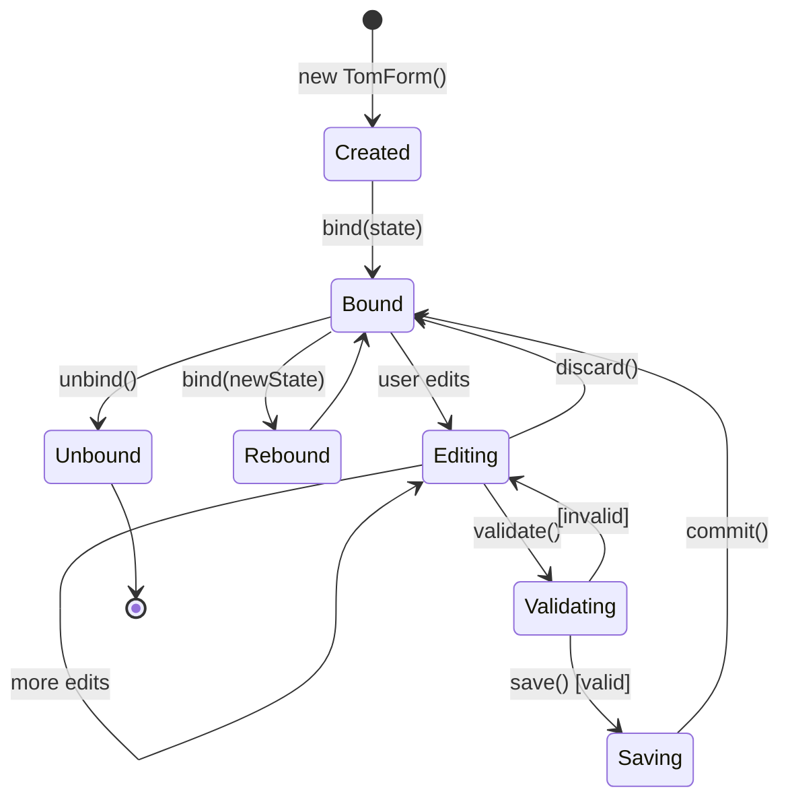
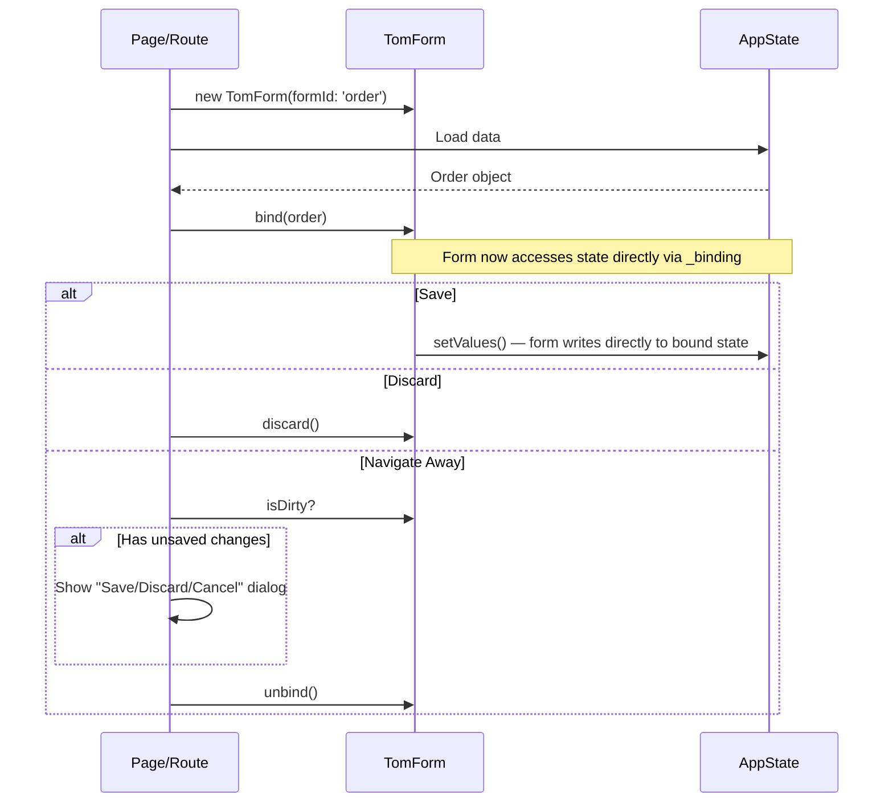

# Tom UI — Forms Framework Specification

*Part of the [Tom Flutter UI documentation set](README.md).*

**Date:** 2026-04-07
**Status:** Active Specification
**Package:** tom_flutter_ui
**Location:** `tom_flutter_ui/lib/src/forms/`

This document is the complete specification for the Tom Forms Framework — a system for validated, coordinated editing of application state through typed, observable form fields. Forms integrate with Tom's observable state system (`TomClass`/`TomObject`), the four-state authorization model (`TomAuthState`), resource lookup, and the action system.

**Key design principles:**
- **Logical form ≠ visual layout** — forms define data structure, fields, and validation; layout is separate
- **Input type abstraction** — logical field types (what is edited) are decoupled from concrete widgets (how it looks)
- **Observable by default** — every field extends `TomObject<T>`, every form extends `TomClass`
- **Nestable and reusable** — forms can be nested, reused (same definition, different instances), and composed in lists
- **Authorization-aware** — forms and fields participate in the four-state auth model via basePath

---

## Table of Contents

### Part 1 — Architecture Overview
- [1. Form System Overview](#1-form-system-overview)
- [2. Logical Form vs Visual Presentation](#2-logical-form-vs-visual-presentation)
- [3. Input Type Abstraction](#3-input-type-abstraction)

### Part 2 — Core Types
- [4. TomField — The Base Form Field](#4-tomfield--the-base-form-field)
- [5. TomForm — Form Container](#5-tomform--form-container)
- [6. Abstract Field Types Catalog](#6-abstract-field-types-catalog)

### Part 3 — Concrete Implementations
- [7. Concrete Implementation Classes](#7-concrete-implementation-classes)
- [8. Flutter Widget Binding Strategy](#8-flutter-widget-binding-strategy)
- [9. Current Implementation Status](#9-current-implementation-status)
- [10. Form Field Anatomy](#10-form-field-anatomy)
- [10a. Form Theming — TomFormStyle](#10a-form-theming--tomformstyle)

### Part 4 — Nested and Reusable Forms
- [11. Nested Forms](#11-nested-forms)
- [12. Form Templates and Reuse](#12-form-templates-and-reuse)
- [13. List Forms](#13-list-forms)

### Part 5 — Form Layout Patterns
- [14. Logical vs Visual Separation in Practice](#14-logical-vs-visual-separation-in-practice)
- [15. Master-Detail Forms](#15-master-detail-forms)
- [16. Inline Forms in Lists](#16-inline-forms-in-lists)

### Part 6 — Authorization, Resources, and Groups
- [17. Form Identity and Resource Resolution](#17-form-identity-and-resource-resolution)
- [18. Form Authorization](#18-form-authorization)
- [19. TomAuthorizationGroup and Forms](#19-tomauthorizationgroup-and-forms)

### Part 7 — Validation and Lifecycle
- [20. Validation System](#20-validation-system)
- [21. Form Lifecycle](#21-form-lifecycle)
- [22. Form Actions](#22-form-actions)

### Part 8 — Non-Form Custom Widgets
- [23. Custom Tom Widgets (Non-Form)](#23-custom-tom-widgets-non-form)

### Part 9 — Implementation Guide
- [24. Package Structure](#24-package-structure)
- [24a. Inspection and Event Callbacks](#24a-inspection-and-event-callbacks)
- [24b. Demo Application](#24b-demo-application)
- [25. API Summary](#25-api-summary)

### Appendices
- [Appendix A — Data Type Coverage Analysis](#appendix-a--data-type-coverage-analysis)
  - [A.1. Dart SDK Primitive and Core Types](#a1-dart-sdk-primitive-and-core-types)
  - [A.2. Flutter SDK Value Types](#a2-flutter-sdk-value-types)
  - [A.3. Tom Core Kernel Types](#a3-tom-core-kernel-types)
  - [A.4. Candidate Types NOT in Tom Core (need custom implementation)](#a4-candidate-types-not-in-tom-core-need-custom-implementation)
- [Appendix B — Form Widget Cross-Reference](#appendix-b--form-widget-cross-reference)
- [Appendix C — Form Class Hierarchy Inventory](#appendix-c--form-class-hierarchy-inventory)
  - [C.1. Text](#c1-text)
  - [C.2. Numeric](#c2-numeric)
  - [C.3. Numeric Range](#c3-numeric-range)
  - [C.4. Boolean](#c4-boolean)
  - [C.5. Date & Time](#c5-date--time)
  - [C.6. Date & Time Range](#c6-date--time-range)
  - [C.7. Single-Select](#c7-single-select)
  - [C.8. Multi-Select](#c8-multi-select)
  - [C.9. File](#c9-file)
  - [C.10. Selectable Sources](#c10-selectable-sources)
  - [C.11. Nullable Inputs](#c11-nullable-inputs)
  - [C.12. Summary](#c12-summary)

- [Related Documents](#related-documents)

---

# Part 1 — Architecture Overview

## 1. Form System Overview

The Tom Form system provides validated, coordinated editing of application state. Forms integrate with Tom's observable state system — forms ARE observable objects.

### Core Design Principles

1. **TomField\<T\> extends TomObject\<T\>** — each field is an observable with a typed value
2. **TomForm extends TomClass** — fields register as members, form itself is observable
3. **Logical field type ≠ widget** — the logical field defines what is edited; the widget defines how
4. **Initial + current values** — fields track both original and edited state
5. **Straightforward state integration** — `getValues()` / `setValues()` for bulk operations
6. **Form is a TomScreenElementsProvider and an ActionController** — contributes scope, widgets, actions, and resources

### Key Differences from Wrapped Widgets

| Aspect | Wrapped Flutter Widgets | Form Widgets |
|--------|------------------------|--------------|
| **State binding** | External (via `TomObservingWidget`) | Internal edit buffer |
| **Observable integration** | Never direct | Via TomForm bind/save |
| **Validation** | None | Built-in per-field and cross-field |
| **Resources** | ID-based lookup | Full anatomy support (label, hint, error, description) |
| **Purpose** | General UI | Data entry with validation |

### When to Use Forms vs. Wrapped Widgets

**Use TomForm + Form Fields when:**
- Editing domain objects with validation requirements
- Multiple related fields that should save/discard together
- Undo/redo editing at the form level
- Complex validation (cross-field, async)

**Use Wrapped Widgets directly when:**
- Simple immediate-effect controls (settings toggles)
- Filters and search inputs
- Navigation and layout

---

## 2. Logical Form vs Visual Presentation

A core architectural principle: **the form is separate from its visual layout**. A `TomForm` defines the data model, fields, and validation. The layout is handled by the widget tree that consumes the form.

### The Separation

**Logical layer (TomForm + TomField subclasses):**
- Defines which data is edited (field types, initial values, validators)
- Owns the edit buffer and dirty tracking
- Provides bind/save/discard lifecycle
- Computes basePath for resource and auth lookups

**Visual layer (Flutter widget tree):**
- Positions fields on screen alongside other widgets
- May mix form fields with non-form content (headings, dividers, images)
- May use different layouts for the same form (compact vs. full, mobile vs. desktop)
- Accesses fields as widgets via `myForm.fieldName.widget`

### Why This Matters

1. **Flexibility** — the same form can be displayed differently in different screens
2. **Composition** — form fields can be mixed with non-form UI elements
3. **Responsive layouts** — layout adapts while form logic stays constant
4. **Testability** — form logic (validation, dirty tracking, save) can be unit-tested without UI
5. **Master-detail** — the detail panel renders a form whose binding changes with selection

### Form Fields as Widgets

Each field produces its widget on demand:

```dart
// Spec — declares what data is edited, not how
abstract class CustomerFormSpec extends TomForm<Customer> {
  CustomerFormSpec({required super.formId});
  late TomFormStringField name;
  late TomFormStringField email;
  late TomFormStringField phone;
}

// Impl — assigns concrete visual representations. In the common case
// the concrete class simply declares `late final` members with
// `form: this`; reflection auto-discovers them. Override
// `createFormElements()` only when fields need cross-references or
// other post-construction wiring that `late final` can't express.
@tomReflector
class CustomerForm extends CustomerFormSpec {
  CustomerForm() : super(formId: 'customer');

  late final name  = TomFormStringInput('name',  '', form: this);
  late final email = TomFormStringInput('email', '', form: this,
      keyboardType: TextInputType.emailAddress,
      validators: [TomValidators.email()]);
  late final phone = TomFormStringInput('phone', '', form: this,
      keyboardType: TextInputType.phone);
}

// Layout: mix form fields and other content freely
Widget build(BuildContext context) {
  return Column(children: [
    Row(children: [
      Expanded(child: customerForm.name.widget),
      SizedBox(width: 16),
      Expanded(child: customerForm.email.widget),
    ]),
    Divider(),
    Text('Contact Information'),
    customerForm.phone.widget,
    Row(children: [
      TomElevatedButton(onPressed: () => customerForm.save(), child: Text('Save')),
      TomElevatedButton(onPressed: customerForm.discard, child: Text('Cancel')),
    ]),
  ]);
}
```

The form doesn't dictate layout. The widget tree consumes `form.field.widget` wherever it wants.

---

## 3. Input Type Abstraction

The forms framework uses a two-layer class hierarchy to decouple **what is edited** from **how it is presented**:

### Layer 1 — Abstract Field Types

Abstract field types define:
- The Dart value type (`String`, `int`, `DateTime`, `T`, etc.)
- Default validation rules for that data type
- The `TomField<T>` subclass

Abstract field types answer: *"What kind of data does the user provide?"*

**Abstract field types are never instantiated directly.** They are used in form declarations to express intent without committing to a visual representation.

### Layer 2 — Concrete Implementations

Concrete implementations extend abstract field types and define:
- The visual appearance (TextField, Dropdown, DatePicker dialog, Slider, etc.)
- Interaction behavior (keyboard type, gestures, dialogs)
- Additional bindings specific to the widget (e.g., min/max for sliders, option source for dropdowns)
- The Flutter widget subtree

Concrete implementations answer: *"How does the user interact with the field?"*

### FormSpec / Form — Two-Layer Declaration

Forms use an optional but important two-layer pattern that separates **declaration** (what fields exist) from **implementation** (how they are rendered):

```dart
// a) Declaration — abstract spec, defines data shape only
@tomReflector
abstract class MyFormSpec extends TomForm<MyData> {
  MyFormSpec({required super.formId});
  late TomFormStringField name;
  late TomFormStringField address;
  late TomFormIntField income;
}

// b) Implementation — assigns concrete visual representations.
// Default pattern: `late final` initializers with `form: this` — the
// form's reflected members become its fields automatically.
@tomReflector
class MyForm extends MyFormSpec {
  MyForm() : super(formId: 'myForm');

  late final name    = TomFormStringInput('name',    '', form: this);
  late final address = TomFormStringDropdown('address', null,
      form: this, source: countriesSource);
  late final income  = TomFormIntSlider('income', 50000,
      form: this,
      min: 0,
      max: 1000000);
}
```

This separation is optional — a form can instantiate concrete types directly without a spec class. But the two-layer pattern is important for:
1. **Swappable implementations** — change how fields render without touching the spec
2. **Testing** — test form logic against the abstract spec
3. **Platform adaptation** — different implementations per platform (Material vs. Cupertino)
4. **Implementation sequencing** — build specs first, add visual implementations later

### @tomReflector Annotation Requirement

All form classes and state classes **must** be annotated with `@tomReflector`. This annotation enables the observer mechanism that underpins the entire forms system — field discovery, observable notifications, dirty tracking, and automatic UI rebuilds all depend on it:

```dart
@tomReflector
class OrderForm extends TomForm<Order> {
  OrderForm() : super(formId: 'order');
  // ...fields...
}

@tomReflector
class Order extends TomClass {
  TomString name = TomString('');
  TomInt quantity = TomInt(0);
}
```

Without `@tomReflector`, the form cannot discover its fields and the observer system will not function.

### Additional Constructor Bindings

Concrete implementations often need more than the field value. Bounds, steps,
divisions and formatting are plain constructor parameters, fixed for the life of
the field:

```dart
income = TomFormIntSlider('income', 50000, min: 0, max: 250000, divisions: 100);
```

The one binding that *is* reactive is the option list, and it is reactive
through the source rather than through the field: a `TomSelectableSource<T>`
whose `itemsStream` is non-null re-emits, and the field rebuilds. See
[§7](#7-concrete-implementation-classes) for the contract and
[Appendix C.10](#c10-selectable-sources) for the four shipped sources.

```dart
country = TomFormStringDropdown('country', '', source: countrySource);
```

### Fields ARE Widgets

Since every concrete field has a `.widget` getter, fields participate directly in the widget tree:

```dart
final income = myForm.income.widget;  // the Slider TomFormIntSlider configures
```

The field is not itself a Widget, but it produces one. This is true for both abstract types (which delegate to their concrete subclass) and concrete types (which build the actual Flutter widget).

### Value Access — Always Use setValue(T)

All `TomObject<T>` subclasses (and therefore all form fields) expose a `setValue(T)` method. **This method must always be used** for writing values — never assign to `.value` directly. `setValue(T)` ensures:

1. **Overridability** — subclasses can intercept and transform value changes
2. **Observable notifications** — all registered observers are notified of the change
3. **Dirty tracking** — the field's `isDirty` state updates correctly

```dart
// ✅ Correct: uses setValue for overridability and notifications
field.setValue('new value');

// ✅ Correct: the ~ operator reads the value (shorthand for .value)
final current = ~field;

// ❌ Wrong: bypasses observer notifications and overridability
field.value = 'new value';  // DO NOT DO THIS
```

### Technical Mechanism

```dart quote
/// Abstract field type — not instantiated directly
abstract class TomFormStringField extends TomField<String> {
  TomFormStringField(super.tomId, super.initialValue);
}

/// Concrete implementation — extends abstract type
class TomFormStringInput extends TomFormStringField {
  final TextInputType? keyboardType;

  TomFormStringInput(super.tomId, super.initialValue, {
    this.keyboardType,
  });

  @override
  Widget get widget { ... }   // a TextField bound to this field
}

/// Concrete implementation with selection via TomSelectableItem
class TomFormStringDropdown extends TomFormStringField {
  final TomSelectableSource<String> source;

  TomFormStringDropdown(super.tomId, super.initialValue, {
    required this.source,
  });

  @override
  Widget get widget { ... }   // a dropdown over [source]
}

/// Concrete implementation with additional constructor bindings
class TomFormIntSlider extends TomFormIntField {
  final int min;
  final int max;
  final int? divisions;

  TomFormIntSlider(super.tomId, super.initialValue, {
    required this.min,
    required this.max,
    this.divisions,
  });

  @override
  Widget get widget { ... }   // a Slider between [min] and [max]
}
```

This makes the system open for extension: new implementations can be added without changing the logical field types.

---

# Part 2 — Core Types

## 4. TomField — The Base Form Field

All form fields extend `TomField<T>`, which extends `TomObject<T>`:

```dart quote
/// Base class for all form fields.
///
/// Identity model (consistent with the rest of tom_flutter_ui):
///   - `tomId`  — short identifier the caller passes to the constructor.
///                The `<suffix>` half of every resource key of the form
///                `"$basePath.<suffix>"`.
///   - `basePath` — scope-prefixed full path, e.g. `"demoC.customer.email"`.
///                  Built inside `constructionScope`, adding the form id as a
///                  namespace segment when `form:` is passed.
abstract class TomField<T> extends TomObject<T> implements TomAuthorizable {
  @override
  String tomId;
  TomForm? form;
  T _initialValue;

  /// The frame this field resolves in — its own path and its group's alike.
  late final TomScope constructionScope;
  late final String scope;
  late final String basePath;

  /// TomValidators applied to this field. Sync validators return immediately;
  /// async validators return Future<TomValidationResult>.
  final List<TomValidator<T>> validators;

  /// Current validation state — may be pending, success, or error.
  TomValidationResult _validationState = const TomValidationSuccess();

  /// Debounce timer for change-triggered validation.
  Timer? _debounceTimer;

  /// Authorization group this field belongs to (optional).
  @override
  TomAuthorizationGroup? tomGroup;

  /// Per-widget authorizer (optional).
  TomAuthorizer? authorizer;

  /// Build-time UI state controller (optional).
  TomUIStateController? uiStateController;

  TomField(this.tomId, T initialValue, {
    this.form,
    this.validators = const [],
    this.tomGroup,
    this.authorizer,
    this.uiStateController,
  })  : _initialValue = initialValue,
        super(initialValue) {
    // Inherit the form's frame — lets a field be instantiated at its
    // declaration site (`late final x = TomFormStringInput('x', '',
    // form: this)`) and still anchor on the right scope regardless of
    // whatever TomScope.current carries at lazy-init time. Falls back to
    // the ambient zone scope when `form` is omitted.
    constructionScope = form?.constructionScope ?? TomScope.current;
    scope = form == null
        ? constructionScope.getScopePath()
        : TomScopePath.qualify(form!.formId, constructionScope);
    basePath = TomScopePath.join(scope, tomId);
  }

  // --- Value tracking ---

  /// The value when the field was initialized or last saved.
  T get initialValue => _initialValue;

  /// Whether the field value differs from initial.
  bool get isDirty => value != _initialValue;

  /// Commit current value as the new initial value.
  void commit() => _initialValue = value;

  /// Reset to initial value and clear validation state.
  void reset() {
    set(_initialValue);
    _debounceTimer?.cancel();
    _validationState = const TomValidationSuccess();
  }

  // --- Authorization ---

  @override
  String? get tomId => basePath;

  /// Resolved effective authorization state (see §19 for resolution order).
  @override
  TomAuthState get effectiveAuthState => resolveEffectiveAuth();

  /// Whether the field is currently editable (full auth).
  bool get isEditable => effectiveAuthState == TomAuthState.full;

  /// Whether the field is visible (not `none`).
  bool get isVisible => effectiveAuthState != TomAuthState.none;

  // --- Validation ---

  /// Current validation state.
  TomValidationResult get validationState => _validationState;

  /// Debounce duration for change-triggered validation. Default: 300ms.
  Duration get validationDebounce => const Duration(milliseconds: 300);

  /// Validate the current value. Always async.
  Future<TomValidationResult> validate() async { /* see §20 */ }

  // --- Widget ---

  /// The implementation widget for this field (overridden by concrete classes).
  Widget get widget;

  // --- Lifecycle ---

  /// Dispose resources (timers, controllers, listeners).
  void dispose() {
    _debounceTimer?.cancel();
  }

  @override
  String toString() => '$runtimeType($tomId: $value, dirty: $isDirty)';
}
```

### Observable Integration

Since `TomField<T>` extends `TomObject<T>`:
- `set(value)` notifies observers (cascades to parent form)
- `get()` / `~field` / `field()` reads the current value
- `field >> callback` subscribes to changes
- `field | newValue` sets via pipe operator

### Form Registration

When a `TomForm` discovers its members via reflection (`getMembers()`), it finds all `TomField` instances and registers them. Changes to any field propagate up to the form via the `TomClass` observation cascade.

---

## 5. TomForm — Form Container

Forms extend `TomClass`, so fields register as members and the entire form is observable:

```dart quote
@tomReflector
abstract class TomForm<T extends TomClass> extends TomClass
    implements TomScreenElementsProvider, TomActionController {
  final String formId;
  late final TomScope scope;
  late final String basePath;
  late final Map<String, TomField> fields = {};
  T? _binding;

  TomForm({required this.formId}) {
    scope = TomScope.current;
    final parentPath = scope.getScopePath();
    basePath = parentPath.isNotEmpty ? '$parentPath.$formId' : formId;
  }

  /// Optional override hook for forms that need to create fields with
  /// cross-references that can't be expressed as plain `late final`
  /// initializers. Default implementation is a no-op — most forms
  /// declare their fields as `late final` members with
  /// `form: this`, and reflection auto-discovers them.
  void createFormElements() {}

  /// Called by the framework after construction to register the
  /// field members with the form. Walks the reflected members list,
  /// picks out every `TomField`, calls `field.form = this`, and
  /// stores it under its `tomId` in [fields]. Nested `TomForm`
  /// members are treated the same way — the parent's `basePath`
  /// becomes the child's scope prefix (see §11).
  void _registerReflectedFields() {
    getMembers().entries
      .where((entry) => entry.value is TomField)
      .forEach((entry) {
        final field = entry.value as TomField;
        field.form = this;
        fields[entry.key] = field;
      });
  }

  // --- Binding ---

  /// Bind to a TomClass instance (state).
  void bind(T target) {
    _binding = target;
    final values = target.getValues();
    _initialSnapshot = Map.unmodifiable(values);
    setValues(values);
    for (final field in fields.values) field.commit();
    onBound();
  }

  /// Save form values back to bound state.
  /// Runs full validation first — returns `false` if any errors.
  Future<bool> save() async {
    final errors = await validate();
    if (errors.isNotEmpty) return false;
    onSaving();
    _binding?.setValues(getValues());
    for (final field in fields.values) field.commit();
    _initialSnapshot = Map.unmodifiable(getValues());
    onSaved();
    return true;
  }

  /// Discard edits, reset all fields.
  void discard() {
    onDiscarding();
    for (final field in fields.values) field.reset();
    onDiscarded();
  }

  // --- State queries ---

  bool get isDirty => fields.values.any((f) => f.isDirty);
  bool get isValid => fields.values.every(
    (f) => f.validationState is TomValidationSuccess,
  );

  // --- Validation (async — see §20) ---

  Future<List<TomFormValidationError>> validate() async { /* see §20 */ }
  Future<List<TomFormValidationError>> validateForm() async => [];

  // --- Inspection ---

  /// Get a field by its tomId.
  TomField? getField(String tomId) => fields[tomId];

  /// Get the current values of all fields as a map.
  Map<String, dynamic> getValues() { /* collects from all fields */ }

  /// Get the initial snapshot (values at bind time / last save).
  Map<String, dynamic>? get initialSnapshot => _initialSnapshot;

  /// All fields that currently have validation errors.
  List<TomField> get fieldsWithErrors => fields.values
      .where((f) => f.validationState is TomValidationError)
      .toList();

  /// All fields that are dirty (value differs from initial).
  List<TomField> get dirtyFields => fields.values
      .where((f) => f.isDirty)
      .toList();

  // --- Lifecycle hooks ---

  @protected void onBound() {}
  @protected void onUnbinding() {}
  @protected void onSaving() {}
  @protected void onSaved() {}
  @protected void onDiscarding() {}
  @protected void onDiscarded() {}

  /// Dispose all fields and clean up.
  void dispose() {
    for (final field in fields.values) field.dispose();
  }
}
```

### Form Example

The shipped demos declare fields as **`late final`
members that pass `form: this`**. Reflection auto-discovers every
`TomField` member in the concrete class and registers it with the
form — no explicit `createFormElements()` body is needed for the
common case. Override `createFormElements()` only when fields need
cross-references or other post-construction wiring that `late final`
initializers can't express.

```dart
// Address form — reused for billing, shipping, or any address slot.
@tomReflector
class AddressForm extends TomForm<TomClass> {
  AddressForm({
    required String tomId,
    TomForm? form,
    TomAuthorizationGroup? authGroup,
  })  : super(formId: tomId) {
    if (form != null) super.form = form;
    if (authGroup != null) tomGroup = authGroup;
  }

  // Fields are `late final` members that pass `form: this` so the
  // form's basePath becomes each field's scope prefix. Reflection
  // does the rest.
  late final street = TomFormStringInput(
    'street', '',
    form: this,
    validators: [TomValidators.required()],
  );
  late final city = TomFormStringInput(
    'city', '',
    form: this,
    validators: [TomValidators.required()],
  );
  late final zip = TomFormStringInput(
    'zip', '',
    form: this,
    validators: [TomValidators.required(), TomValidators.pattern(r'^\d{5}$')],
  );
  late final country = TomFormStringDropdown(
    'country', 'US',
    form: this,
    source: TomStaticSelectableSource<String>([
      for (final code in const ['US', 'CA', 'MX', 'GB', 'DE', 'FR'])
        TomSelectableItem(value: code, label: code),
    ]),
  );
}

// Usage
final billingForm = AddressForm(tomId: 'billing')
  ..bind(appState.order.billing);

if (await billingForm.save()) {
  // save() already copies values back into the bound TomClass.
}
```

Some forms need an explicit `createFormElements()` — e.g. when a
field constructor needs another field as a cross-reference that
can't be captured via `late final`. In those cases the override
body runs inside `TomScope.withScope(formId, ...)` so newly-created
fields inherit the form's basePath even when they're assigned from
inside a method body:

```dart
@tomReflector
class DependentFieldsForm extends TomForm<TomClass> {
  DependentFieldsForm() : super(formId: 'dep');

  late TomFormStringInput primary;
  late TomFormStringInput secondary;

  @override
  void createFormElements() {
    primary = TomFormStringInput('primary', '', form: this);
    // secondary's validator reads primary — needs primary to be
    // constructed first, so we place both in createFormElements().
    secondary = TomFormStringInput(
      'secondary', '',
      form: this,
      validators: [
        (String value) => value == primary.get()
            ? const TomValidationSuccess()
            : TomValidationError('error.mismatch'),
      ],
    );
  }
}
```

---

## 6. Abstract Field Types Catalog

An abstract field type says what kind of data the user provides.
`TomFormStringField` is a field whose value is a `String`; `TomFormDateField` is
one whose value is a `DateTime`. **They are not instantiated directly** — a
concrete implementation extends one of them and supplies the widget (§7).

### The field is the observable

`TomField<T> extends TomObject<T>`. A field does not *hold* an observable
wrapper; it *is* one, over the plain Dart value. That single line settles what
the specification originally treated as an open question — an early draft of
this section asked for a `TomObject` wrapper per value type
(`TomDuration`, `TomIntRange`, `TomFileRef`, and nullable variants), and none of
them was built, because the generic base already covers every `T`:

```dart quote
abstract class TomField<T> extends TomObject<T> implements TomAuthorizable { ... }

class TomFormDurationField extends TomField<Duration> { ... }
```

So a `Duration` field observes a `Duration`, not a `TomDuration`. Read the value
with `.value` or `~`, and write it with `setValue` (§4), exactly as for any other
`TomObject`.

The four value types the framework had to define itself are plain classes, not
observables: `TomNumRange<int>` and `TomNumRange<double>` (a `low`/`high` pair),
`TomTimeOfDayRange`, and `TomFileRef`. They are immutable values with `==` and `hashCode`,
so a field change is a whole-value replacement and comparison is by content.

### Naming convention

Two layers, distinguishing what is edited from how it is rendered:

| Layer | Pattern | Example | Purpose |
|-------|---------|---------|---------|
| **Abstract field type** | `TomForm{Type}Field` | `TomFormStringField`, `TomFormIntField` | Declares field intent; extends `TomField<T>` |
| **Concrete implementation** | `TomForm{Type}{WidgetKind}` | `TomFormIntSlider`, `TomFormBoolSwitch` | Instantiated as a `late final` form member (or in `createFormElements()` for cross-referencing fields); extends the abstract type |
| **Cupertino implementation** | `TomCupertinoForm{Type}{WidgetKind}` | `TomCupertinoFormDatePicker` | The same, rendered with Cupertino widgets |
| **Widget wrapper** | `Tom{FlutterWidget}` | `TomTextField`, `TomSlider` | Wraps a Flutter widget; lives in the widgets layer, outside forms |
| **Text-input base** | `TomTextFormFieldBase<T>` | — | Shared base for text-input fields, owning the `TextEditingController` |

The `Field` suffix on abstract types prevents collisions with widget wrappers:
`TomTextField` wraps Flutter's `TextField`, while `TomFormStringField` is the
form field for string input.

**No separate implementation class.** The concrete field *is* the field —
declare `late final email = TomFormStringInput('email', '', form: this)` on the
concrete form, or, under the two-layer FormSpec / FormImpl split, declare
`late TomFormStringField email` in the spec and assign the concrete in
`createFormElements()`.

### The twenty-three abstract types

Each row is one abstract type and the value it binds. **The concrete classes
that extend them are catalogued once, in
[Appendix C](#appendix-c--form-class-hierarchy-inventory)**, which is held to
`lib/src/forms/fields/` by `tool/check_doc_class_inventories.py`; this table
carries only what the appendix does not, which is the value type.

| Abstract Type | Binds | Notes |
|---------------|-------|-------|
| `TomFormStringField` | `String` | One string type; email, password, multiline and URL are constructor options on the concrete, not separate types |
| `TomFormIntField` | `int` | |
| `TomFormDoubleField` | `double` | Currency and percent are formatting on the concrete, not separate types |
| `TomFormBoolField` | `bool` | |
| `TomFormNullableBoolField` | `bool?` | Tri-state: true / false / unset |
| `TomFormDateField` | `DateTime` | Date part only; the time part is not significant |
| `TomFormTimeField` | `TimeOfDay` | |
| `TomFormDateTimeField` | `DateTime` | |
| `TomFormDateRangeField` | `DateTimeRange` | Flutter's own range type |
| `TomFormTimeRangeField` | `TomTimeOfDayRange` | No concrete implementation ships — see §9 |
| `TomFormDateTimeRangeField` | `DateTimeRange` | No concrete implementation ships — see §9 |
| `TomFormDurationField` | `Duration` | |
| `TomFormIntRangeField` | `TomNumRange<int>` | `low` / `high` pair |
| `TomFormDoubleRangeField` | `TomNumRange<double>` | |
| `TomFormEnumField<T>` | `T` (an enum constant) | Labels resolve from the text bundle |
| `TomFormObjectField<T>` | `T` | Selection over arbitrary objects |
| `TomFormSearchField<T>` | `T` | Type-ahead over a source |
| `TomFormLookupField<T>` | `T` | Selection through a dialog or sheet |
| `TomFormStringListField` | `List<String>` | |
| `TomFormIntListField` | `List<int>` | |
| `TomFormEnumListField<T>` | `List<T>` | |
| `TomFormObjectListField<T>` | `List<T>` | |
| `TomFormFileField` | `TomFileRef?` | Nullable in the type: "no file chosen" is a state of the field, not a separate type |

### Nullable fields

There is no nullable variant of every abstract type. Nine concrete classes bind
`T?` directly — `TomFormNStringInput`, `TomFormNIntInput`, `TomFormNDoubleInput`,
`TomFormNDateInput`, `TomFormNEnumDropdown` and four Cupertino counterparts —
extending `TomField<T?>` rather than an abstract type in the list above. They
accept `null` as a value, start there, and render a clear action.

The asymmetry is deliberate. A nullable variant of each of the twenty-three
would double the catalogue to carry one bit of information, and most of the
duplicates would never be instantiated: a multi-select whose value is
`List<String>?` rather than `[]` distinguishes nothing a form author cares
about. The nine that exist are the ones where "unset" is a state a user
actually reaches.

### Multi-value binding

A list field binds `List<T>` as a whole value: selecting an option produces a
new list rather than mutating the old one, so a change is a single field event
and comparison is by content. Concrete implementations
(`TomFormStringFilterChips`, `TomFormStringMultiCheckbox` and the rest) prevent
duplicates at the widget level.

### Range fields

A range field binds one immutable value, not two coupled ones:

| Range Field | Binds | Members |
|-------------|-------|---------|
| `TomFormIntRangeField` | `TomNumRange<int>` | `int low`, `int high` |
| `TomFormDoubleRangeField` | `TomNumRange<double>` | `double low`, `double high` |
| `TomFormDateRangeField` | `DateTimeRange` | `DateTime start`, `DateTime end` |
| `TomFormTimeRangeField` | `TomTimeOfDayRange` | `TimeOfDay start`, `TimeOfDay end` |
| `TomFormDateTimeRangeField` | `DateTimeRange` | `DateTime start`, `DateTime end` |

Single-value binding is what makes `start ≤ end` checkable: the invariant holds
over one value the validator can see whole, rather than over two observables
that are briefly inconsistent while the user drags one end of a slider.

---

# Part 3 — Concrete Implementations

## 7. Concrete Implementation Classes

Each abstract field type has one or more concrete implementations that the form author instantiates on the concrete form — usually as `late final` members with `form: this`, or inside `createFormElements()` when a field's constructor needs to reference another already-created field. Concrete classes extend the abstract type and may add additional observable bindings.

**Naming convention:** `TomForm{Type}{WidgetStyle}` for the Material family —
`TomFormStringInput`, `TomFormIntSlider`, `TomFormBoolSwitch` — and
`TomCupertinoForm{Type}{WidgetStyle}` for the Cupertino one:
`TomCupertinoFormDatePicker`, `TomCupertinoFormStringSegmented`. The platform
leads because it qualifies the whole field rather than only its rendering; a
reader scanning a form declaration sees which family a line belongs to at the
front of the name.

**The catalogue itself is [Appendix C](#appendix-c--form-class-hierarchy-inventory),
and it is the only copy.** This section describes the scheme — how a concrete
class relates to its abstract type, what a selection field takes for its
options, and what happens when those options change — and names classes only
as examples of the scheme. It deliberately does not tabulate them.

That division is not tidiness. This section and Appendix C were once two
hand-written lists of the same 68 classes, and the appendix carried a
`**(TBD)**` marker on 81 rows describing classes that had shipped months
earlier. A second inventory beside a first drifts the moment either moves, and
nothing brings a writer back to the copy they were not editing. One list, held
to `lib/src/forms/fields/` by `tool/check_doc_class_inventories.py`, is the
arrangement that cannot decay quietly.

### Selection Implementations — the shared machinery

Most concrete classes add nothing but a widget: `TomFormBoolSwitch` and
`TomFormBoolCheckbox` both extend `TomFormBoolField`, bind the same `bool`, and
differ only in what they build. Selection is the exception — its concretes share
real machinery, and that machinery is the part of the scheme worth describing
here.

A selection field does not hold its own options. It takes a
`TomSelectableSource<T>`, and the source answers the one question the field
needs answered:

```dart
abstract class TomSelectableSource<T> {
  Future<List<TomSelectableItem<T>>> getItems();

  /// Non-null when the options can change after construction; the field
  /// subscribes and rebuilds. A fixed source returns null and is read once.
  Stream<List<TomSelectableItem<T>>>? get itemsStream => null;
}
```

`TomSelectableItem<T>` pairs the value the field binds with the label the widget
shows, so the two never have to be kept in step by the caller:

```dart
class TomSelectableItem<T> {
  final T value;
  final String label;
  const TomSelectableItem({required this.value, required this.label});
}
```

Separating the source from the field is what lets one dropdown class serve a
hard-coded list, an enum whose labels come from the text bundle, and a set that
changes while the form is open. The four shipped sources are listed in
[Appendix C.10](#c10-selectable-sources); two of them cover most forms:

```dart
final countrySource = TomStaticSelectableSource<String>(const [
  TomSelectableItem(value: 'de', label: 'Germany'),
  TomSelectableItem(value: 'fr', label: 'France'),
]);

// Labels come from the text bundle, not from Dart:
// keys are `<scope>.priority.<value>`, e.g. `global.priority.high`.
final prioritySource = TomEnumSelectableSource<Priority>(Priority.values);
```

`TomEnumSelectableSource<E>` binds the enum constant itself. When the entity
stores the constant's `name` in a `TomString` instead — which is what a
persisted enum usually looks like — use `TomEnumNameSelectableSource<E>`, which
is valued by `Enum.name` and otherwise behaves identically, labels included.

Every selection concrete takes its source the same way, as a required named
`source:` after the two positional arguments every field starts with:

```dart
late final country = TomFormStringDropdown('country', '', source: countrySource);
late final priority = TomFormEnumDropdown<Priority>(
  'priority',
  Priority.normal,
  source: prioritySource,
);
```

The uniformity is deliberate: swapping a dropdown for segmented buttons or a
radio group is a change of class name and nothing else.

### Selection Source Change Convention

When a source with a non-null `itemsStream` emits a new list — the locale
changing under `TomEnumSelectableSource`, say — selection fields must handle the
case where the currently selected value is no longer among the options:

1. **Dropdown / single-select fields:** If the current value is not in the new items, **reset to the first available option**. If the items list is empty, set the field value to its default (null for nullable fields, or keep the stale value and show a validation error for non-nullable fields).
2. **Multi-select fields:** Remove any selected values that are no longer in the new items list. Keep selected values that are still available.
3. **Search fields:** Clear the search text and selection if the source changes fundamentally (e.g., switching from one API endpoint to another).

This convention prevents stale/orphaned values that don't match any available option. The field fires a `TomFieldValueChangedEvent` when the reset occurs.

---

## 8. Flutter Widget Binding Strategy

Each concrete implementation bridges a Tom observable field to a Flutter widget. This section defines the binding categories and documents exactly how each Flutter widget parameter maps to a Tom concept.

### 8.1. Binding Categories

Every Flutter widget parameter falls into one of these categories:

| Category | Description | Managed By | Examples |
|----------|-------------|-----------|----------|
| **Value binding** | Primary field value — always bidirectional | Concrete field class | `Slider.value`, `Checkbox.value`, `DropdownButton.value` |
| **Write-back callback** | Flutter callback that writes user input back to the observable | Concrete field class | `onChanged`, `onSelected`, `onSelectionChanged`, `onDateChanged` |
| **Bounds and formatting** | Fixed configuration read when the widget builds | Constructor params (plain values) | `min`, `max`, `firstDate`, `lastDate`, `decimals` |
| **Data source** | Options/items provided to selection widgets | `TomSelectableSource<T>` | `items`, `dropdownMenuEntries`, `segments`, `suggestionsBuilder` |
| **Internal controller** | Controllers created and owned by the concrete class | Concrete field class | `TextEditingController`, `SearchController`, `FocusNode` |
| **Auth-driven state** | Enabled/disabled/read-only based on authorization | `TomPolicyNodeBase` (auth system) | `enabled`, `readOnly`, null `onChanged` |
| **Resource-driven text** | Labels, hints, errors resolved from scoped resources | Tom resource system | `labelText`, `hintText`, `helperText`, `errorText`, `cancelText` |
| **Theme-driven style** | Colors, shapes, typography from the Tom theme | Tom theme resolution | `activeColor`, `fillColor`, `shape`, `textStyle` |
| **User callbacks** | Optional pass-through callbacks for form authors | Scope-wrapped (`ScopeCapture`) | `onSubmitted`, `onChangeStart`, `onChangeEnd`, `onTap` |
| **Static config** | Non-reactive configuration set once at construction | Constructor params (plain values) | `divisions`, `obscureText`, `tristate`, `minuteInterval` |

### 8.2. Binding Pattern — Observable → Flutter Widget

The core binding pattern for all concrete implementations:

```dart quote
class TomFormIntSlider extends TomFormIntField {
  final int min;
  final int max;
  final int? divisions;
  final bool showValueLabel;

  TomFormIntSlider(super.tomId, super.initialValue, {
    required this.min,
    required this.max,
    this.divisions,
    this.showValueLabel = true,
  });

  @override
  Widget get widget => _TomFormIntSliderWidget(field: this);
}

class _TomFormIntSliderWidget extends StatelessWidget {
  final TomFormIntSlider field;
  const _TomFormIntSliderWidget({required this.field});

  @override
  Widget build(BuildContext context) {
    // Rebuilds when the field's value changes
    return TomMultiObservableBuilder(
      observables: [field],
      builder: (context) {
        return Slider(
          // VALUE BINDING — read from observable
          value: field.value.toDouble().clamp(field.min.toDouble(), field.max.toDouble()),

          // WRITE-BACK — write to observable
          onChanged: field.isEditable
              ? (v) => field.setValue(v.round())
              : null,  // null = disabled (auth-driven)

          // BOUNDS AND STATIC CONFIG — plain constructor values
          min: field.min.toDouble(),
          max: field.max.toDouble(),
          divisions: field.divisions,

          // DERIVED — from value
          label: field.showValueLabel ? field.value.toString() : null,
        );
      },
    );
  }
}
```

### 8.3. Per-Widget Binding Maps

#### TextField (text input types)

Used by: `TomFormStringInput`, `TomFormIntInput`, `TomFormDoubleInput`, `TomFormCurrencyDoubleInput`, `TomFormPercentDoubleInput`, `TomFormDateTextInput`, `TomFormTimeTextInput`, `TomFormDateTimeTextInput`, `TomFormDurationInput` and the nullable inputs

| Flutter Parameter | Category | Tom Binding | Notes |
|-------------------|----------|-------------|-------|
| `controller` | Internal controller | Created by field; syncs bidirectionally with `TomObject<T>` via converter pair | Field owns lifecycle |
| `onChanged` | Write-back | `controller.addListener` → validate → write to observable | Not exposed; internal |
| `decoration.labelText` | Resource text | `t('label')` → scoped resource lookup | |
| `decoration.hintText` | Resource text | `t('hint')` → scoped resource lookup | |
| `decoration.helperText` | Resource text | `t('description')` → scoped resource lookup | |
| `decoration.errorText` | Resource text | `ValueNotifier<String?>` from validation | Reactive via `ValueListenableBuilder` |
| `enabled` | Auth-driven | `TomAuthState != none/disabled` | null = hidden, false = disabled |
| `readOnly` | Auth-driven | `TomAuthState == read` | Shows value but no editing |
| `obscureText` | Static config | The `obscureText` constructor parameter — `true` makes a password field | |
| `keyboardType` | Static config | From field type: email → `TextInputType.emailAddress`, phone → `.phone`, int → `.number`, etc. | |
| `inputFormatters` | Static config | From field type: `TomFormIntInput` → `FilteringTextInputFormatter.digitsOnly`, currency → `CurrencyInputFormatter` | |
| `maxLength` | Static config | The `maxLength` constructor parameter | Optional |
| `maxLines` / `minLines` | Static config | The `maxLines` constructor parameter — greater than 1 makes a text area | |
| `focusNode` | Internal controller | Created and owned by field | |
| `onSubmitted` | User callback | Scope-wrapped pass-through | Optional |
| `onEditingComplete` | User callback | Scope-wrapped pass-through | Optional |
| `onTap` | User callback | Scope-wrapped pass-through | Optional |
| All style params | Theme | Resolved via Tom theme system | Colors, cursor, text style |

#### Slider

Used by: `TomFormIntSlider`, `TomFormDoubleSlider`

| Flutter Parameter | Category | Tom Binding | Notes |
|-------------------|----------|-------------|-------|
| `value` | Value binding | `TomObject<num>.value` (cast to `double`) | Read from observable |
| `onChanged` | Write-back | `(v) => field.setValue(convert(v))` | null when not editable (auth) |
| `min` | Observable config | `TomObject<num>.value` — reactive | Rebuilds when changed |
| `max` | Observable config | `TomObject<num>.value` — reactive | Rebuilds when changed |
| `divisions` | Static config | `int?` from constructor | |
| `label` | Derived | `field.value.toString()` or semantic formatter | Auto-generated |
| `onChangeStart` | User callback | Scope-wrapped pass-through | Optional |
| `onChangeEnd` | User callback | Scope-wrapped pass-through | Optional |
| `secondaryTrackValue` | Not used | — | Could be exposed as observable |
| All color params | Theme | Tom theme resolution | |

#### RangeSlider

Used by: `TomFormIntRangeSlider`, `TomFormDoubleRangeSlider`

| Flutter Parameter | Category | Tom Binding | Notes |
|-------------------|----------|-------------|-------|
| `values` | Value binding | `RangeValues(range.start.value, range.end.value)` | Read from `TomClass` (start/end members) |
| `onChanged` | Write-back | `(v) { range.start.value = v.start; range.end.value = v.end; }` | null when not editable |
| `min` | Observable config | `absoluteMin` (`TomObject<num>`) — reactive | |
| `max` | Observable config | `absoluteMax` (`TomObject<num>`) — reactive | |
| `divisions` | Static config | `int?` | |
| `labels` | Derived | From start/end values | Auto-generated |
| `onChangeStart` / `onChangeEnd` | User callback | Scope-wrapped | Optional |

#### Checkbox

Used by: `TomFormBoolCheckbox`, `TomFormNullableBoolCheckbox`

| Flutter Parameter | Category | Tom Binding | Notes |
|-------------------|----------|-------------|-------|
| `value` | Value binding | `TomBool.get()` | |
| `onChanged` | Write-back | `(v) => field.setValue(v!)` | null when not editable |
| `tristate` | Static config | `false` for `TomFormBoolField`, `true` for `TomFormNullableBoolField` | Tri-state |
| All color/shape params | Theme | Tom theme resolution | |

#### Switch

Used by: `TomFormBoolSwitch`, `TomFormBoolToggle`

| Flutter Parameter | Category | Tom Binding | Notes |
|-------------------|----------|-------------|-------|
| `value` | Value binding | `TomBool.get()` | |
| `onChanged` | Write-back | `(v) => field.setValue(v)` | null when not editable |
| All color/thumb params | Theme | Tom theme resolution | |

#### SegmentedButton\<T\>

Used by: `TomForm{Type}Segmented`, `TomForm{Type}MultiSegmented`

| Flutter Parameter | Category | Tom Binding | Notes |
|-------------------|----------|-------------|-------|
| `selected` (single) | Value binding | `{TomObject<T>.value}` | Wrapped in `Set` |
| `selected` (multi) | Value binding | `TomList<T>.value` | Direct set |
| `onSelectionChanged` (single) | Write-back | `(s) => field.setValue(s.first)` | |
| `onSelectionChanged` (multi) | Write-back | `(s) => field.setValue(s)` | Writes entire set |
| `segments` | Data source | Built from `TomSelectableSource<T>.items` → `List<ButtonSegment<T>>` | Reactive when source is observable |
| `multiSelectionEnabled` | Static config | `true` for list/multi fields | |

#### DropdownButton\<T\> / DropdownMenu\<T\>

Used by: `TomForm{Type}Dropdown`

| Flutter Parameter | Category | Tom Binding | Notes |
|-------------------|----------|-------------|-------|
| `value` / `initialSelection` | Value binding | `TomObject<T>.value` | |
| `onChanged` / `onSelected` | Write-back | `(v) => field.setValue(v)` | null when not editable |
| `items` / `dropdownMenuEntries` | Data source | Built from `TomSelectableSource<T>.items` → `List<DropdownMenuItem<T>>` or `List<DropdownMenuEntry<T>>` | Reactive when source is observable |
| `enabled` | Auth-driven | From auth state | |
| `label` / `hintText` / `helperText` / `errorText` | Resource text | Scoped resource lookup | `DropdownMenu` only |
| `controller` | Internal controller | For `DropdownMenu` — managed internally | |
| `isExpanded` | Static config | Always `true`, via `TomDropdownDecorationMixin.dropdownFillsColumnWidth` | See below |

A dropdown **field** always fills the width of the column the form gives it,
and its item labels are rendered through
`TomDropdownDecorationMixin.dropdownItemLabel` — one line, ellipsised.

Flutter's `isExpanded` defaults to `false`, sizing the button to its content.
That is right for a general-purpose dropdown a caller places wherever it likes
— which is what `TomDropdownButton` / `TomDropdownButtonFormField` in
`widgets/selects` are, and why they keep the Flutter default and expose the
knob as a constructor parameter. It is wrong for a field: a field never chooses
its own width (a breakpoint, a two-column section or a drawer does), while its
items arrive from data. "The widest label is wider than the column" is
therefore an ordinary runtime state, and a content-sized button answers it with
a `RenderFlex overflowed by N pixels`.

Ellipsis rather than wrapping, because the closed button draws the selected
item into a row of fixed height: a label that reflowed to a second line would
merely trade a horizontal overflow for a vertical one.

`test/forms/fields/tom_form_dropdown_narrow_constraint_test.dart` renders all
four dropdown fields into a box narrower than their longest label and fails if
any of them overflows again.

#### RadioGroup\<T\> + Radio\<T\> (group)

Used by: `TomForm{Type}RadioGroup`

Renders one `Radio<T>` per `TomSelectableSource<T>` item, each in an `InkWell`
row beside its label, and wraps the whole column in a single `RadioGroup<T>`.
The group value and the write-back belong to the option list as a whole, so
they sit on that ancestor; a radio carries only its own value and whether it
accepts input:

| Flutter Parameter | On | Category | Tom Binding | Notes |
|-------------------|-----|----------|-------------|-------|
| `groupValue` | `RadioGroup<T>` | Value binding | `TomObject<T>.value` | One per field, shared by every row |
| `onChanged` | `RadioGroup<T>` | Write-back | `(v) => field.setValue(v)` | Always supplied; rows opt out through `enabled` |
| `value` | `Radio<T>` | Data source | `item.value` from `TomSelectableItem<T>` | One radio per option |
| `enabled` | `Radio<T>` | Availability | `field.isEditable && item.enabled` | The per-row lever; a null `onChanged` no longer expresses this |

The label is a sibling `Text`, not a `title` on the radio — the row is
assembled from `Radio` + `Text` rather than from `RadioListTile`.

#### FilterChip (group)

Used by: `TomForm{Type}FilterChips` (multi-select)

Renders one `FilterChip` per `TomSelectableSource<T>` item:

| Flutter Parameter | Category | Tom Binding | Notes |
|-------------------|----------|-------------|-------|
| `selected` (per chip) | Value binding | `TomList<T>.contains(item.value)` | Per-chip check |
| `onSelected` | Write-back | `(sel) => sel ? set.add(item.value) : set.remove(item.value)` | Toggle per chip |
| `label` | Data source | `Text(item.label)` from `TomSelectableItem<T>` | |

#### ChoiceChip (group)

Used by: `TomForm{Type}ChoiceChips` (single-select)

Renders one `ChoiceChip` per `TomSelectableSource<T>` item:

| Flutter Parameter | Category | Tom Binding | Notes |
|-------------------|----------|-------------|-------|
| `selected` (per chip) | Value binding | `TomObject<T>.value == item.value` | Per-chip check |
| `onSelected` | Write-back | `(sel) => field.setValue(item.value)` | Writes selected value |
| `label` | Data source | `Text(item.label)` from `TomSelectableItem<T>` | |

#### CheckboxListTile (group)

Used by: `TomForm{Type}MultiCheckbox` (multi-select)

Renders one `CheckboxListTile` per `TomSelectableSource<T>` item:

| Flutter Parameter | Category | Tom Binding | Notes |
|-------------------|----------|-------------|-------|
| `value` (per tile) | Value binding | `TomList<T>.contains(item.value)` | Per-tile check |
| `onChanged` | Write-back | `(v) => v! ? set.add(item.value) : set.remove(item.value)` | Toggle per tile |
| `title` | Data source | `Text(item.label)` from `TomSelectableItem<T>` | |

#### Date Picker (hybrid text + dialog)

Used by: `TomFormDatePicker`, `TomFormDateTimePicker`

| Flutter Parameter | Category | Tom Binding | Notes |
|-------------------|----------|-------------|-------|
| Text field `controller` | Internal controller | Displays formatted date; syncs with `TomOZonedDate` | |
| `showDatePicker.initialDate` | Value binding | `TomOZonedDate.value` → `DateTime` | Read from observable |
| Dialog result | Write-back | `DateTime` result → write to `TomOZonedDate.value` | Async dialog |
| `firstDate` | Observable config | `TomObject<TomZonedDate>` — reactive | Rebuilds if changed |
| `lastDate` | Observable config | `TomObject<TomZonedDate>` — reactive | Rebuilds if changed |
| `selectableDayPredicate` | User callback | Optional predicate | |
| `helpText`, `cancelText`, `confirmText` | Resource text | From scoped resources | |
| `initialEntryMode` | Static config | `DatePickerEntryMode` | |

#### CalendarDatePicker (inline)

Used by: `TomFormDateCalendar`

| Flutter Parameter | Category | Tom Binding | Notes |
|-------------------|----------|-------------|-------|
| `initialDate` | Value binding | `TomOZonedDate.value` → `DateTime` | |
| `onDateChanged` | Write-back | `DateTime` → write to `TomOZonedDate.value` | |
| `firstDate` | Observable config | Reactive | |
| `lastDate` | Observable config | Reactive | |
| `selectableDayPredicate` | User callback | Optional | |
| `initialCalendarMode` | Static config | `DatePickerMode` | |

#### Time Picker (dialog)

Used by: `TomFormTimePicker`

| Flutter Parameter | Category | Tom Binding | Notes |
|-------------------|----------|-------------|-------|
| `initialTime` | Value binding | `TomOZonedTime.value` → `TimeOfDay` | |
| Dialog result | Write-back | `TimeOfDay` → write to `TomOZonedTime.value` | Async dialog |
| `helpText`, `cancelText`, `confirmText` | Resource text | From scoped resources | |
| `initialEntryMode` | Static config | `TimePickerEntryMode` | |

#### Date Range Picker (dialog)

Used by: `TomFormDateRangePicker`

| Flutter Parameter | Category | Tom Binding | Notes |
|-------------------|----------|-------------|-------|
| `initialDateRange` | Value binding | `DateTimeRange(start: range.start.value, end: range.end.value)` | From `TomDateRange` |
| Dialog result | Write-back | `DateTimeRange` → write to `TomDateRange` start/end | |
| `firstDate` | Observable config | Reactive | |
| `lastDate` | Observable config | Reactive | |
| All help/label texts | Resource text | From scoped resources | |

#### CupertinoDatePicker

Used by: `TomCupertinoFormDatePicker`, `TomCupertinoFormDateTimePicker`, `TomCupertinoFormDateRangePicker`

| Flutter Parameter | Category | Tom Binding | Notes |
|-------------------|----------|-------------|-------|
| `initialDateTime` | Value binding | From observable → `DateTime` | |
| `onDateTimeChanged` | Write-back | `DateTime` → write to observable | Continuous callback |
| `minimumDate` | Observable config | Reactive | |
| `maximumDate` | Observable config | Reactive | |
| `mode` | Static config | `CupertinoDatePickerMode` (date / dateAndTime) | Based on field type |
| `use24hFormat` | Static config | Locale-dependent | |
| `minuteInterval` | Static config | `int` | |

#### CupertinoTimerPicker

Used by: `TomCupertinoFormTimePicker`, `TomCupertinoFormDurationPicker`

| Flutter Parameter | Category | Tom Binding | Notes |
|-------------------|----------|-------------|-------|
| `initialTimerDuration` | Value binding | `TomDuration.value` | |
| `onTimerDurationChanged` | Write-back | `Duration` → write to `TomDuration.value` | Continuous |
| `mode` | Static config | `CupertinoTimerPickerMode` (hms / hm / ms) | |
| `minuteInterval` / `secondInterval` | Static config | `int` | |

#### SearchAnchor / Autocomplete

Used by: `TomFormSearchInput<T>`, `TomCupertinoFormSearchInput<T>`, `TomCupertinoFormStringSearchInput`

| Flutter Parameter | Category | Tom Binding | Notes |
|-------------------|----------|-------------|-------|
| `searchController` | Internal controller | Managed by concrete class | |
| `suggestionsBuilder` | Data source | Filters `TomSelectableSource<T>.getItems()` through the field's `searchPredicate` → builds suggestion widgets | Async |
| Selection result | Write-back | Selected `T` → write to `TomObject<T>.value` | |
| `viewHintText` | Resource text | From scoped resources | |
| `isFullScreen` | Static config | `bool` | Full-screen on the Cupertino variants |
| `builder` | Internal | Builds the search trigger widget | |

#### CupertinoPicker

Used by: `TomCupertinoFormEnumPicker<T>`, `TomCupertinoFormStringPicker`, `TomCupertinoFormObjectPicker<T>`, `TomCupertinoFormIntPicker`

| Flutter Parameter | Category | Tom Binding | Notes |
|-------------------|----------|-------------|-------|
| `scrollController` | Internal controller | Initial item from `TomObject<T>.value` index in source | |
| `onSelectedItemChanged` | Write-back | Index → `field.setValue(items[index].value)` | |
| `children` | Data source | Built from `TomSelectableSource<T>.getItems()` → `List<Widget>` | |
| `itemExtent` | Static config | `double` | |

### 8.4. Data Source Adaptation Summary

How `TomSelectableSource<T>` adapts to each Flutter widget's items parameter:

| Flutter Widget | Items Parameter | Adapted From |
|---------------|----------------|-------------|
| `DropdownButton<T>` | `List<DropdownMenuItem<T>>` | `items.map((s) => DropdownMenuItem(value: s.value, child: Text(s.label)))` |
| `DropdownMenu<T>` | `List<DropdownMenuEntry<T>>` | `items.map((s) => DropdownMenuEntry(value: s.value, label: s.label))` |
| `SegmentedButton<T>` | `List<ButtonSegment<T>>` | `items.map((s) => ButtonSegment(value: s.value, label: Text(s.label)))` |
| `RadioListTile<T>` (group) | One widget per item | `for (final s in items) RadioListTile(value: s.value, title: Text(s.label), ...)` |
| `ChoiceChip` (group) | One chip per item | `for (final s in items) ChoiceChip(label: Text(s.label), selected: ..., ...)` |
| `FilterChip` (group) | One chip per item | `for (final s in items) FilterChip(label: Text(s.label), selected: ..., ...)` |
| `CheckboxListTile` (group) | One tile per item | `for (final s in items) CheckboxListTile(title: Text(s.label), value: ..., ...)` |
| `CupertinoPicker` | `List<Widget>` children | `items.map((s) => Center(child: Text(s.label)))` |
| `SearchAnchor` | `suggestionsBuilder` | `items.where(matches).map((s) => ListTile(title: Text(s.label), ...)))` |

### 8.5. Observable Rebuild Strategy

When an observed value changes, the widget must rebuild. All rebuilds use `TomMultiObservableBuilder`, which observes one or more `TomObservable` instances and triggers a rebuild when any of them change.

`TomMultiObservableBuilder` manages **clean registration and deregistration** of observable listeners. When the widget is created, it registers listeners on all provided observables. When the widget is disposed or when the observable list changes, it deregisters all previous listeners before registering new ones. This avoids listener leaks and ensures that widgets only rebuild when their current observables change.

**The field itself is the observable** — `TomField<T> extends TomObject<T>` — so
a widget that must follow its own value observes the field:

```dart
TomMultiObservableBuilder(
  observables: [field],
  builder: (context) => Slider(
    value: field.value.toDouble(),
    min: field.min.toDouble(),   // plain int, fixed at construction
    max: field.max.toDouble(),
    onChanged: (v) => field.setValue(v.round()),
  ),
);
```

Bounds, divisions and formatting are plain constructor parameters and never
change, so they contribute nothing to the observable list. The one thing that
does change under a field is its **option list**, and a selection field
subscribes to `TomSelectableSource.itemsStream` rather than adding the source to
the builder — the source is not a `TomObservable`, and the stream is what says
whether it can change at all.

There is no need for `ValueListenableBuilder` or other listener patterns; the
Tom observer system handles all reactive updates uniformly.

### 8.6. Auth State Integration

The `TomPolicyNodeBase` authorization model produces four states that affect widget rendering:

| Auth State | `onChanged`/`onSelected` | Visual | Widget Behavior |
|------------|--------------------------|--------|----------------|
| `none` | — | Hidden | `SizedBox.shrink()` — field not rendered |
| `disabled` | `null` | Greyed out | Widget shown but non-interactive |
| `read` | `null` | Normal appearance | Value displayed, no editing; text fields get `readOnly: true` |
| `full` | Active callback | Normal | Full interaction |

Concrete fields expose an `isEditable` getter derived from the resolved auth state. This is used to conditionally pass `null` to write-back callbacks, which is Flutter's convention for disabling widgets.

---

## 9. Current Implementation Status

The specification is built. `lib/src/forms/fields/` declares 97 classes in the
`TomField` hierarchy — 23 abstract field types and 74 concrete
implementations, of which 28 are Cupertino. Appendix C lists them one by one
and is held to the directory by a gate; this section says only what a
one-by-one list cannot, which is where the shipped framework and this
specification still differ.

| Class | Status | Notes |
|-------|--------|-------|
| `TomForm` | **Implemented** | Base form with reflection discovery, scope, bind, validate, save |
| `TomField<T>` | **Implemented** | Base field with `basePath` scope, authorization, events, dirty tracking and the `widget` getter |
| `TomListForm` | **Implemented** | Collections of sub-forms; see §13 |
| `TomTextFormFieldBase<T>` | **Implemented** | The whole Classic tier. Concrete and used directly: `TextEditingController`, converters, keystroke-level input validators, `InputDecoration` rendering. No subclasses ship |

The Classic tier is one class. A caller who wants the Classic rendering
constructs `TomTextFormFieldBase` and supplies what it needs — a password,
email, int or double field is that class with a constructor argument or a
validator, not a subclass of its own, because a subclass that only fixes an
argument its caller could pass adds a name and nothing else. The
spec-conforming tier is where field *types* live.

### Where the build diverged from this specification

Three decisions were taken during the build that the sections above still
describe in their original form. They are recorded here rather than silently
rewritten into §6 and §7, because each was a choice and a reader of a
specification is owed the choice as well as its outcome.

| Decision | Specified | Built |
|----------|-----------|-------|
| **Cupertino naming** | `TomForm{Type}{Widget}` throughout, with Cupertino as a widget style — `TomFormCupertinoDatePicker` | A `TomCupertinoForm…` prefix family — `TomCupertinoFormDatePicker`. The platform is a property of the whole field, not of its widget style, so it reads at the front where a reader scanning a form declaration sees it |
| **Value types** | Six new observables — `TomDuration`, `TomIntRange`, `TomDoubleRange`, `TomFileRef` and two nullable variants | None of them. `TomField<T>` binds the plain value directly, so the fields bind `Duration`, `TomNumRange<int>`, `TomNumRange<double>`, `TomTimeOfDayRange` and `TomFileRef?` with no observable wrapper. The observability a form needs is the field's, and a second one inside it bought nothing |
| **Format variants** | A class per text format — `TomFormEmailStringInput`, `TomFormUrlStringInput`, `TomFormPhoneStringInput`, `TomFormPasswordStringInput`, `TomFormMultilineStringInput`, `TomFormStringOutlinedInput` | Constructor parameters on `TomFormStringInput` — `keyboardType`, `maxLines`, `obscureText` — plus a validator where the format needs one. Six classes differing only in a fixed argument are the shape the Classic tier above declines |

Two abstract types have no concrete implementation:
`TomFormTimeRangeField` and `TomFormDateTimeRangeField`. Both are usable — a
caller can extend either — and neither is rendered by anything this package
ships. Appendix C names them so the omission is visible rather than absent.

---

## 10. Form Field Anatomy

Every Tom form field follows a consistent visual structure:

```
┌────────────────────────────────────────────┐
│  [label]                        [info] [?] │  Label row
├────────────────────────────────────────────┤
│  [error message above field]               │  Top error (optional)
├────────────────────────────────────────────┤
│  ┌─────────────────────────┐ [action-icon] │  Input row
│  │  [placeholder / hint]   │ [action-icon] │
│  └─────────────────────────┘               │
├────────────────────────────────────────────┤
│  [error message below field]               │  Bottom error (optional)
├────────────────────────────────────────────┤
│  [description / helper text]               │  Description row
└────────────────────────────────────────────┘
```

### Resource Suffixes

Resource lookup uses the field's basePath with these suffixes:

| Suffix | Purpose | Example Key |
|--------|---------|-------------|
| `label` | Field label text | `order.billingAddress.email.label` |
| `hint` | Placeholder/hint text | `order.billingAddress.email.hint` |
| `description` | Helper text below | `order.billingAddress.email.description` |
| `error.required` | Required validation error | `order.billingAddress.email.error.required` |
| `error.format` | Format validation error | `order.billingAddress.email.error.format` |
| `error.min` | Minimum value error | `order.quantity.error.min` |
| `error.max` | Maximum value error | `order.quantity.error.max` |
| `info.title` | Info popup title | `order.billingAddress.email.info.title` |
| `info.body` | Info popup content | `order.billingAddress.email.info.body` |
| `help.title` | Help panel title | `order.billingAddress.email.help.title` |
| `help.body` | Help panel content | `order.billingAddress.email.help.body` |
| `action.<name>.tooltip` | Action icon tooltip | `order.billingAddress.email.action.clear.tooltip` |

The actual resource suffixes depend on the field type and its validation rules. Some composite fields have sub-elements that add subtrees (e.g., `dateRange.from.label`, `dateRange.to.label`).

### Form Field Decoration Mixin

The anatomy diagram above (label, hint, error, description, action icons) is consistent across all field types, but different Flutter widgets provide these elements in different ways:

- **Text-based fields** (`TextField`, `TextFormField`) — Material's `InputDecoration` provides label, hint, error, helper text, prefix/suffix icons natively. The anatomy maps directly.
- **Non-text fields** (Slider, Checkbox, Switch, DatePicker, SegmentedButton, etc.) — These widgets have **no built-in decoration**. A consistent frame must be added externally.

To achieve uniform visual structure across all field types, concrete
implementations mix in a decoration mixin that wraps the inner widget with the
standard anatomy. Three ship, differing only in what they must do about the
inner widget's *own* decoration:

| Mixin | Used by | Because |
|-------|---------|---------|
| `TomGenericFieldDecorationMixin<T>` | Checkboxes, switches, sliders, segmented buttons, chips, radio groups, pickers | The inner control carries no decoration, so the anatomy is simply wrapped around it |
| `TomStringInputDecorationMixin<T>` | Text inputs | The inner `TextField` has an `InputDecoration` whose error border must be reshaped rather than duplicated |
| `TomDropdownDecorationMixin<T>` | Dropdowns | The same, for the dropdown's own decoration slot |

All three expose the same `decorateField`, and resolve label, error and
description the same way, so a form author sees one anatomy:

```dart quote
mixin TomGenericFieldDecorationMixin<T> on TomField<T> {
  /// Wraps the inner widget with the standard field anatomy (label, error, description, actions).
  Widget decorateField(BuildContext context, Widget innerWidget) {
    return Column(
      crossAxisAlignment: CrossAxisAlignment.start,
      children: [
        // Label row with info/help icons
        if (hasLabel) TomFieldLabelRow(field: this),
        // Top error (if configured for above-field display)
        if (showTopError) TomFieldError(field: this),
        // Input row with action icons
        Row(children: [
          Expanded(child: innerWidget),
          ...actionIcons,
        ]),
        // Bottom error (default position)
        if (showBottomError) TomFieldError(field: this),
        // Description / helper text
        if (hasDescription) TomFieldDescription(field: this),
      ],
    );
  }
}
```

**Every spec field carries one of the three**, so label row, error row and
description are built by the same code whatever the inner widget is.

**Classic fields** (`*Classic` suffixed legacy implementations) continue to use `InputDecoration` for their native Material appearance. This is the only distinction: new spec fields use the mixin; classic fields use `InputDecoration`.

The benefit is **uniform look and feel** across all field types. A `TomFormStringInput`, `TomFormBoolCheckbox`, and `TomFormStringDropdown` all share the same label/error/description structure, spacing, and style inheritance from `TomFormStyle`. This makes per-section and per-form theming consistent without special-casing text fields.

> **Required indicator:** When a field has `TomValidators.required()` in its validators list, the decoration mixin appends a required symbol (default: red asterisk `*`) to the label text. The indicator style is configurable via `TomFieldStyle.requiredIndicator`.

### Anatomy Configuration Options

Field anatomy elements can be configured per-field or globally via `TomFormStyle` (see §10a). The following options control placement and visibility:

| Option | Type | Default | Values |
|--------|------|---------|--------|
| `labelPlacement` | `TomLabelPlacement` | `above` | `above` — label row above field; `below` — label row below field; `floating` — Material floating label inside field; `inline` — label to the left of the field; `hidden` — no label (e.g., for icon-only fields) |
| `errorPlacement` | `TomErrorPlacement` | `below` | `below` — error below field; `above` — error above field; `tooltip` — error in a tooltip on hover/focus; `both` — above and below; `replaceDescription` — error takes the description (helper-text) slot below the field, rendered in the error colour; if no description is set the slot still materialises so the error is visible. Unlike the retired `replaceHint` mode, the error stays visible while the user types. |
| `requiredIndicator` | `TomRequiredIndicator` | `asterisk` | `asterisk` — red asterisk after label; `text` — "(required)" text; `none` — no indicator; `custom` — custom widget |
| `requiredIndicatorOnHint` | `TomRequiredIndicator` | `none` | Same options, applied to the **placeholder** (Material's `InputDecoration.hintText`) — visible only while the field is empty. |
| `requiredIndicatorOnDescription` | `TomRequiredIndicator` | `none` | Same options, applied to the **description** (helper text below the field). |
| `descriptionPlacement` | `TomDescriptionPlacement` | `below` | `below` — below error; `above` — between label and field; `tooltip` — on info icon click |
| `actionIconPlacement` | `TomActionIconPlacement` | `trailing` | `trailing` — right side of input row; `leading` — left side; `above` — in label row |

```dart
enum TomLabelPlacement       { above, below, floating, inline, hidden }
enum TomErrorPlacement       { below, above, tooltip, both, replaceDescription }
enum TomRequiredIndicator    { asterisk, text, none, custom }
enum TomDescriptionPlacement { below, above, tooltip }
enum TomActionIconPlacement  { trailing, leading, above }
```

### Field Action Icons

Every `TomField` accepts an optional **action icon** via three
constructor parameters, inherited from the base class — no dedicated
subclass is needed. The icon paints in the slot controlled by
`actionIconPlacement` and is rendered consistently across every field
type that mixes in `TomStringInputDecorationMixin` or
`TomDropdownDecorationMixin`.

| Param | Type | Purpose |
|---|---|---|
| `actionIcon` | `Widget?` | The visual. Typically a plain `Icon` (the anatomy wraps it in an `IconButton` when needed); a full `IconButton` / `InkWell` is also accepted when the caller wants custom ripple / semantics. |
| `actionIconTooltip` | `String?` | Tooltip text. When set (or when `onActionIconPressed` is non-null) the anatomy wraps the `actionIcon` with an `IconButton` so tap targets and Semantics come for free. |
| `onActionIconPressed` | `VoidCallback?` | Tap handler. The anatomy ignores taps when `!field.isEditable`, so the icon greys out with the rest of the field under `read`/`disabled` auth states. |

```dart
late final search = TomFormStringInput(
  'search',
  '',
  form: this,
  actionIcon: const Icon(Icons.search),
  actionIconTooltip: 'Search customer database',
  onActionIconPressed: () => showSearchSheet(context),
);
```

**Slot sharing with async validation:** the action-icon slot is the
same one that renders the spinner while a slow validator is in flight
(see §20). Pending state visibly replaces the action icon so the user
sees progress before seeing a (still valid) trigger; once validation
settles the icon returns. No extra wiring is needed on the caller.

**Authorization interaction:** the anatomy respects the field's
resolved auth — `onActionIconPressed` is disabled under `read` /
`disabled` states, the icon dims with the field, and it disappears
entirely under `none` alongside the rest of the field.

These options are typically set via `TomFormStyle` for the entire application, but can be overridden per field:

```dart
// Per-field override
name = TomFormStringInput('name', '',
  labelPlacement: TomLabelPlacement.floating,  // override global setting
  errorPlacement: TomErrorPlacement.tooltip,
);
```

### Three Text Slots — Terminology

Each field widget has three text slots, all independently stylable and all resource-loadable:

| Slot        | Code name     | Material concept         | Visibility                                  |
|-------------|---------------|--------------------------|---------------------------------------------|
| label       | `label`       | label above / floating   | always (unless `TomLabelPlacement.hidden`)     |
| placeholder | `hint`        | `InputDecoration.hintText` | only while the field value is empty      |
| helper text | `description` | "helper text"             | always when non-empty                       |

Resource keys reflect these names: `{fieldPath}.label`, `{fieldPath}.hint`, `{fieldPath}.description`. Each slot has its own required-indicator control (`requiredIndicator`, `requiredIndicatorOnHint`, `requiredIndicatorOnDescription`).

### Required Field Indicator

Fields with a `required` validator display a required indicator (default: red asterisk after the label). The indicator is rendered by the decoration mixin based on:

1. Whether the field has `TomValidators.required()` in its validator list
2. The `requiredIndicator` / `requiredIndicatorOnHint` / `requiredIndicatorOnDescription` settings (from field or `TomFormStyle`)
3. Whether the field is editable (hidden when auth state is `read` or `disabled`)

### Uniform Field Heights

The description slot is **always rendered** (as transparent space when `description` is empty or unset) and **clipped to one line** with ellipsis overflow. This keeps every field's total height identical regardless of whether a description is configured — so rows with mixed-content fields stay aligned and the vertical gap between rows remains uniform.

Input widgets default `maxLines: 1`. Multi-line fields must set `maxLines` explicitly (e.g. `TomFormStringInput(..., maxLines: 4)`). This prevents the field from growing unpredictably in narrow columns.

---

## 10a. Form Theming — TomFormStyle

### Design Philosophy

Tom forms theming does **not** replace Flutter's `ThemeData`. It adds a **form-specific style layer** that controls:

1. **Form field anatomy** — label / placeholder / description placement, error placement, required-indicator kind per slot.
2. **Form field decoration** — border styles, corner radii, content padding.
3. **Typography per slot** — label, input text, placeholder (hint), description, error.
4. **Authorization visuals** — how `disabled` and `read` states look.

Flutter's `ThemeData` continues to control colours, typography defaults, and Material component themes. `TomFormStyle` sits on top and layers form-specific concerns. **Layout** concerns (spacing *between* fields, row alignment, section containers) live on the ACL (§12) and on whatever widget wraps a group — not on the style class.

### Shape — Umbrella + Per-Widget Overrides

`TomFormStyle` is an **umbrella** class carrying:

- `defaults: TomFieldStyle` — a fully-populated base (never null) with every property set.
- One nullable per-widget sub-style: `stringInputStyle`, `dropdownStyle`, `sliderStyle`, `checkboxStyle`, `switchStyle`, `segmentedStyle`, `radioGroupStyle`, `datePickerStyle`, `timePickerStyle`, `filePickerStyle`, `chipsStyle`, `multilineInputStyle`. Each carries the same property shape as `TomFieldStyle` but with every field nullable, plus widget-specific extras (`TomSliderStyle.trackColor`, `TomStringInputStyle.variant`, etc.).

```text
TomFormStyle                           (umbrella — one per scope)
├─ defaults            : TomFieldStyle (non-nullable; full values)
├─ stringInputStyle    : TomStringInputStyle?   (partial override)
├─ dropdownStyle       : TomDropdownStyle?
├─ sliderStyle         : TomSliderStyle?
├─ checkboxStyle       : TomCheckboxStyle?
├─ switchStyle         : TomSwitchStyle?
├─ segmentedStyle      : TomSegmentedStyle?
├─ radioGroupStyle     : TomRadioGroupStyle?
├─ datePickerStyle     : TomDatePickerStyle?
├─ timePickerStyle     : TomTimePickerStyle?
├─ filePickerStyle     : TomFilePickerStyle?
├─ chipsStyle          : TomChipsStyle?
└─ multilineInputStyle : TomMultilineInputStyle?
```

**Per-pair atomic resolution.** For any breakpointable property `p` on a field of widget type `T` with sub-style field `<t>Style`:

1. If `formStyle.<t>Style?.p` is non-null, take the whole pair `(<t>Style.p, <t>Style.pBpOverrides)` from the sub-style.
2. Otherwise take the whole pair `(defaults.p, defaults.pBpOverrides)` from `defaults`.

The `(value, overrides)` duo is treated atomically — a sub-style cannot partially override only the list while inheriting the default. For non-breakpointable properties the same rule applies with the single value.

### TomFieldStyle Properties

Anatomy placements (none breakpointable by default except `labelPlacement`):

| Property | Type | Default |
|---|---|---|
| `labelPlacement` | `TomLabelPlacement` | `above` |
| `errorPlacement` | `TomErrorPlacement` | `below` |
| `requiredIndicator` | `TomRequiredIndicator` | `asterisk` |
| `requiredIndicatorOnHint` | `TomRequiredIndicator` | `none` |
| `requiredIndicatorOnDescription` | `TomRequiredIndicator` | `none` |
| `descriptionPlacement` | `TomDescriptionPlacement` | `below` |
| `actionIconPlacement` | `TomActionIconPlacement` | `trailing` |

Intra-field gaps (breakpointable — `<prop>BpOverrides: List<(double, double)>`):

| Property | Type | Default |
|---|---|---|
| `labelFieldGap` | `double` | `4.0` — vertical distance between the label row and the input row |
| `errorFieldGap` | `double` | `4.0` — vertical distance between the error row and the adjacent input / description row |
| `descriptionFieldGap` | `double` | `4.0` — vertical distance between the description row and the input row. Independent of `errorFieldGap` so descriptions breathe differently from error copy, especially when an error sits between the input and the description (`errorPlacement.below` + `descriptionPlacement.below`) |

Field-box shape:

| Property | Type | Default |
|---|---|---|
| `fieldContentPadding` | `EdgeInsets` | `EdgeInsets.symmetric(horizontal: 12, vertical: 8)` |
| `borderRadius` | `double` | `8.0` — reshapes `fieldBorder` / `focusedBorder` / `errorBorder` at render time via `applyBorderRadius` (used by the spec-aligned field widgets and by `applyErrorVisuals`); any `OutlineInputBorder` or `UnderlineInputBorder` the presets carry is rebuilt with this radius. Also consumed by `TomFormErrorBanner` for its outer container. |
| `borderWidth` | `double` | `1.0` — line weight of `fieldBorder` / `errorBorder`. Reapplied to the presets' borders at render time via `applyBorderWidth` — for `UnderlineInputBorder` this IS the thickness of the underline, so the same token controls outlined and underlined variants uniformly. |
| `focusedBorderWidth` | `double` | `2.0` — line weight of `focusedBorder`. Defaults match Material's emphasis step on focus (1→2 px). |
| `fieldBorder` | `InputBorder?` | `null` |
| `focusedBorder` | `InputBorder?` | `null` |
| `errorBorder` | `InputBorder?` | `null` |

Typography (breakpointable: `labelStyle`, `hintStyle`):

| Property | Type | Default |
|---|---|---|
| `inputStyle` | `TextStyle?` | `null` — style of the typed value (TextField value, Dropdown selected label). |
| `labelStyle` | `TextStyle?` | `null` |
| `hintStyle` | `TextStyle?` | `null` |
| `errorStyle` | `TextStyle?` | `null` |
| `descriptionStyle` | `TextStyle?` | `null` |

Hint tuning (layered on top of `hintStyle` at render time):

| Property | Type | Default | Null means |
|---|---|---|---|
| `hintFontWeight` | `FontWeight?` | `FontWeight.w400` | Inherit the theme's weight (so a bold theme carries bold hints). |
| `hintOpacity` | `double?` | `0.7` | Full opacity. |

The defaults (`w400` + `0.7`) ensure the placeholder stays visually subordinate to the label even when the theme's `bodyMedium` is bold. `TomFieldStyle.copyWith` has matching `hintFontWeightSet` / `hintOpacitySet` flags so callers can **explicitly clear** either override (pass `null` with `*Set: true`).

State visuals:

| Property | Type | Default |
|---|---|---|
| `disabledOpacity` | `double` | `0.5` — Opacity wrapping applied when the effective auth is `disabled`. |
| `readOnlyOpacity` | `double` | `0.8` — Opacity wrapping applied when the effective auth is `read`. Distinct from `disabledOpacity` so the two auth states read differently on fields that otherwise route through the same `enabled: false` path (text inputs, dropdowns). |
| `readOnlyBackground` | `WidgetStateProperty<Color>?` | `null` — opt-in `ColoredBox` wrapping for read-only fields; **not** auto-derived from the theme. |
| `focusedBackground` | `WidgetStateProperty<Color>?` | `null` |
| `errorBorderEnabled` | `bool` | `false` (breakpointable) — when `true` and the field is in error, swap every state-border to `errorBorder`. |
| `errorIconEnabled` | `bool` | `false` (breakpointable) — when `true` and in error, append a red circle-exclamation icon to the trailing slot. |

### Breakpoints — Three Ways

**Per-property breakpoint overrides** live on `TomFieldStyle` as pair-fields: a plain `prop` alongside `propBpOverrides: List<(double, T)>`. A minWidth ≤ the captured width wins; highest match wins. Currently breakpointable: `labelPlacement`, `labelStyle`, `hintStyle`, `labelFieldGap`, `errorFieldGap`, `errorBorderEnabled`, `errorIconEnabled`. Other properties promote to pair-fields only when a clear use-case arrives.

**Scope-level whole-style overrides** live on `TomFormStyleScope.styleBpOverrides: List<(double, TomFormStyle)>` — for swapping the entire style wholesale when a width threshold is crossed.

**Named breakpoint ladder** — see `TomBreakpoint` below — accepts `mobile`/`tablet`/`desktop` alongside raw numeric minWidths.

### TomBreakpoint

A tiny class with three static getters behind one setter — apps retune the ladder once at startup with `configure`, and every downstream reference follows:

```dart
class TomBreakpoint {
  static double get mobile { ... }    // 600 until configured
  static double get tablet { ... }    // 900
  static double get desktop { ... }   // 1200

  static void configure({double? mobile, double? tablet, double? desktop}) { ... }
  static void reset() { ... }         // back to 600 / 900 / 1200

  static double? resolve(String name) { ... }   // 'mobile' | 'tablet' | 'desktop' → value
  static const List<String> names = ['mobile', 'tablet', 'desktop'];
}
```

Both resources and programmatic code can refer to named breakpoints; the name resolves to the current value at query time, so runtime retuning flows through without cache invalidation (see §10a.Scope caching).

### Presets

```dart
TomFormStyle.material3; // vanilla M3 defaults; null borders (Material underline).
TomFormStyle.compact;   // floatingLabel + labelFieldGap/errorFieldGap = 2.
TomFormStyle.bordered;  // floatingLabel + errorBorderEnabled/errorIconEnabled true +
                        // OutlineInputBorder triad (field/focused/error).
```

### `withTheme(ThemeData)` — Theme Derivation

`TomFormStyle.withTheme(theme)` walks `defaults` and, for every property that **still equals the canonical origin** (`TomFieldStyle()` untouched), substitutes a theme-derived value:

- `inputStyle`, `labelStyle` ← `theme.textTheme.bodyMedium` **as-is** (the theme's `bodyMedium.color` wins; `null` stays `null` and the rendered `Text` inherits from `DefaultTextStyle`).
- `hintStyle` ← `bodyMedium.copyWith(color: cs.onSurfaceVariant)` — weight is **not** pinned here; the dedicated `hintFontWeight` (default `w400`) handles weight subordination.
- `errorStyle` ← `bodySmall.copyWith(color: cs.error)`.
- `descriptionStyle` ← `bodySmall.copyWith(color: cs.onSurfaceVariant)`.
- `focusedBackground` ← `WidgetStatePropertyAll(cs.surfaceContainerHighest)`.
- `readOnlyBackground` is **not** auto-derived — readonly fields should not spontaneously grow a grey fill just because a theme is in play. Users who want the visual distinction set it explicitly via `style.readOnlyBackground` or the `readOnlyBackground` JSON property. `readOnlyOpacity` (default `0.8`) and `disabledOpacity` (default `0.6`) already differentiate the two auth states without a background.
- Borders — **variant preserved, width preserved**: `null` stays `null` (so `material3`/`compact` keep their underlined look). Non-null borders keep their shape and their original stroke width; only the colour is re-tinted (`cs.outline` → `fieldBorder`, `cs.primary` → `focusedBorder`, `cs.error` → `errorBorder`). `withTheme` never inflates `null` into a concrete outline.

User overrides set via `copyWith` or the resource overlay are preserved — only canonical-default values get themed.

### Automatic `withTheme` in `TomFormStyleScope`

`TomFormStyleScope.build()` calls `withTheme` **automatically** as the last step of style resolution, using whichever theme is active for the scope (the resolved `@bp.{key}.theme`, `themeSpec`, or the ambient `Theme.of(context)`):

```
resolved = programmaticStyle
         → resource overlay applied   (JSON wins over programmatic)
         → .withTheme(activeTheme)    (theme fills in remaining origin-defaults)
```

**The effect:**

| Scenario | Result |
|---|---|
| Property **absent from JSON and programmatic** (origin value) | `withTheme` derives a theme-consistent value: `labelStyle` gets the theme's `bodyMedium`, borders get retinted from `cs.primary`/`cs.outline`/`cs.error`, etc. |
| Property **set in JSON** (e.g. `"labelStyle": { "fontSize": 13 }`) | JSON value survives; `withTheme` does not overwrite it because it is no longer the canonical origin. |
| Property **set programmatically** via `style.copyWith(...)` | Same preservation rule — the user's value wins. |
| Property set to `null` via `hintFontWeightSet: true` (explicit-null copyWith) | `null` is stored as "intentional user choice"; `withTheme` treats it as user-set and does not replace it. |

**Practical consequence — minimal config for a themed form:**

```dart
TomFormStyleScope(
  style: TomFormStyle(),      // all origins → withTheme derives everything
  tomId: 'app.forms',         // JSON fills in the properties you want explicit
  child: app,
)
```

With `style: TomFormStyle()` and a minimal or empty JSON block, the form automatically adopts the app's Material theme: `bodyMedium` font for labels, `bodyMedium+onSurfaceVariant` for hints, `cs.primary` for focused borders (if the preset has non-null borders), error colours from `cs.error`. **No hex hardcoding is needed for standard theme colours** — either leave the property absent (and `withTheme` derives it) or use a `cs.*` token in the JSON (and the token is resolved against the active `ColorScheme` before `withTheme` runs).

**Interaction with per-breakpoint themes:**

When `@bp.tablet.theme` or a `themeSpecBpOverrides` entry changes the Material theme for a given width, that theme is used both for:
1. Wrapping the child in `Theme(data: activeTheme, child: ...)`.
2. Supplying the `ColorScheme` for `cs.*` token resolution.
3. The `withTheme(activeTheme)` pass.

So a resource block like:

```jsonc
"@bp.tablet": {
  "theme": { "seed": "#00897B" },
  "labelStyle": { "fontSize": 15 }
}
```

produces a form whose labels are **15pt with the teal theme's `bodyMedium` colour** — the explicit `fontSize` survives `withTheme`, and the colour is derived from the teal theme because `labelStyle.color` was not set (stays at origin) and `withTheme` fills it in from `bodyMedium`.

**Disabling automatic `withTheme`:**

If you want to opt out and manage all styling explicitly, you can call `withTheme` yourself before passing to the scope:

```dart
TomFormStyleScope(
  // Explicitly pre-theme the style — the scope's automatic withTheme
  // call is a no-op because no fields will still be at origin after this.
  style: TomFormStyle.material3.withTheme(Theme.of(context)),
  child: formBody,
)
```

Alternatively, any property you set explicitly (programmatically or via JSON) is never touched by the automatic `withTheme` — so you only need to specify the fields you want to differ from the theme.

### TomThemeSpec — Structured Theme Resource

`TomThemeSpec` is a small serialisable view of `ThemeData` covering the subset apps typically configure at their root: `brightness`, `seed` (used via `ColorScheme.fromSeed`), `primary`/`secondary`/`error` direct overrides, `fontFamily` (applied across the whole textTheme via `TextTheme.apply`), `bodySize`, `bodyWeight`/`labelWeight`, `density`. Every field is **nullable** — `null` means "inherit from the base ThemeData".

```dart
final spec = TomThemeSpec(
  seed: const Color(0xFF5E35B1),
  fontFamily: 'Inter',
  bodySize: 14,
);

// Preserves every component theme, extension, and other base setting:
final themeData = spec.toThemeData(ambientOrSpecifiedBase);
```

**Critical — `toThemeData([ThemeData? base])` derives from `base`**, not from scratch. Anything the spec doesn't set (card themes, app-bar themes, theme extensions, etc.) is inherited through `ThemeData.copyWith`. When `base` is null, a vanilla M3 light theme is used.

Resource schema for a spec — keys are all optional:

```jsonc
"app.theme": {
  "brightness":  "light",         // light | dark
  "seed":        "#5E35B1",
  "primary":     "#5E35B1",
  "secondary":   "#F57C00",
  "error":       "#B00020",
  "fontFamily":  "Inter",
  "bodySize":    14,
  "weights": { "body": "w400", "label": "w500" },
  "density":     "standard"       // compact | standard | comfortable
}
```

### TomFormStyleScope

```dart quote
class TomFormStyleScope extends StatelessWidget {
  final String?        tomId;                 // resource overlay root
  final TomScope?      scope;
  final TomFormStyle?  style;                 // programmatic base (optional)
  final List<(double, TomFormStyle)> styleBpOverrides;

  // Theme injection (all optional)
  final ThemeData?                   theme;
  final List<(double, ThemeData)>    themeBpOverrides;
  final TomThemeSpec?                themeSpec;
  final List<(double, TomThemeSpec)> themeSpecBpOverrides;
  final ThemeData?                   themeSpecTheme;  // base for .toThemeData(base)

  final Widget child;
}
```

`style` is **optional**. When `null`, the scope does NOT introduce its
own form-style layer — form-style resolution falls through to the
nearest enclosing `TomFormStyleScope` (or to `TomFormStyle.material3`
if none exists). That's the intended way to drop this widget into the
tree purely as a breakpoint-aware theme / `themeSpec` injector: declare
the breakpoints you care about, skip `style`, and every form field
downstream keeps the ambient form style while picking up the theme
swap:

```dart
TomFormStyleScope(
  themeSpecBpOverrides: [
    (0.0,   const TomThemeSpec(brightness: Brightness.light)),
    (900.0, const TomThemeSpec(brightness: Brightness.dark)),
  ],
  child: ListView(children: [
    customerForm.billing.widget,
    customerForm.shipping.widget,
  ]),
)
```

The scope wraps its child in a `LayoutBuilder` so breakpoints resolve against the *captured* width of the scope's subtree (not the screen). Descendants read:

- `TomFormStyleScope.of(context)` → the resolved `TomFormStyle`.
- `TomFormStyleScope.widthOf(context)` → the captured width, used by per-property `pickPair` resolution inside decoration mixins.

**Style resolution — five stages (applied in order):**

1. Programmatic `style` (the base).
2. Programmatic `styleBpOverrides` — highest `minWidth ≤ width` wins.
3. Resource overlay base (`{path}.*`) when `tomId` is set.
4. Resource overlay breakpoint (`{path}.@bp.{key}.*`) matching the captured width.
5. **`withTheme(activeTheme)`** — fills in every property that is still at its canonical origin with a value derived from the active `ColorScheme` and `TextTheme`. Properties explicitly set in any earlier stage survive unchanged.

**Theme resolution precedence (low → high):**

1. Programmatic `theme`.
2. Programmatic `themeBpOverrides`.
3. `themeSpec.toThemeData(themeSpecTheme ?? Theme.of(context))`.
4. `themeSpecBpOverrides` — matching entry, materialised with the same base.
5. Resource `{path}.theme.*` → `toThemeData(themeSpecTheme ?? Theme.of(context))`.
6. Resource `{path}.@bp.{key}.theme.*` → same.

If nothing yields a `ThemeData`, the child is returned without a `Theme` wrapper — ambient wins. When a theme resolves, the scope wraps its subtree in `Theme(data: resolved, child: ...)` **inside** the inherited-widget boundary, so the inner tree sees both the form style and the themed context.

**`themeSpecTheme`** is the explicit base for every spec (programmatic, BP variant, or resource). When null, the scope falls back to `Theme.of(context)` — so by default a spec patches the app's ambient theme rather than reinventing one.

### Resource Overlay — Full Property Coverage

When `tomId` is set, every style property readable by `TomCtr` helpers is picked up from resources. Keys under `{path}.*`:

#### ColorScheme tokens

Anywhere a `"color"` sub-key appears in the JSON (for text styles and borders), you can write either:

- a hex string — `"#5E35B1"`, or `"#AARRGGBB"` with alpha **leading**
  (`"#805E35B1"` is that purple at 50 %). `#RGB` and `#ARGB` shorthands expand
  by doubling each digit. Alpha-last `#RRGGBBAA`, as CSS and design tools emit
  it, is *not* rejected — it is read as `AARRGGBB` and silently gives a
  different colour. See [resource_auth.md](resource_auth.md#colour-resolution).
- a named color — `"mRed"`, `"cSystemBlue"` (via `TomUIColors`)
- a **`cs.*` token** — resolved against the *active `ColorScheme`* at build time

Token names are **case-insensitive** and normalise hyphens/underscores, so `"cs.onSurface"`, `"cs.on_surface"`, and `"CS.ONSURFACE"` are all equivalent.

Supported tokens:

| Token | Resolves to |
|---|---|
| `cs.primary` | `colorScheme.primary` |
| `cs.onPrimary` | `colorScheme.onPrimary` |
| `cs.primaryContainer` | `colorScheme.primaryContainer` |
| `cs.onPrimaryContainer` | `colorScheme.onPrimaryContainer` |
| `cs.secondary` | `colorScheme.secondary` |
| `cs.onSecondary` | `colorScheme.onSecondary` |
| `cs.secondaryContainer` | `colorScheme.secondaryContainer` |
| `cs.onSecondaryContainer` | `colorScheme.onSecondaryContainer` |
| `cs.tertiary` | `colorScheme.tertiary` |
| `cs.onTertiary` | `colorScheme.onTertiary` |
| `cs.tertiaryContainer` | `colorScheme.tertiaryContainer` |
| `cs.onTertiaryContainer` | `colorScheme.onTertiaryContainer` |
| `cs.error` | `colorScheme.error` |
| `cs.onError` | `colorScheme.onError` |
| `cs.errorContainer` | `colorScheme.errorContainer` |
| `cs.onErrorContainer` | `colorScheme.onErrorContainer` |
| `cs.surface` | `colorScheme.surface` |
| `cs.onSurface` | `colorScheme.onSurface` |
| `cs.onSurfaceVariant` | `colorScheme.onSurfaceVariant` |
| `cs.surfaceTint` | `colorScheme.surfaceTint` |
| `cs.surfaceContainerHighest` | `colorScheme.surfaceContainerHighest` |
| `cs.surfaceContainerHigh` | `colorScheme.surfaceContainerHigh` |
| `cs.surfaceContainer` | `colorScheme.surfaceContainer` |
| `cs.surfaceContainerLow` | `colorScheme.surfaceContainerLow` |
| `cs.surfaceContainerLowest` | `colorScheme.surfaceContainerLowest` |
| `cs.inverseSurface` | `colorScheme.inverseSurface` |
| `cs.onInverseSurface` | `colorScheme.onInverseSurface` |
| `cs.inversePrimary` | `colorScheme.inversePrimary` |
| `cs.outline` | `colorScheme.outline` |
| `cs.outlineVariant` | `colorScheme.outlineVariant` |
| `cs.scrim` | `colorScheme.scrim` |
| `cs.shadow` | `colorScheme.shadow` |
| `cs.primaryFixed` … `cs.onTertiaryFixedVariant` | Fixed-scheme tokens (M3 extended palette) |

The active `ColorScheme` is whichever theme the scope is currently wrapped in — i.e., the resolved `@bp.{key}.theme` spec, or `themeSpecTheme`, or the ambient `Theme.of(context)`. This means a `"color": "cs.primary"` in an `@bp.tablet` block resolves against the tablet breakpoint's theme seed, automatically picking up the right colour without any hardcoded hex.

Because tokens are resolved at **build time** (not parse/cache time), changing the theme mid-session (locale switch, dark-mode toggle, `@bp.{name}.theme` swap) automatically re-derives all token-bearing colours.

#### Style keys

| Resource key | Parsed via | Applied to |
|---|---|---|
| `labelPlacement`, `errorPlacement`, `descriptionPlacement`, `actionIconPlacement`, `requiredIndicator`, `requiredIndicatorOnHint`, `requiredIndicatorOnDescription` | enum name (case-insensitive) | corresponding placement/indicator |
| `labelFieldGap`, `errorFieldGap`, `descriptionFieldGap`, `borderRadius`, `borderWidth`, `focusedBorderWidth`, `hintOpacity` | `TomCtr.doubleVal` | numeric style fields |
| `fieldContentPadding.{left,top,right,bottom}` | `TomCtr.edgeInsets` | `fieldContentPadding` |
| `errorBorderEnabled`, `errorIconEnabled` | `TomCtr.boolVal` | toggle bools |
| `fieldBorder`, `focusedBorder`, `errorBorder` | `TomCtr.inputBorder` — `{kind: outline\|underline\|none, width, color, radius}` | border slots |
| `inputStyle`, `labelStyle`, `hintStyle`, `errorStyle`, `descriptionStyle` | `TomCtr.textStyle` — `{fontSize, fontWeight, fontFamily, color, letterSpacing, fontStyle}` | text styles |
| `hintFontWeight` | string (`w100`…`w900`, `bold`, `normal`, `medium`, …) | `hintFontWeight` |
| `theme.{…}` | `TomThemeSpec.fromResources` | theme spec (nested under `theme`) |

**Breakpoint overlays** live under `{path}.@bp.{key}.*` where `{key}` is either a numeric minWidth (`500`, `1024`, …) or a named breakpoint (`mobile`, `tablet`, `desktop`). Within each block the same keys work, including a nested `theme.*` for per-breakpoint theme swaps.

Numeric and named keys compete in the same pool after name resolution (named → current `TomBreakpoint` value). Highest matching `minWidth ≤ width` wins and is applied on top of the base block. Multiple `@bp` blocks can coexist.

```jsonc
"myForm": {
  "labelPlacement":   "above",
  "labelFieldGap":    4,
  "fieldBorder":      { "kind": "outline", "width": 1, "color": "#9E9E9E" },
  "labelStyle":       { "fontSize": 13, "fontWeight": "w500" },
  "hintFontWeight":   "w400",
  "hintOpacity":      0.7,
  "theme": { "seed": "#5E35B1", "fontFamily": "Inter", "bodySize": 14 },

  "@bp": {
    "mobile":  { "labelFieldGap": 6, "inputStyle": { "fontSize": 15 } },
    "tablet":  { "labelFieldGap": 8, "theme": { "seed": "#00897B", "bodySize": 15 } },
    "desktop": { "labelPlacement": "inline",
                 "theme": { "seed": "#EF6C00", "bodySize": 16 } },
    "1600":    { "labelFieldGap": 12 }   // literal breakpoint
  }
}
```

A **single root-level** `TomFormStyleScope(tomId: 'myForm', style: TomFormStyle(), child: app)` is enough to drive every field's style and the Material theme from this one JSON block — no Dart-level styling below the scope.

**JSON key validity.** JSON object keys are always strings, so `"500"` is legal; `@bp` (leading `@`) is legal too; nested numeric-looking keys (`"@bp": { "500": {...} }`) are all fine.

### Caching

Resource parsing happens **once per `(resource-provider, resolved-path)`** via a static cache inside `TomFormStyleScope`. The outer key is a `Expando`-wrapped reference to the resource provider, so replacing the provider (e.g. locale switch installing a fresh `TomTextResourceProvider`) gives the new provider its own empty cache slot naturally without leaking the old one.

`build()` does no resource I/O — just a few `copyWith` calls against the cached overlay. Sibling scopes with the same `tomId` share the parse, so an app with many `TomFormStyleScope` instances pointing at one config parses it exactly once.

**Cache invalidation.** A new provider instance is automatically separated from the old cache. Apps that **mutate the provider's underlying map in place** (rare) can call:

```dart
TomFormStyleScope.invalidateResourceCache();
```

This clears the cache slot for the current provider; the next scope that resolves against it re-parses.

### Scope usage patterns

**Application-wide form style + theme driven from one resource block:**

```dart
TomFormStyleScope(
  tomId: 'app.forms',              // resolves to app.forms.* in JSON
  style: const TomFormStyle(),     // vanilla base — resources fill it in
  child: MaterialApp.router(/* ... */),
)
```

**Per-section override nested under the app-wide scope:**

```dart
TomFormStyleScope(
  tomId: 'checkout.forms',
  style: TomFormStyle.compact,     // programmatic base for this subtree
  child: CheckoutScreen(),
)
```

**Programmatic whole-style breakpoints (no resources):**

```dart
TomFormStyleScope(
  style: TomFormStyle.material3,
  styleBpOverrides: [
    (TomBreakpoint.tablet, TomFormStyle.compact),
    (TomBreakpoint.desktop, TomFormStyle.bordered),
  ],
  child: formBody,
)
```

### Material vs. Cupertino

`TomFormStyle` is shaped for **Material widgets** — the decoration mixins hand
`style.fieldBorder`, `style.inputStyle` and the rest straight to Material's
`TextField` and `DropdownButtonFormField`. The twenty-eight Cupertino fields
read the same `TomFormStyle`, taking the slots that translate (spacing, label
and error typography, the required indicator) and rendering the rest in
Cupertino's own idiom. There is no separate Cupertino style object: a second
style tree would have to be kept in step with the first by hand, and every slot
that genuinely differs between the platforms is one the Cupertino widget owns
anyway.

### User Preferences Integration

```dart
class UserStylePreferences {
  final double fontSize;          // feeds TomThemeSpec.bodySize
  final bool   compactMode;       // picks TomFormStyle.compact vs .material3
  final String colorScheme;       // feeds TomThemeSpec.seed
  final bool   highContrast;
}

final style = prefs.compactMode ? TomFormStyle.compact : TomFormStyle.material3;
final spec  = TomThemeSpec(
  seed: Color(int.parse(prefs.colorScheme)),
  bodySize: prefs.fontSize,
);

return TomFormStyleScope(
  style: style,
  themeSpec: spec,                 // spec patches the ambient MaterialApp theme
  child: child,
);
```

Preferences can also be stored in `TomCtr` resources and flow through the resource overlay directly — no Dart-level preference wiring required.

---

# Part 4 — Nested and Reusable Forms

## 11. Nested Forms

Forms can be nested to create complex editing structures. This is essential for domain objects that contain other domain objects.

### Basic Nesting

Since `TomForm` extends `TomClass`, and `TomClass` supports nesting, nested forms work seamlessly. Each child form takes its **parent form** as the `form: this` argument — the parent's `basePath` is then used as the child's scope prefix, so every field in the subtree ends up with the right resource / authorization path without the caller having to repeat `formId` strings:

```dart
@tomReflector
class OrderForm extends TomForm<TomClass> {
  OrderForm({String tomId = 'order'}) : super(formId: tomId);

  late final orderNumber = TomFormStringInput('orderNumber', '', form: this);
  late final notes       = TomFormStringInput('notes',       '', form: this);

  // Sub-forms — nested TomForm instances. `form: this` wires the child
  // form's scope into the parent's basePath, so `billing.street`
  // resolves to `order.billing.street` automatically.
  late final billing  = AddressForm(tomId: 'billing',  form: this);
  late final shipping = AddressForm(tomId: 'shipping', form: this);
}
```

### Nesting and Identity Paths

When forms are nested, the identity path extends through the hierarchy:

```
order                           — parent form
order.billing                   — nested billing form
order.billing.street            — street field in billing
order.billing.city              — city field in billing
order.shipping                  — nested shipping form
order.shipping.street           — street field in shipping
```

Forms are always scope providers. When a form receives `form: parent` on its constructor, the child derives its `scope` from the parent's `basePath`, so every field inside the child sees the full path in its `basePath`.

This enables:
- **Distinct resources** — billing address can have different labels than shipping address
- **Distinct authorization** — billing details might be restricted while shipping is editable
- **Scoped validation** — validate billing address independently from shipping

### Nesting Depth

There's no limit to nesting depth. A form tree can be arbitrarily deep — every child form still only needs `form: <enclosing-form>`:

```dart
@tomReflector
class CompanyForm extends TomForm<TomClass> {
  CompanyForm({String tomId = 'company'}) : super(formId: tomId);

  late final headquarters = AddressForm(tomId: 'headquarters', form: this);
  late final ceo          = PersonForm(tomId: 'ceo', form: this);
}

@tomReflector
class PersonForm extends TomForm<TomClass> {
  PersonForm({required String tomId, super.form}) : super(formId: tomId);

  late final name        = TomFormStringInput('name', '', form: this);
  late final homeAddress = AddressForm(tomId: 'homeAddress', form: this);
  late final workAddress = AddressForm(tomId: 'workAddress', form: this);
}
```

Path: `company.ceo.homeAddress.city`

### Value Propagation

When state structure matches form structure, `setValues()` / `getValues()` propagate through the hierarchy:

```dart
// Load entire order including nested addresses
orderForm.bind(appState.selectedOrder);
// Internally: orderForm.setValues(appState.selectedOrder.getValues())
// Which recursively calls billing.setValues(...), shipping.setValues(...)

// Save entire order
if (orderForm.isValid()) {
  appState.selectedOrder.setValues(orderForm.getValues());
}
```

### Dirty Tracking in Nested Forms

The `isDirty` property considers the entire form tree:

```dart
bool get isDirty {
  if (fields.values.any((f) => f.isDirty)) return true;
  return _nestedForms.any((nf) => nf.isDirty);
}
```

### Nested Forms vs Subforms

The Tom forms framework distinguishes between two patterns for composing forms:

**Nested Forms** — share validation state and always update together:
- Nested forms are part of the parent form's tree — they bind to a subtree of the parent's `TomClass` state
- Validation is shared: the parent form's `validate()` recursively validates all nested forms
- Dirty tracking is shared: parent `isDirty` includes all nested forms
- `setValues()` / `getValues()` propagate through the entire tree automatically
- Save/discard affects the entire tree atomically
- **Use case:** AddressForm inside OrderForm — billing and shipping are parts of the order

**Subforms** (not implemented) — independent flow, validate independently:
- Subforms have their own lifecycle: they `bind()`, `validate()`, and `save()` independently
- They modify state directly on their own `TomClass` binding, separate from the parent form
- Validation is independent: a subform's errors do not block the parent form's save
- **Use case:** A settings panel opened from within a form that writes to a different data object

### Naming Convention — Form Tree Matches State Tree

**CRITICAL:** The form tree structure must match the `TomClass` state tree structure for `setValues()` / `getValues()` propagation to work correctly. The `formId` of each nested form must match the member name in the parent `TomClass`:

```dart
// State tree:
class Order extends TomClass {
  late final billingAddress = AddressState(name: 'billingAddress');
  late final shippingAddress = AddressState(name: 'shippingAddress');
}

// Form tree (must match):
class OrderForm extends TomForm<Order> {
  OrderForm() : super(formId: 'order');
  late final billing = AddressForm(formId: 'billingAddress');   // ← matches state name
  late final shipping = AddressForm(formId: 'shippingAddress'); // ← matches state name
}
```

The `formId` is the key used by `setValues()` and `getValues()` to traverse the tree. If the form tree names don't match the state tree names, data binding will silently fail to propagate values to the nested form. No further bind propagation code is needed — `TomClass.setValues()` / `getValues()` handles it automatically given matching names.

---

## 12. Form Templates and Reuse

A key requirement is reusing the same form definition multiple times — for example, using `AddressForm` for both billing and shipping, or for a list of addresses.

### Form Instances vs. Form Definitions

**Form Definition** — the class:

```dart
class AddressForm extends TomForm<Address> {
  AddressForm({required super.formId});
  late final street = TomFormStringInput('street', '');
  late final city = TomFormStringInput('city', '');
  late final zip = TomFormStringInput('zip', '');
  late final country = TomFormEnumDropdown<Country>('country', Country.usa, source: countrySource);
}
```

**Form Instances** — each with a unique `formId`:

```dart
final billingAddress = AddressForm(formId: 'billingAddress');
final shippingAddress = AddressForm(formId: 'shippingAddress');
```

### Instance Identity

| Instance | Nested in OrderForm |
|----------|---------------------|
| `billingAddress` | `order.billingAddress` |
| `shippingAddress` | `order.shippingAddress` |

Resources resolve from instance-specific paths:

```yaml
order:
  billingAddress:
    street:
      label: "Billing Street"
  shippingAddress:
    street:
      label: "Shipping Street"
```

---

## 13. List Forms

Many business objects contain lists of sub-objects — orders have line items, contacts have addresses. List forms manage collections of sub-form instances.

### TomFormChildContainer

`TomFormChildContainer` is an abstract interface that lets `TomForm` fan its lifecycle into non-`TomForm` children (like `TomListForm`) that `getMembers()` cannot discover via reflection. Any object implementing this interface can be registered with a parent form and will receive `validate / save / discard / unbind` fan-outs:

```dart
abstract interface class TomFormChildContainer {
  Future<List<TomFormValidationError>> validate();
  Future<bool> save();
  void discard();
  void unbind();
  bool get isDirty;
  bool get isValid;
}
```

### TomListForm

`TomListForm` is a concrete class (not abstract) that extends `TomObservable` and implements both `TomFormEventSource` and `TomFormChildContainer`. It owns an ordered list of sub-form instances, mirrors all mutations into the bound `TomList<TItem>`, and fans the form lifecycle across every sub-form.

```dart quote
class TomListForm<TItem extends TomClass, TForm extends TomForm<TItem>>
    extends TomObservable
    implements TomFormEventSource, TomFormChildContainer {

  TomListForm({
    required this.listId,
    required TForm Function(int index) formFactory,
    TomForm? parentForm,         // when set, auto-registers with parent
  });

  final String listId;
  TomForm? get parentForm;

  // --- Read-only views ---
  List<TForm> get forms;         // unmodifiable
  int get length;
  bool get isEmpty;
  bool get isNotEmpty;
  TForm operator [](int index);

  // --- Mutation (mirrored into the bound TomList) ---
  TForm add();                   // append + fire TomListItemAddedEvent
  TForm insert(int index);       // insert at index + fire TomListItemAddedEvent
  void removeAt(int index);      // remove + fire TomListItemRemovedEvent
  bool remove(TForm form);       // convenience: remove by instance
  void move(int from, int to);   // reorder + fire TomListItemReorderedEvent
  void reorder(int from, int to); // spec-canonical alias of move()

  // --- Binding ---
  void bind(TomList<TItem> items);   // rebuild sub-forms from bound list
  @override void unbind();           // detach + dispose all sub-forms

  // --- Lifecycle (TomFormChildContainer) ---
  @override Future<List<TomFormValidationError>> validate();
  // Fans into every sub-form, runs validateList(), then fires
  // TomFormValidatedEvent(source: listId) through the event bus.

  @override Future<bool> save();
  // Validates first; updates snapshot on success so isDirty / hasStructuralChanges reset.

  @override void discard();
  // Restores original membership + order captured at bind / last save.

  // --- Aggregate state ---
  @override bool get isDirty;          // any sub-form dirty OR structural change
  bool get hasStructuralChanges;       // add / remove / reorder since bind/save
  @override bool get isValid;          // every sub-form isValid

  // --- Subclass extension points ---
  Future<List<String>> validateList(); // override for list-level rules
  TItem createItem();                  // override when add/insert against bound list

  // --- TomFormEventSource ---
  @override void addListener(TomFormEventListener listener);
  @override void removeListener(TomFormEventListener listener);
  @override void fireEvent(TomFormEvent event);

  void dispose();
}
```

**`reorder` vs `move`:** Both forward to the same implementation and fire `TomListItemReorderedEvent`. `reorder` is the spec-canonical name used by drag-handle UIs (§16); `move` is kept for backward compatibility and directional button code.

**`hasStructuralChanges`:** Compares the current bound list identity to the snapshot captured at `bind` / `save` time. Returns `true` if any item was added, removed, or moved. `isDirty` includes `hasStructuralChanges` so the parent form's dirty state is correctly propagated even when every individual sub-form field is untouched.

**`createItem()`:** Only required when `add()` / `insert()` is called against a bound list. Override to return a fresh `TItem` instance. Default throws `UnsupportedError`.

### Parent Form Fan-Out

When a `TomListForm` is constructed with `parentForm: this` (or passed `parentForm` explicitly), it automatically calls `parentForm.registerChildContainer(this)`. This causes the parent `TomForm` to fan every lifecycle operation into the list:

| `TomForm` operation | Fan-out into `TomListForm` |
|---|---|
| `isDirty` | includes `listForm.isDirty` (`hasStructuralChanges` + any sub-form dirty) |
| `isValid` | includes `listForm.isValid` (every sub-form is valid) |
| `validate()` | calls `listForm.validate()`, merges errors into parent `TomFormValidatedEvent` |
| `save()` | calls `listForm.save()` after own `_applySave` |
| `discard()` | calls `listForm.discard()` |
| `unbind()` | calls `listForm.unbind()` |

The relevant `TomForm` API:

```dart quote
class TomForm<T> {
  /// All explicitly-registered child containers (e.g. TomListForm instances).
  List<TomFormChildContainer> get childContainers;

  /// Called automatically by TomListForm's constructor when parentForm is set.
  void registerChildContainer(TomFormChildContainer container);
}
```

### List Form Identity Paths

List items share a single form/field path (no indexed paths):

```
order.items              — the list form
order.items.quantity     — quantity field (shared by all items)
```

Resources and authorization apply uniformly to all list items. Per-item authorization must be handled via business logic if needed.

### Using List Forms

Pass `parentForm: this` so lifecycle fan-out is wired automatically. The `formFactory` receives the insertion index; convention is that every sub-form uses the same `formId` as the `listId` so resource look-ups are shared across all rows:

```dart
class OrderForm extends TomForm<Order> {
  OrderForm() : super(formId: 'order');

  late final orderNumber = TomFormStringInput('orderNumber', '', form: this);
  late final customer = TomFormStringInput('customer', '', form: this);

  // parentForm: this → auto-registers with this form's childContainers list
  late final items = TomListForm<OrderItem, OrderItemForm>(
    listId: 'items',
    formFactory: (i) => OrderItemForm(),
    parentForm: this,
  );

  @override
  void onBound() {
    items.bind((_binding! as Order).items);
  }

  @override
  void onUnbinding() {
    items.unbind();
  }
}

class OrderItemForm extends TomForm<OrderItem> {
  OrderItemForm() : super(formId: 'items'); // same id as listId — shared resources

  late final productName = TomFormStringInput('productName', '', form: this);
  late final quantity    = TomFormStringInput('quantity',    '1', form: this);
  late final unitPrice   = TomFormStringInput('unitPrice',   '0', form: this);
}
```

### List-Level Validation

Override `validateList()` to enforce cross-row rules. Returned strings are treated as resource keys and are included in the `TomFormValidatedEvent` fired by `validate()` through the parent bus — so a `TomErrorView(form: parentForm)` sees them without any extra wiring:

```dart
class OrderItemListForm extends TomListForm<OrderItem, OrderItemForm> {
  OrderItemListForm({required super.listId, required super.formFactory});

  @override
  Future<List<String>> validateList() async {
    if (length == 0) return ['error.items.minRequired'];
    return [];
  }
}
```

### List Events

Every structural mutation fires a typed event through the form bus. When `parentForm` is set the event bubbles up through the parent's bus, so a single `parent.addListener(inspector)` captures both field-level and list-level events:

| Event | Fired by | Key fields |
|---|---|---|
| `TomListItemAddedEvent` | `add()`, `insert()` | `source` (listId), `index`, `itemFormId` |
| `TomListItemRemovedEvent` | `removeAt()` | `source`, `index`, `itemFormId` |
| `TomListItemReorderedEvent` | `move()`, `reorder()` | `source`, `fromIndex`, `toIndex`, `itemFormId` |
| `TomFormValidatedEvent` | `validate()` | `source` (listId), `errors` (combined per-row + list-level) |

---

# Part 5 — Form Layout Patterns

## 14. Logical vs Visual Separation in Practice

### Mixing Form Fields with Other Content

```dart
Widget build(BuildContext context) {
  return Column(children: [
    // Section header (not part of the form)
    Text('Personal Information', style: Theme.of(context).textTheme.titleMedium),
    customerForm.name.widget,
    customerForm.email.widget,

    // Divider (not part of the form)
    Divider(),

    // Another section
    Text('Preferences'),
    customerForm.newsletter.widget,  // TomFormBoolCheckbox
    customerForm.language.widget,    // TomFormEnumDropdown

    // Image (not part of the form)
    Image.asset('assets/promo_banner.png'),

    // Actions
    Row(children: [
      TomElevatedButton(onPressed: () => customerForm.save(), child: Text('Save')),
    ]),
  ]);
}
```

### ACL-Based Layout

For ACL-based layouts, forms provide widgets via `getMembers()`. Fields already carry their correct id and scope from the form field declaration — no manual `.setId()` is needed:

```dart
Widget build(BuildContext context) {
  return TomAclBuilder(id: 'customerEdit', elementProvider: customerForm)
    .setAclDefaultRowVerticalAlignment(AclRowCrossAlignment.center)
    .append((_) => customerForm.name.widget).expandX()
    .append((_) => customerForm.email.widget).expandX()
    .newRow(dist: 8)
    .append((_) => customerForm.phone.widget).expandX()
    .build();
}
```

#### Row sizing rules that matter for form layouts

The ACL workspace-level default for row cross alignment is
`AclRowCrossAlignment.top` (anchored label top + tall input makes the
label look centered-ish against the label text only). Label/field
rows typically look better with `.setAclDefaultRowVerticalAlignment(
AclRowCrossAlignment.center)` so short labels sit vertically centered
against their taller input — the opt-in is one line per builder.

Component widths follow these rules (horizontal axis only; vertical
growth still requires `expandY`):

- A component with **both** `setMSize(w, _)` and `setPSize(w, _)` set,
  where min < pref, participates in horizontal growth. Its weight is
  `(P / M − 1)` — the caller's declared growth ratio between minimum
  and preferred. Components without an explicit minimum stay pinned at
  preferred.
- In a row **without** any expandX, non-expandX components share the
  surplus above the sum of their preferred widths. Each is clamped at
  `maximumSize` if set; any unused growth from clamped components
  redistributes to the rest.
- In a row **with** an expandX component, non-expandX components stay
  at their preferred widths and expandX absorbs the surplus —
  distributed by the same `(P / M − 1)` weight when multiple expandX
  are present.
- **Shrinking** (row narrower than the sum of preferred widths) is
  proportional over every non-alignX component, expandX included.
  Each component stops at its `minimumSize`; once every component has
  reached minimum, any remaining deficit shows up as a RenderFlex
  overflow (expected — nothing can shrink further).
- `alignX*` components (cross-row alignment like `.alignRightToRight
  (anchor)`) are positioned by the alignment rule, not sequentially.
  Their preferred width + the gap before them is still reserved from
  the grow-phase budget so the other (growable) components don't
  over-grow and push the row past its container.

---

## 15. Master-Detail Forms

Master-detail patterns: a list of items (master) with an editor panel (detail) showing the selected item's form.

### Pattern Overview

```
┌─────────────────────────────────────────────────────────────┐
│                        Screen                               │
├───────────────────────┬─────────────────────────────────────┤
│    Master List        │           Detail Form               │
│  ┌─────────────────┐  │  ┌───────────────────────────────┐  │
│  │ ○ Item 1        │  │  │  Name: [_______________]      │  │
│  │ ● Item 2 (sel)  │──┼──│  Email: [_______________]     │  │
│  │ ○ Item 3        │  │  │  Status: [Dropdown ▼]         │  │
│  │ ○ Item 4        │  │  │                               │  │
│  └─────────────────┘  │  │  [Save]  [Discard]            │  │
│  [+ Add New]          │  └───────────────────────────────┘  │
└───────────────────────┴─────────────────────────────────────┘
```

### Selection and Binding

```dart
class CustomerMasterDetail {
  final TomList<Customer> customers;
  final TomNInt selectedIndex = TomNInt(null);

  Customer? get selectedCustomer {
    final idx = ~selectedIndex;
    if (idx == null || idx < 0 || idx >= customers.length) return null;
    return customers[idx];
  }
}

class CustomerScreenState extends State<CustomerScreen> {
  final customerForm = CustomerForm(formId: 'customerDetail');
  late final TomFunctionObserver<TomNInt> _selectionObserver;

  @override
  void initState() {
    super.initState();
    // Held in a field, not left on initState's stack: observers are weakly
    // referenced, so a discarded wrapper stops firing at the next collection —
    // which typically means the screen works in development and goes deaf
    // under memory pressure.
    _selectionObserver =
        masterDetail.selectedIndex >> (_) => _onSelectionChanged();
  }

  @override
  void dispose() {
    masterDetail.selectedIndex.removeObserver(_selectionObserver);
    super.dispose();
  }

  void _onSelectionChanged() {
    final customer = masterDetail.selectedCustomer;
    if (customer != null) {
      customerForm.bind(customer);
    } else {
      customerForm.clear();
    }
    setState(() {});
  }
}
```

### Dirty State and Navigation

Before changing selection, check for unsaved changes:

```dart
Future<void> _selectItem(int index) async {
  if (customerForm.isDirty) {
    final result = await showDialog<SaveDiscardCancel>(
      context: context,
      builder: buildSaveDiscardDialog,
    );
    switch (result) {
      case SaveDiscardCancel.save:
        if (!await customerForm.save()) return;
        break;
      case SaveDiscardCancel.discard:
        customerForm.discard();
        break;
      case SaveDiscardCancel.cancel:
        return;
    }
  }
  masterDetail.selectedIndex | index;
}
```

### Form Identity in Master-Detail

The detail form maintains a stable identity regardless of which item is selected:

```
customerDetail.name    — always the same path
customerDetail.email   — regardless of which customer is selected
```

The **data binding** changes, but the **form identity** stays constant. This ensures stable authorization, resources, and undo/redo.

### Creating New Items

```dart
void _addNewCustomer() {
  if (customerForm.isDirty && !customerForm.save()) return;
  final newCustomer = Customer();
  masterDetail.customers.add(newCustomer);
  masterDetail.selectedIndex | (masterDetail.customers.length - 1);
  customerForm.bind(newCustomer);
}
```

---

## 16. Inline Forms in Lists

Forms can appear inline within list items rather than in a separate detail panel.

### Single-Field Inline Edit

> **Intended — not yet built.** Fields have no inline editing state —
> `isEditing` / `startEditing` are not in `tom_flutter_ui`; the sketch shows
> the design.

```dart intended
class InlineEditableItem extends StatelessWidget {
  final Customer customer;
  final TomFormStringInput nameField;

  Widget build(BuildContext context) {
    return ListTile(
      title: TomObservingWidget<TomFormStringInput>(
        subState: nameField,
        child: (field) => field.isEditing
            ? nameField.widget
            : Text(~nameField),
      ),
      onTap: () => nameField.startEditing(),
    );
  }
}
```

### Expandable Row Forms

```dart
class ExpandableRowForm extends StatelessWidget {
  final OrderItemForm form;
  final bool isExpanded;

  Widget build(BuildContext context) {
    return Column(children: [
      ListTile(
        title: Text(~form.productName),
        subtitle: Text('Qty: ${~form.quantity}'),
        trailing: Text('\$${~form.totalPrice}'),
      ),
      if (isExpanded)
        Padding(
          padding: EdgeInsets.all(16),
          child: Column(children: [
            form.quantity.widget,
            form.unitPrice.widget,
            form.discount.widget,
          ]),
        ),
    ]);
  }
}
```

### Editable Tables

```dart
class EditableOrderItemsTable extends StatelessWidget {
  final TomListForm<OrderItem, OrderItemForm> items;

  Widget build(BuildContext context) {
    return Table(children: [
      TableRow(children: [Text('Product'), Text('Qty'), Text('Price'), Text('Total'), Text('')]),
      for (final form in items.forms)
        TableRow(children: [
          form.productId.widget,
          form.quantity.widget,
          form.unitPrice.widget,
          Text('\$${form.computedTotal}'),
          IconButton(icon: Icon(Icons.delete), onPressed: () => items.remove(form)),
        ]),
    ]);
  }
}
```

---

# Part 6 — Authorization, Resources, and Groups

## 17. Form Identity and Resource Resolution

Forms participate in the Tom identity system through Zone-based scope inheritance. Every form and field has a `basePath` used for resource lookup and authorization.

### Path Structure

```
$default.$zone.$form.$nestedform...$field.suffix
```

| Segment | Example |
|---------|---------|
| Default | `shoppingApp` |
| Zone | `checkout` |
| Form | `addressForm` |
| Nested Form | `billingAddress` |
| Field | `email` |
| Suffix | `label` |

Full path: `shoppingApp.checkout.addressForm.billingAddress.email.label`

### basePath Resolution

Forms and fields resolve their basePath at construction time, and each one
first names the **frame** it stands in — the `TomScope` every path it produces
comes out of. A form reads the ambient `TomScope.current`; a field inherits its
form's frame, or reads the ambient scope when it has no form:

```dart quote
abstract class TomForm<T extends TomClass> extends TomClass {
  @override
  void prepareForSelfObservation() {
    scope = TomScope.current;
    basePath = TomScopePath.qualify(formId, scope);
    // ...
  }
}

abstract class TomField<T> extends TomObject<T> implements TomAuthorizable {
  TomField(this.tomId, this._initialValue, {this.form}) {
    // The form's frame, not the form's basePath. The field is often declared
    // at its class-level `late final x = TomFormStringInput('x', '',
    // form: this, ...)`, which fires during reflection-driven member
    // enumeration where only the outer scope is pushed, so TomScope.current
    // is the wrong answer there.
    constructionScope = form?.constructionScope ?? TomScope.current;
    scope = form == null
        ? constructionScope.getScopePath()
        : TomScopePath.qualify(form!.formId, constructionScope);
    basePath = TomScopePath.join(scope, tomId);
  }
}
```

Both go through `TomScopePath`, the same helper `TomNodeBase` uses — `qualify`
to put an id into a frame, `join` to append a segment to a path that is already
qualified. No `BuildContext` needed.

Naming the frame rather than only the path is what lets a field's **group**
resolve in the same place its own path does: `resolveEffectiveAuth` passes
`constructionScope` to `applyMode`, so `<frame>.<groupId>` and
`<frame>.<formId>.<tomId>` share a prefix no matter which zone the state is
read from. The frame is deliberately the form's, one segment shallower than the
field's own path: a form is both a field container and a `TomActionController`,
so a single group routinely holds a field and an action of the same form, and
resolving the field's group a segment deeper would give that one group two
different ceilings depending on which member asked. The `formId` stays in
`basePath` as the field's namespace, exactly as the controller id does in
`TomAction.canonicalPath`.

### Path Structure Flexibility

The path structure shown above is the **typical** default. However, the actual path can be influenced by several mechanisms:

- **`ScreenElementProvider`** — provides alternative element IDs that override the default path segments
- **`TomScope.withScope`** — creates nested zone scopes that insert additional path segments
- **Explicit `basePath` override** — forms and fields can receive a custom basePath at construction time

These mechanisms allow the same form class to participate in different resource and authorization hierarchies depending on where it is used in the application.

### Nested Form Resource Paths

```yaml
shoppingApp.checkout.orderForm.billingAddress.street.label: "Billing Street"
shoppingApp.checkout.orderForm.shippingAddress.street.label: "Shipping Street"
```

### List Form Resource Paths

List items share a single path — no indexed paths:

```yaml
shoppingApp.checkout.orderForm.items.quantity.label: "Quantity"
shoppingApp.checkout.orderForm.items.unitPrice.label: "Unit Price"
```

---

## 18. Form Authorization

Forms and fields participate in the four-state authorization system (`TomAuthState`). Authorization is resolved at construction time via `basePath`.

### Authorization Values for Forms

| TomAuthState | Form Behavior | Field Behavior | Button Behavior |
|-------------|---------------|----------------|-----------------|
| `none` | Hidden | Hidden | Hidden |
| `disabled` | Visible, greyed out, no content | Visible, greyed out | Disabled |
| `read` | Visible, non-editable | Visible, non-editable | Disabled |
| `full` | Visible, editable | Visible, editable | Enabled |

Default (no rule) = `full`.

### Auth Resolution Pattern

```dart
// In TomForm constructor:
auth = TomAuthorization.resolveAuth(basePath);

// In TomField constructor:
auth = TomAuthorization.resolveAuth(basePath);
```

### Authorization Inheritance

Fields inherit the form's auth state through the full resolution chain (see Resolution Order below). The simplified view: the form narrows all fields:

- Form is `read` → all fields are at most `read` (even if field is `full`)
- Form is `disabled` → all fields are at most `disabled`
- Form is `none` → entire form and all fields are hidden
- Form is `full` → fields use their individual authorization

The simple case (no groups, no authorizers, no uiStateController) reduces to:

```dart
TomAuthState get effectiveAuth => form.auth.narrow(auth);
```

For the full multi-layered resolution with resource-based auth, groups, authorizers, and UI state controllers, see `resolveEffectiveAuth()` in the Resolution Order section below.

### Authorization for Nested Forms

Each nested form has its own authorization:

```yaml
shoppingApp.checkout.orderForm: full
shoppingApp.checkout.orderForm.billingAddress: read    # billing readonly
shoppingApp.checkout.orderForm.shippingAddress: full   # shipping editable
```

### Authorization for List Items

List items share authorization:

```yaml
shoppingApp.checkout.orderForm.items: full
shoppingApp.checkout.orderForm.items.quantity: read    # quantity readonly in ALL items
```

### Conditional Authorization

Authorization can be dynamic via `TomAuthorizer`:

```dart
// Per-widget authorizer — applied after resource + group auth.
// `actionAuth` is a nullary closure: it captures whatever inputs the
// decision needs via lexical scope (a TomAction, a sibling field, a
// state object) and returns a TomAuthState. The ACL / form widget
// must rebuild when any captured observable changes so the closure
// re-runs — see tom_flutter_ui/doc/form_authorizers.md for the full
// rebuild story.
final orderAuthorizer = TomAuthorizer.fromAction(
  actionAuth: () {
    if (currentOrder.status.isFinalized) {
      return TomAuthState.read;
    }
    return TomAuthState.full;
  },
);
```

The `TomAuthorizer.fromAction` factory takes a closure that returns the
action's authorization state. Per-item permission (for list rows whose
auth depends on the row's own data) is expressed by closing over the
row's data in the enclosing scope rather than by threading a `data`
argument through `actionAuth` — the data parameter on
`TomUIStateController.apply({Object? data})` is reserved for a
planned row-level extension but is not currently threaded in by any
caller.

---

## 19. TomAuthorizationGroup and Forms

### Forms as Implicit Authorization Groups

Every `TomForm` acts as an **implicit authorization group** for its fields. The form's own auth state is a ceiling — no field can be more permissive than its parent form:

- Form is `read` → all fields are at most `read`
- Form is `disabled` → all fields are at most `disabled`
- Form is `none` → entire form hidden
- Form is `full` → fields use their individual authorization

This behavior is built into the form itself and does not require an explicit `TomAuthorizationGroup`.

### Explicit TomAuthorizationGroup — For Field Subsets

When you need to control a **subset** of fields within a form independently, use an explicit `TomAuthorizationGroup`. For example, a form with personal data fields and financial data fields where financial fields should be readonly for certain roles:

```dart
@tomReflector
class CustomerForm extends TomForm<Customer> {
  CustomerForm() : super(formId: 'customer');

  late final name = TomFormStringInput('name', '', form: this);
  late final email = TomFormStringInput('email', '', form: this,
      keyboardType: TextInputType.emailAddress);

  // Financial fields controlled as a group
  late final financialGroup = TomAuthorizationGroup(
    'financial',
    mode: AuthGroupMode.controlsAll,
  );
  late final salary = TomFormCurrencyDoubleInput('salary', 0.0,
      form: this, tomGroup: financialGroup);
  late final bonus = TomFormCurrencyDoubleInput('bonus', 0.0,
      form: this, tomGroup: financialGroup);
}
```

### Authorization Group Modes

Groups support three modes that determine how the group's auth state applies to its members:

| Mode | Name | Behavior |
|------|------|----------|
| `controlsAll` | Group controls all | The group's auth state overrides all member states. Every member gets the group's state (narrowed by the form's state). |
| `controlsWidest` | Group controls widest allowed | The group's auth state is the maximum any member can have. Members may be narrower individually. Same as form-level narrowing. |
| `controlsNarrowest` | Group controls narrowest | The group's auth state is the minimum for all members. Members that would individually be more restrictive are elevated to the group's state. Useful for "all or nothing" groups. |

```dart
enum AuthGroupMode {
  /// Group state replaces all member states (after form-level narrowing).
  controlsAll,

  /// Group state is the ceiling — members can be narrower but not wider.
  controlsWidest,

  /// Group state is the floor — members that would be more restrictive are elevated.
  controlsNarrowest,
}
```

### Resolution Order

Auth resolution for a field considers all layers in order. **CRITICAL: All four layers must be evaluated.** Skipping any layer (especially group auth) is a severe bug that causes authorization groups to be silently ignored.

```dart quote
abstract class TomField<T> extends TomObject<T> implements TomAuthorizable {
  // The layers, in order, live in TomAuthLayers.resolve and are shared with
  // the widget-side resolvers:
  // 1. resource auth at basePath, combined with the group per its mode -- the
  //    group resolving in the frame basePath was built from, not the reader's;
  // 2. the form, an implicit group that can only narrow;
  // 3. the per-widget authorizer;
  // 4. the build-time UI state controller, which can only narrow.
  TomAuthState resolveEffectiveAuth() => TomAuthLayers.resolve(
        basePath: basePath,
        group: tomGroup,
        groupScope: constructionScope,
        narrowBy: form != null
            ? TomAuthorization.resolveAuth(form!.basePath)
            : null,
        authorizer: authorizer,
        uiStateController: uiStateController,
      );
}
```

The resolution order is: **(resource + group, based on group mode) → form → authorizer (based on authorizer mode) → uiStateController**.

### UIStateController and Data Inspection

`TomUIStateController.apply(state, {Object? data})` carries an optional
`data` parameter intended for row-level decisions in list forms. In the
current implementation no caller threads a value through `data` — the
controller closure captures whatever it needs (form field values,
selection state, an owning item) from its enclosing lexical scope and
returns a narrowed `TomAuthState`. For list-scoped decisions (e.g. a
row that's read-only once its item is shipped), close over the
item within the controller's factory:

```dart
TomUIStateController shippedRowController(OrderItem item) =>
    TomUIStateController(
      resolve: (current, _) {
        if (item.isShipped) {
          return current.narrow(TomAuthState.read);
        }
        return current;
      },
    );
```

The `data:` parameter stays on the API surface for a future extension
where the ACL plumbs per-row data through during build, but today the
closure-capture pattern is the authoritative way to access row state.

### TomAuthorizable Must Expose Effective Auth State

The `TomAuthorizable` interface exposes the member's resolved auth state so that groups and external code can query it:

```dart
abstract interface class TomAuthorizable {
  String? get tomId;
  TomAuthorizationGroup? get tomGroup;

  /// The current effective authorization state of this element.
  TomAuthState get effectiveAuthState;
}
```

### Group-Level Queries

With `effectiveAuthState` on members, the group provides useful queries:

```dart
class TomAuthorizationGroup {
  final String groupId;
  final AuthGroupMode mode;
  final List<TomAuthorizable> _members = [];

  /// The group's own auth state (from resource lookup).
  TomAuthState get authState => TomAuthorization.resolveAuth(basePath);

  /// Apply the group's mode to a member's current state.
  TomAuthState applyMode(TomAuthState memberState) {
    switch (mode) {
      case AuthGroupMode.controlsAll:
        return authState;
      case AuthGroupMode.controlsWidest:
        return memberState.narrow(authState);
      case AuthGroupMode.controlsNarrowest:
        return memberState.widen(authState);
    }
  }

  /// The members the user can actually see. Every query below is defined in
  /// terms of this getter — it is the single place the `none` filter is
  /// applied, which is what stops the queries disagreeing about membership.
  Iterable<TomAuthorizable> get members => _members
      .where((m) => m.effectiveAuthState != TomAuthState.none);

  /// Whether all visible members share the same effective state.
  ///
  /// Vacuously `true` when nothing is visible.
  bool get isUniform {
    TomAuthState? first;
    for (final member in members) {
      final state = member.effectiveAuthState;
      first ??= state;
      if (state != first) return false;
    }
    return true;
  }

  /// The most restrictive state across all visible members, or
  /// [TomAuthState.none] when nothing is visible.
  TomAuthState get mostRestrictive {
    final visible = members;
    if (visible.isEmpty) return TomAuthState.none;
    var result = TomAuthState.full;
    for (final member in visible) {
      result = result.narrow(member.effectiveAuthState);
    }
    return result;
  }
}
```

`mostRestrictive` answers `none` — not `full` — for a group with nothing
visible. `full` is the identity element of the narrowing fold, so returning it
would report the most permissive state possible for the one case where the
group displays nothing at all: a section gated on `mostRestrictive == full`
would treat a fully hidden group as fully editable. `isUniform` keeps the
opposite convention on purpose, because "all of nothing" *is* uniform.

---

# Part 7 — Validation and Lifecycle

## 20. Validation System

### Design Principle: All Validation is Async

Validation is **always asynchronous** in the Tom forms framework, even when individual validators are synchronous. This provides a uniform API and avoids special-casing:

1. **Validate all fields** — each field runs its validators (sync and async) in parallel
2. **Wait for all results** — collect all field-level results
3. **Run form cross-validation** — only after all fields have resolved
4. **Return result** — either success or a structured error list

This means the form never returns validation results synchronously. The caller always `await`s.

### Validation Result Types

```dart
sealed class TomValidationResult {
  const TomValidationResult();
}

class TomValidationPristine extends TomValidationResult {
  const TomValidationPristine();
}

class TomValidationSuccess extends TomValidationResult {
  const TomValidationSuccess();
}

class TomValidationError extends TomValidationResult {
  final String errorKey;
  final Map<String, dynamic>? params;
  const TomValidationError(this.errorKey, {this.params});
}

class TomValidationPending extends TomValidationResult {
  const TomValidationPending();
}
```

**`TomValidationPristine`** is the **initial state** of every field before the user has interacted with it. While pristine:
- The field does **not** display validation errors, even if the value is technically invalid (e.g., a required field that is empty)
- The form's `isValid` returns `false` (pristine ≠ valid) but no errors are shown in the UI
- This prevents showing a wall of red errors on a fresh, untouched form

A field transitions out of pristine when:
- The user modifies the field value (triggers debounced validation → `TomValidationSuccess` or `TomValidationError`)
- The user attempts to save the form (form-level `validate()` forces all pristine fields to validate, showing errors)
- `autoValidate` is `true` on the field (immediately validates on `bind()` without waiting for user interaction)

The `autoValidate` setting is useful for **auto-save forms** where validation must happen immediately without user-triggered save actions.

**`TomValidationPending`** indicates that a **slow** async validation is in progress. While pending:
- The field displays a loading indicator (spinner on the trailing edge) — **only for slow validators**
- The form's save action is disabled
- The form's `isValid` returns `false` (pending ≠ valid)
- Other fields may continue editing — pending does not block the UI, only submission

Fast validators (local checks like `required`, `email`, `minLength`) do **not** transition through `TomValidationPending` and never show a spinner. Only validators explicitly marked as slow (e.g., remote API calls) trigger the pending state.

Once the async validator resolves, the field transitions to either `TomValidationSuccess` or `TomValidationError`.

**State transitions:**
```
pristine → (user edits) → success (fast validators only) → success/error
pristine → (user edits, has slow validators) → success (fast) → pending (slow) → success/error
pristine → (save attempt) → pending → success/error
pristine → (autoValidate + bind) → pending → success/error
success/error → (commit/reset/discard/bind) → pristine
```

### Field Validators

Fields declare validators as a list. Sync validators return immediately; async validators return `Future<TomValidationResult>`:

```dart quote
typedef TomValidator<T> = FutureOr<TomValidationResult> Function(T value);

abstract class TomField<T> extends TomObject<T> {
  final List<TomValidator<T>> validators;
  final bool autoValidate;
  TomValidationResult _validationState = const TomValidationPristine();

  /// Current validation state — may be pristine, pending, success, or error.
  TomValidationResult get validationState => _validationState;

  /// Validate the current value. Always async.
  Future<TomValidationResult> validate() async {
    _validationState = const TomValidationPending();
    // Field updates its widget via its own reactive state — no manual notify needed
    _validationNotifier.value = _validationState;

    for (final validator in validators) {
      final result = await validator(value);
      if (result is TomValidationError) {
        _validationState = result;
        _validationNotifier.value = _validationState;
        return result;
      }
    }

    _validationState = const TomValidationSuccess();
    _validationNotifier.value = _validationState;
    return _validationState;
  }
}
```

The field communicates validation state changes through a `ValueNotifier<TomValidationResult>` that the widget observes via `ValueListenableBuilder`. There is no `notifyObservers()` call during validation — validation state is a separate reactive channel from the field's value.

### Built-in Validators

```dart
class TomValidators {
  static TomValidator<String> required() => (v) =>
      v.isEmpty ? const TomValidationError('error.required') : const TomValidationSuccess();

  static TomValidator<String> pattern(RegExp regex) => (v) =>
      !regex.hasMatch(v) ? const TomValidationError('error.format') : const TomValidationSuccess();

  static TomValidator<String> email() =>
      pattern(RegExp(r'^[\w-\.]+@([\w-]+\.)+[\w-]{2,4}$'));

  static TomValidator<String> minLength(int min) => (v) =>
      v.length < min ? TomValidationError('error.minLength', params: {'min': min}) : const TomValidationSuccess();

  static TomValidator<num> min(num minValue) => (v) =>
      v < minValue ? TomValidationError('error.min', params: {'min': minValue}) : const TomValidationSuccess();

  static TomValidator<num> max(num maxValue) => (v) =>
      v > maxValue ? TomValidationError('error.max', params: {'max': maxValue}) : const TomValidationSuccess();

  /// Compose multiple validators into one. Runs sequentially, stops on first error.
  static TomValidator<T> compose<T>(List<TomValidator<T>> validators) => (value) async {
    for (final validator in validators) {
      final result = await validator(value);
      if (result is! TomValidationSuccess) return result;
    }
    return const TomValidationSuccess();
  };
}
```

### Error Resource Key Namespace

Validation error keys are **relative to the field's `basePath`**. The field resolves the full resource path by combining its basePath with the error key:

```dart
// Field basePath: "orderForm.email"
// Validator returns: TomValidationError('error.format')
// Resolved resource key: "orderForm.email.error.format"
final message = t(errorKey);  // looks up "{basePath}.{errorKey}" in resource system
```

Parameter interpolation uses `params` from `TomValidationError`:

```dart
// Validator: TomValidationError('error.minLength', params: {'min': 5})
// Resource: "orderForm.name.error.minLength" → "Must be at least {min} characters"
// Resolved: "Must be at least 5 characters"
```

The resource system performs `{key}` substitution with the params map. If no resource is found, the raw `errorKey` is displayed as fallback.

### Form-Level Validation (Always Async)

The form validates all fields first, then runs cross-field validation:

```dart
abstract class TomForm<T extends TomClass> extends TomClass {
  /// Validate all fields and then run cross-field validation.
  /// Returns an empty list on success, or a list of TomFormValidationError.
  Future<List<TomFormValidationError>> validate() async {
    // 1. Validate all fields in parallel
    final fieldResults = await Future.wait(
      fields.values.map((f) => f.validate()),
    );

    // 2. Collect field-level errors
    final errors = <TomFormValidationError>[];
    for (var i = 0; i < fields.values.length; i++) {
      final result = fieldResults.elementAt(i);
      if (result is TomValidationError) {
        final field = fields.values.elementAt(i);
        errors.add(TomFormValidationError(
          errorKey: result.errorKey,
          params: result.params,
          fields: [field],
        ));
      }
    }

    // 3. Run cross-field validation only if all fields passed
    if (errors.isEmpty) {
      errors.addAll(await validateForm());
    }

    return errors;
  }

  /// Override for cross-field validation. Always async.
  Future<List<TomFormValidationError>> validateForm() async => [];

  bool get isValid => fields.values.every(
    (f) => f.validationState is TomValidationSuccess,
  );
}
```

### Cross-Field Validation and Error Display

Cross-field validation can produce errors that link to **multiple fields** with **field-specific messages**:

```dart
class TomFormValidationError {
  /// The primary error key (for the form-level error message).
  final String errorKey;

  /// Optional parameters for message interpolation.
  final Map<String, dynamic>? params;

  /// Fields involved in this cross-field error.
  /// Each entry maps a field to its specific error key.
  final List<TomField> fields;

  /// Per-field error keys (optional; use different resource keys per field).
  /// If null, all fields show the same errorKey.
  final Map<TomField, String>? fieldErrorKeys;

  TomFormValidationError({
    required this.errorKey,
    this.params,
    required this.fields,
    this.fieldErrorKeys,
  });

  /// Field IDs involved in this error (convenience getter for display).
  List<String> get tomIds => fields.map((f) => f.tomId).toList();
}
```

Example — date range cross-validation with per-field messages:

```dart
@override
Future<List<TomFormValidationError>> validateForm() async {
  final errors = <TomFormValidationError>[];

  if (~endDate < ~startDate) {
    errors.add(TomFormValidationError(
      errorKey: 'error.dateRange.invalid',
      fields: [startDate, endDate],
      fieldErrorKeys: {
        startDate: 'error.dateRange.startAfterEnd',  // "Start date must be before end date"
        endDate: 'error.dateRange.endBeforeStart',    // "End date must be after start date"
      },
    ));
  }

  return errors;
}
```

### Form Error Display Widgets

A field-level error is shown by the field's own decoration. Errors that span
fields — and, if wanted, all of a form's errors in one place — are shown by one
of two widgets placed in the form's layout. Both listen to the form as a
`TomFormEventSource`: they take the errors of each `TomFormValidatedEvent` and
clear on `TomFormSavedEvent` and `TomFormDiscardedEvent`, so a form that has not been
validated shows nothing, and neither can be dismissed by the user.

| Widget | Shows | Layout |
|--------|-------|--------|
| `TomFormErrorBanner` | Cross-field errors only — every `TomFormValidationError` that does not name exactly one field | A full-width banner titled by the `form.errorBannerTitle` resource ("Form Errors"); collapses to nothing when there are no errors |
| `TomErrorView` | Every error by default; `includeFieldErrors: false` narrows it to cross-field errors, like the banner | Wherever it is mounted — above, below or beside the form. Optional `title`, an `emptyState` widget, and `onErrorTap` for a "go to this field" affordance |

Both word each error with `resolveFormValidationMessage`: an error naming one
field is looked up under that field's `basePath` first, every error is then
looked up globally by its key, and the key itself is the fallback. The error's
`params` replace their `{name}` placeholders, so `error.dateRange.invalid`
bound to `The range ends before {start}.` reaches the screen with the value
substituted.

```dart
Widget build(BuildContext context) {
  return Column(children: [
    // Form-level error display
    TomFormErrorBanner(form: orderForm),

    // Fields
    orderForm.startDate.widget,
    orderForm.endDate.widget,

    // Save button
    TomElevatedButton(
      onPressed: () async {
        final errors = await orderForm.validate();
        if (errors.isEmpty) orderForm.save();
      },
      child: Text('Save'),
    ),
  ]);
}
```

The banner observes the form's validation events and shows or hides itself as
the errors change.

### Debouncing for Field-Change Validation

Field-change validation is **debounced** to avoid excessive validation calls, especially for validators that make server requests (e.g., checking username availability).

#### Fast vs Slow Validators

Validators are categorized as **fast** (local, synchronous or near-synchronous) or **slow** (remote, potentially high-latency):

- **Fast validators** (default): Run after the standard debounce (`validationDebounce`, default 300ms). They do **not** show a pending spinner. Examples: `required()`, `email()`, `minLength()`, `pattern()`.
- **Slow validators**: Wrapped in `TomSlowValidator<T>`. Run after a longer debounce (`slowValidationDebounce`, default 600ms). They **do** show a pending spinner (`TomValidationPending`). Examples: API availability checks, server-side validation.

```dart
/// Wraps a validator to mark it as "slow" (e.g., remote API call).
class TomSlowValidator<T> {
  final TomValidator<T> validate;
  const TomSlowValidator(this.validate);
}
```

Usage:
```dart
TomFormStringInput('email', '',
  validators: [
    TomValidators.required(),              // fast — no spinner
    TomValidators.email(),                 // fast — no spinner
    TomSlowValidator(checkEmailAvailable), // slow — spinner shown after 600ms
  ],
)
```

#### Debounce Behavior

```dart quote
abstract class TomField<T> extends TomObject<T> {
  /// Debounce duration for fast validation. Default: 300ms.
  Duration get validationDebounce => const Duration(milliseconds: 300);

  /// Debounce duration for slow validation. Default: 600ms.
  Duration get slowValidationDebounce => const Duration(milliseconds: 600);

  Timer? _debounceTimer;
  Timer? _slowDebounceTimer;

  /// Called when the field value changes (from user input).
  void setValue(T newValue) {
    // ... update value, fire event ...

    // Schedule fast validation after short debounce
    _debounceTimer?.cancel();
    _slowDebounceTimer?.cancel();
    _debounceTimer = Timer(validationDebounce, () => _validateFast());

    // Schedule slow validation after longer debounce
    if (hasSlowValidators) {
      _slowDebounceTimer = Timer(slowValidationDebounce, () => _validateSlow());
    }
  }
}
```

**Debounce behavior:**
- Each keystroke resets both timers
- Fast validators run after `validationDebounce` (300ms default) — no spinner
- Slow validators run after `slowValidationDebounce` (600ms default) — with spinner
- If fast validation fails, slow validation is cancelled (no need for remote check)
- Blur validation is immediate (no debounce) — provides feedback when the user leaves the field
- The `validate()` method (called by save/manual trigger) runs all validators: fast first, then slow

### Validation Timing Summary

| Trigger | Debounced | Validation Scope | Spinner | Behavior |
|---------|-----------|-----------------|---------|----------|
| Field value change (fast) | Yes (300ms default) | Single field fast validators | No | Debounced fast validate after typing pause |
| Field value change (slow) | Yes (600ms default) | Single field slow validators | Yes | Debounced slow validate after longer typing pause |
| Field blur | No | Single field (all validators) | Yes (if slow) | Immediate validate when focus leaves |
| Save action | No | All fields + cross-field | Yes (if slow) | Full async validation pipeline |
| Manual `form.validate()` | No | All fields + cross-field | Yes (if slow) | Explicit trigger |

### Validation Error Reset Timing

After a validation error is displayed, the error must be cleared at the right moment to provide good UX. Clearing too early (before the user has a chance to read the error) or too late (error lingers after the user has corrected the problem) are both poor experiences.

**Field-level errors** are reset according to these rules:

| Event | Reset Behavior | Rationale |
|-------|----------------|-----------|
| User types in the field | Error cleared immediately on first keystroke | The user is actively correcting; stale error should not distract |
| Field re-validated (debounced) | Error replaced by new result | New validation result supersedes the old one |
| `field.reset()` / `form.discard()` | Error cleared | Resetting to initial value clears all validation state |
| `form.bind(newData)` | All errors cleared | New data binding starts fresh |

**Cross-field / form-level errors** are reset when:

| Event | Reset Behavior | Rationale |
|-------|----------------|-----------|
| Any involved field value changes | Form-level error cleared from display | User is editing one of the fields involved; error may no longer apply |
| `form.validate()` called again | Replaced by new result | Full re-validation supersedes previous errors |
| `form.discard()` | All errors cleared | Form returns to initial state |

```dart
/// In TomField — clear error on value change
void _onValueChanged(T newValue) {
  // Immediately clear any displayed error (user is correcting)
  if (_validationState is TomValidationError) {
    _validationState = const TomValidationSuccess();
    _validationNotifier.value = _validationState;
  }

  setValue(newValue);

  // Schedule debounced re-validation
  _debounceTimer?.cancel();
  _debounceTimer = Timer(validationDebounce, () => validate());
}
```

> **Design note:** Immediate error clearing on keystroke provides responsive feedback. The debounced re-validation will show a new error if the correction is still invalid, but the brief "clean" state between clearing and re-validation avoids visual noise during active typing.

### Async Validation Example (Username Availability)

```dart
@tomReflector
class RegistrationForm extends TomForm<Registration> {
  RegistrationForm() : super(formId: 'registration');

  late final username = TomFormStringInput('username', '',
    validators: [
      TomValidators.required(),
      TomValidators.minLength(3),
      _checkUsernameAvailability,
    ],
  );

  @override
  Duration get validationDebounce => const Duration(milliseconds: 600);

  Future<TomValidationResult> _checkUsernameAvailability(String value) async {
    final available = await _userService.isUsernameAvailable(value);
    return available
        ? const TomValidationSuccess()
        : const TomValidationError('error.usernameTaken');
  }
}
```

---

## 21. Form Lifecycle

### Lifecycle States



### Lifecycle Methods

```dart quote
abstract class TomForm<T extends TomClass> extends TomClass {
  T? _binding;

  /// The initial values at the time of binding (snapshot).
  Map<String, dynamic>? _initialSnapshot;

  void bind(T target) {
    _binding = target;
    final values = target.getValues();
    _initialSnapshot = Map.unmodifiable(values);
    setValues(values);
    for (final field in fields.values) field.commit();
    onBound();
  }

  void unbind() {
    onUnbinding();
    _binding = null;
    _initialSnapshot = null;
  }

  Future<bool> save() async {
    final errors = await validate();
    if (errors.isNotEmpty) return false;
    onSaving();
    _binding?.setValues(getValues());
    for (final field in fields.values) field.commit();
    _initialSnapshot = Map.unmodifiable(getValues());
    onSaved();
    return true;
  }

  void discard() {
    onDiscarding();
    for (final field in fields.values) field.reset();
    onDiscarded();
  }

  // Lifecycle hooks for subclass customization
  @protected void onBound() {}
  @protected void onUnbinding() {}
  @protected void onSaving() {}
  @protected void onSaved() {}
  @protected void onDiscarding() {}
  @protected void onDiscarded() {}
}
```

### initialValue vs currentValue

Each field tracks two values:

| Property | Meaning | Set When |
|----------|---------|----------|
| `initialValue` | The value at bind time (or after last save) | `bind()`, `save()`, `commit()` |
| `value` (currentValue) | The live editing value | User edits, `set()`, `reset()` |

**`isDirty`** = `value != initialValue`. After `save()`, both align. After `discard()`, `value` reverts to `initialValue`.

### When Underlying Data Changes

The form's edit buffer is **detached** from the bound state. After `bind()`, the form owns its own copy. If the underlying `TomClass` changes externally (e.g., from a server push, another user's edit, or a background sync), the form does **not** automatically update.

To handle external data changes:

```dart
// Option 1: Re-bind (replaces all edits — use when user hasn't started editing)
myForm.bind(updatedDataObject);

// Option 2: Check for conflicts (preserve user edits)
void onExternalDataChanged(MyData newData) {
  if (!myForm.isDirty) {
    // No user edits — safe to re-bind
    myForm.bind(newData);
  } else {
    // User has unsaved edits — prompt for conflict resolution
    showConflictDialog(
      localValues: myForm.getValues(),
      remoteValues: newData.getValues(),
      onAcceptRemote: () => myForm.bind(newData),
      onKeepLocal: () {}, // user continues editing
    );
  }
}
```

### Form Lifecycle and Page/Route Lifecycle

The page or route is responsible for **linking** the form to its state via `bind()`. After binding, the form accesses the state object directly — the page does not mediate between form and state. The page's role is limited to:

1. **Creating** the form (in `initState()` or a provider)
2. **Binding** the form to state when data becomes available (`form.bind(data)`)
3. **Intercepting navigation** to check for unsaved changes (`form.isDirty`)
4. **Unbinding** the form when the page is disposed

The form itself handles all data flow (reading from and writing to the bound state) without going through the page:



**Key patterns:**

| Route Event | Form Action | Notes |
|-------------|-------------|-------|
| `initState()` | Create form | Form is empty until `bind()` |
| Data loaded | `bind(data)` | Populates form, resets dirty state |
| User navigates away | Check `isDirty`, prompt if needed | Prevent accidental data loss |
| Route disposed | `unbind()` and dispose form | Clean up resources |
| Route re-entered | Re-create or re-bind | Forms can be re-bound to new data |

**Master-detail pattern:** The form is created once and re-bound when the selected item changes (see §15). The form persists across item selections — only the binding changes.

**Tab/page navigation with unsaved state:** Use `WillPopScope` (or `PopScope` in newer Flutter) or `RouteAware` to intercept navigation:

```dart
PopScope(
  canPop: !orderForm.isDirty,
  onPopInvokedWithResult: (didPop, result) async {
    if (didPop) return;
    final action = await showSaveDiscardCancelDialog(context);
    switch (action) {
      case SaveDiscardCancel.save:
        final errors = await orderForm.validate();
        if (errors.isEmpty && orderForm.save()) Navigator.pop(context);
        break;
      case SaveDiscardCancel.discard:
        orderForm.discard();
        Navigator.pop(context);
        break;
      case SaveDiscardCancel.cancel:
        break; // stay on page
    }
  },
  child: buildFormContent(),
)
```

---

## 22. Form Actions

Forms are action controllers. A form registers the actions it owns with
`registerAction` and finds them with `findAction`; they resolve under the
form's `basePath`, so a policy rule that reaches the form reaches its actions.

### Standard Form Actions

> **Intended — not yet built.** `TomForm` registers none of the standard
> actions below; the table shows the design. A form's buttons call `save()`,
> `discard()` and `validate()` directly, and anything else is a custom action,
> registered as shown under [Custom Actions](#custom-actions).

| Action Path | Description | Undoable |
|-------------|-------------|----------|
| `<form.basePath>.save` | Validates and commits | Yes |
| `<form.basePath>.discard` | Resets to initial values | No |
| `<form.basePath>.validate` | Validates without saving | No |
| `<form.basePath>.clear` | Clears all fields | No |

### Wiring Actions to Buttons

A registered action reaches a button through `TomActionTrigger`, which checks
authorization and `canExecute` before it runs the action in a transaction:

```dart
final submit = orderForm.findAction('submitForApproval')!;

TomElevatedButton(
  tomId: 'submitBtn',
  // TomAction exposes `.authorizer`, which wraps fromAction(() => authState)
  // for you — no need to construct the factory by hand.
  authorizer: submit.authorizer,
  onPressed: TomActionTrigger(
    action: submit,
    contextBuilder: () => TomActionContext(),
  ).trigger,
  child: Text(submit.label),
);
```

### Custom Actions

A form-specific action subclasses `TomSimpleAction` with the form as its
controller; constructing it registers it with the form:

```dart
class SubmitForApprovalAction extends TomSimpleAction<TomActionContext> {
  SubmitForApprovalAction(OrderForm form)
      : super(actionId: 'submitForApproval', controller: form);

  @override
  void executeSimple(TomActionContext context, TomActionTransaction tx) {
    // submit the order for approval
  }
}

// Registers itself with the form it is given:
SubmitForApprovalAction(orderForm);
```

---

# Part 8 — Non-Form Custom Widgets

## 23. Custom Tom Widgets (Non-Form)

Custom widgets that don't wrap Flutter SDK classes. Purpose-built for Tom's authorization, resource, and state binding systems.

**These widgets ship, and this section does not table them.** The one table
of them is in
[tom_ui_flutter_widgets.md](tom_ui_flutter_widgets.md#custom-tom-widgets-non-form),
and it is checked against `lib/` by `tool/check_unimplemented_claims.py`. A
second copy here would have to be kept in step by hand, and two documents
holding the same table turn a single stale fact into two.

Where to read about them:

- [custom.md](custom.md) — the module document for the eight widgets in
  `lib/src/custom/`: `TomAuthGuard`, `TomAuthTreeView`, `TomChoiceGroup`,
  `TomEmptyState`, `TomLoadingOverlay`, `TomSkeletonLoader`, `TomErrorBoundary`
  and `TomInfiniteScroll`.
- [widgets.md](widgets.md) — the Tree family, where `TomTreeView` /
  `TomTreeNode` live. That pair is the *widget-level*-auth tree;
  `TomAuthTreeView` in `custom/` is the per-node one.

None of them is a form field, and none binds a form value — which is why they
are described elsewhere and only referenced from a forms specification.

---

# Part 9 — Implementation Guide

## 24. Package Structure

All form code lives in `tom_flutter_ui/lib/src/forms/`:

```
forms/
├── tom_form.dart                    # TomForm, TomField base classes
├── fields/
│   ├── tom_form_string_field.dart   # TomFormStringField
│   ├── tom_form_int_field.dart      # TomFormIntField
│   ├── tom_form_double_field.dart   # TomFormDoubleField
│   ├── tom_form_bool_field.dart     # TomFormBoolField
│   ├── tom_form_date_field.dart     # TomFormDateField, ...DateTimeField, etc.
│   ├── tom_form_duration_field.dart # TomFormDurationField
│   ├── tom_form_enum_field.dart     # TomFormEnumField<T>
│   ├── tom_form_object_field.dart   # TomFormObjectField<T>
│   ├── tom_form_search_field.dart   # TomFormSearchField<T>
│   ├── tom_form_lookup_field.dart   # TomFormLookupField<T>
│   ├── tom_form_list_fields.dart    # TomFormStringListField, TomFormIntListField, etc.
│   └── tom_form_file_field.dart     # TomFormFileField
├── implementations/
│   ├── tom_form_string_input.dart
│   ├── tom_form_multiline_string_input.dart
│   ├── tom_form_password_string_input.dart
│   ├── tom_form_email_string_input.dart
│   ├── tom_form_int_input.dart
│   ├── tom_form_double_input.dart
│   ├── tom_form_currency_double_input.dart
│   ├── tom_form_bool_checkbox.dart
│   ├── tom_form_bool_switch.dart
│   ├── tom_form_bool_toggle.dart
│   ├── tom_form_date_picker.dart
│   ├── tom_form_time_picker.dart
│   ├── tom_form_datetime_picker.dart
│   ├── tom_form_duration_input.dart
│   ├── tom_form_enum_dropdown.dart
│   ├── tom_form_string_dropdown.dart
│   ├── tom_form_string_segmented.dart
│   ├── tom_form_string_radio_group.dart
│   ├── tom_form_search_input.dart
│   ├── tom_form_lookup_dialog.dart
│   ├── tom_form_int_slider.dart
│   ├── tom_form_int_stepper.dart
│   ├── tom_form_file_upload.dart
│   └── tom_form_string_filter_chips.dart
├── tom_form_child_container.dart    # TomFormChildContainer interface
├── lists/
│   └── tom_list_form.dart           # TomListForm
├── validation/
│   ├── validation_result.dart
│   └── validators.dart              # Built-in validators
└── tom_forms.dart                   # Barrel export
```

---

## 24a. Inspection and Event Callbacks

### Design Goal

Forms and fields must be **inspectable at runtime** — for debugging, logging, demo panels, and tooling. The API provides two layers:

1. **Inspection getters** — synchronous access to current state (already added to `TomField` in §4 and `TomForm` in §5)
2. **Event callbacks** — a listener interface that receives structured events as they occur

### TomFormEvent

All form events extend a base class:

```dart quote
class TomFormEvent {
  final DateTime timestamp;   // defaults to now
  final String source;        // field ID or form ID
  final String description;   // human-readable summary
}

// Field events — `source` is the field's ID.
class TomFieldValueChangedEvent extends TomFormEvent {
  final Object? oldValue;
  final Object? newValue;
}

class TomFieldValidatedEvent extends TomFormEvent {
  final Object result;        // the field's TomValidationResult
}

class TomFieldAuthChangedEvent extends TomFormEvent {
  final Object oldState;      // TomAuthState before
  final Object newState;      // TomAuthState after
}

class TomFieldBoundEvent extends TomFormEvent {}
class TomFieldCommittedEvent extends TomFormEvent {}

// Form events — `source` is the form's ID.
class TomFormBoundEvent extends TomFormEvent {}
class TomFormSavedEvent extends TomFormEvent {}
class TomFormDiscardedEvent extends TomFormEvent {}

class TomFormValidatedEvent extends TomFormEvent {
  final List<Object> errors;  // empty when the form is valid
}

// List form events.
class TomListItemAddedEvent extends TomFormEvent {
  final int index;
  final String itemFormId;
}

class TomListItemRemovedEvent extends TomFormEvent {
  final int index;
  final String itemFormId;
}

class TomListItemReorderedEvent extends TomFormEvent {
  final int fromIndex;
  final int toIndex;
  final String itemFormId;
}
```

### TomFormEventListener

```dart
/// Callback interface for form events.
/// Implement selectively — all methods have default no-op implementations.
mixin TomFormEventListener {
  void onFieldValueChanged(TomFieldValueChangedEvent event) {}
  void onFieldValidated(TomFieldValidatedEvent event) {}
  void onFieldAuthChanged(TomFieldAuthChangedEvent event) {}
  void onFieldBound(TomFieldBoundEvent event) {}
  void onFieldCommitted(TomFieldCommittedEvent event) {}
  void onFormBound(TomFormBoundEvent event) {}
  void onFormSaved(TomFormSavedEvent event) {}
  void onFormDiscarded(TomFormDiscardedEvent event) {}
}
```

### Attaching Listeners

```dart
class TomForm<T> {
  final List<TomFormEventListener> _listeners = [];

  void addListener(TomFormEventListener listener) => _listeners.add(listener);
  void removeListener(TomFormEventListener listener) => _listeners.remove(listener);

  // Internal: fire events
  void _fireEvent(TomFormEvent event) {
    for (final listener in _listeners) {
      if (event is TomFieldValueChangedEvent) listener.onFieldValueChanged(event);
      if (event is TomFieldValidatedEvent) listener.onFieldValidated(event);
      // ... etc.
    }
  }
}
```

### TomFormInspector — Convenience Collector

For debugging and demo panels, `TomFormInspector` collects events into a buffer:

```dart
class TomFormInspector with TomFormEventListener {
  final List<TomFormEvent> events = [];
  final int maxEvents;

  TomFormInspector({this.maxEvents = 500});

  @override
  void onFieldValueChanged(TomFieldValueChangedEvent event) => _add(event);
  @override
  void onFieldValidated(TomFieldValidatedEvent event) => _add(event);
  // ... all event types

  void _add(TomFormEvent event) {
    events.add(event);
    if (events.length > maxEvents) events.removeAt(0);
  }

  /// Clear all collected events.
  void clear() => events.clear();

  /// Get events filtered by type.
  List<T> eventsOfType<T extends TomFormEvent>() =>
      events.whereType<T>().toList();

  /// Get events for a specific field.
  List<TomFormEvent> eventsForField(String tomId) =>
      events.where((e) => e.source == tomId).toList();
}
```

### Usage in Demo / Debug Panel

```dart
final inspector = TomFormInspector();
form.addListener(inspector);

// In a debug panel widget:
ListView.builder(
  itemCount: inspector.events.length,
  itemBuilder: (context, index) {
    final event = inspector.events[index];
    return ListTile(
      leading: Icon(_iconForEvent(event)),
      title: Text(event.description),
      subtitle: Text('${event.source} — ${event.timestamp}'),
    );
  },
);
```

---

## 24b. Demo Application

The framework is exercised end to end by `tom_ai/core/tom_flutter_form_test`, a
Flutter app with two tabs: full-featured demos with event logs, inspectors and
control panels, and copy-friendly examples that each come in a Material and a
Cupertino flavour. Its
[demo catalogue](../../tom_flutter_form_test/doc/demo_catalogue.md) lists every
screen and the `tom_flutter_ui` feature each one validates.

---

## 25. API Summary

### Core Classes

| Class | Extends / Implements | Description |
|-------|----------------------|-------------|
| `TomField<T>` | `TomObject<T>` | Abstract base for all form fields |
| `TomForm<T>` | `TomClass` | Abstract form container with field discovery and child-container fan-out |
| `TomListForm<TItem, TForm>` | `TomObservable`, `TomFormChildContainer`, `TomFormEventSource` | Collection of sub-forms with full lifecycle fan-out |
| `TomFormChildContainer` | (interface) | Contract for non-`TomForm` children that participate in parent lifecycle fan-out |

### Abstract Field Types

The twenty-three abstract types and the values they bind are in
[§6](#6-abstract-field-types-catalog); their seventy-four concrete
implementations are in
[Appendix C](#appendix-c--form-class-hierarchy-inventory), which is the only
list of them and is checked against `lib/src/forms/fields/`.

### Key Methods

| Method | On | Description |
|--------|----|-------------|
| `bind(T target)` | TomForm | Load state into form; fans out to all child containers |
| `save()` | TomForm | Validate + save to bound state; fans out to all child containers |
| `discard()` | TomForm | Reset all fields; fans out to all child containers |
| `unbind()` | TomForm | Detach from bound object; fans out to all child containers |
| `validate()` | TomForm | Return list of errors; fans out to all child containers and merges results |
| `isValid` | TomForm | `true` if all fields and all child containers are valid |
| `isDirty` | TomForm/TomField/TomListForm | Whether value differs from initial (includes `hasStructuralChanges` for list forms) |
| `registerChildContainer(c)` | TomForm | Register a `TomFormChildContainer` for lifecycle fan-out (called automatically by `TomListForm`) |
| `childContainers` | TomForm | List of all registered child containers |
| `add()` | TomListForm | Append a blank sub-form; mirrors to bound `TomList` |
| `insert(index)` | TomListForm | Insert a blank sub-form at index |
| `removeAt(index)` | TomListForm | Remove sub-form at index |
| `move(from, to)` | TomListForm | Reorder sub-form |
| `reorder(from, to)` | TomListForm | Spec-canonical alias of `move()` (used by drag-handle UIs) |
| `hasStructuralChanges` | TomListForm | `true` if list membership / order changed since `bind` / `save` |
| `validateList()` | TomListForm | Override for cross-row rules; return resource-key strings |
| `createItem()` | TomListForm | Override to produce fresh `TItem` for `add` / `insert` against bound list |
| `commit()` | TomField | Mark current value as initial |
| `reset()` | TomField | Revert to initial value |
| `widget` | TomField | Returns the implementation widget |
| `useImplementation()` | TomField | Replace the default widget |
| `effectiveAuth` | TomField | Auth narrowed by form + group |

---

# Appendix A — Data Type Coverage Analysis

This appendix catalogs candidate data types from the Dart SDK, Flutter SDK, and Tom Core that form fields should cover. The goal is to ensure the logical field type catalog (§6) has good coverage of the types developers actually need to edit in forms.

> **Action required:** Review the tables below and mark which data types should be covered by the forms framework. The checked types will drive implementation priorities.

## A.1. Dart SDK Primitive and Core Types

| Value Type | Category | Form Use Case | Currently in §6 |
|-----------|----------|---------------|:---:|
| `String` | Primitive | Short text, long text, email, URL, phone, password, formatted text | ✅ |
| `int` | Primitive | Counters, quantities, IDs, age, year, port numbers | ✅ |
| `double` | Primitive | Measurements, ratings, percentages, currency | ✅ |
| `bool` | Primitive | Toggles, checkboxes, yes/no, agree/disagree | ✅ |
| `num` | Primitive | Abstract numeric (int or double — for fields that accept either) | ❌ |
| `DateTime` | Temporal | Date, time, timestamp (non-timezone-aware) | via Tom types |
| `Duration` | Temporal | Time spans, intervals, timeouts, delays, periods | ✅ |
| `Uri` | Network | URL/URI entry with parsing and validation | ❌ |
| `BigInt` | Numeric | Large numbers beyond int range (financial, scientific) | ❌ |
| `Enum` | Type | Selection from enum values (single or multi) | ✅ |
| `RegExp` | Pattern | Regex/pattern entry (admin/developer forms) | ❌ |
| `Set<T>` | Collection | Multi-select result type (unordered, unique) | ❌ |
| `List<T>` | Collection | Ordered multi-select via `TomList<T>`, tag lists, reorderable items | ✅ |
| `Map<K,V>` | Collection | Key-value pair editing (headers, metadata, settings) | ❌ |

## A.2. Flutter SDK Value Types

| Value Type | Source | Form Use Case | Currently in §6 |
|-----------|--------|---------------|:---:|
| `Color` | `dart:ui` | Color picker, theme color, background color | ❌ |
| `TimeOfDay` | `material` | Time-only input (no date, no timezone) — Flutter native | ❌ |
| `DateTimeRange` | `material` | Date range selection — Flutter native pair | ❌ |
| `RangeValues` | `material` | Min/max pair via range slider (price range, age range) | ❌ |
| `Locale` | `dart:ui` | Language/region selection | ❌ |
| `Offset` | `dart:ui` | 2D position (x, y) — niche, design tools | ❌ |
| `Size` | `dart:ui` | Width/height pair — niche, design tools | ❌ |
| `EdgeInsets` | `painting` | Padding/margin editor — niche, design tools | ❌ |
| `Alignment` | `painting` | Alignment picker — niche, design tools | ❌ |
| `TextAlign` | `dart:ui` | Text alignment (left/center/right/justify) — small enum | ❌ |

## A.3. Tom Core Kernel Types

These types are defined in `tom_core_kernel` and are the Tom-native value types for timezone-aware dates, times, and ranges.

| Value Type | Observable Wrapper | Form Use Case | Currently in §6 |
|-----------|-------------------|---------------|:---:|
| `TomZonedDate` | `TomOZonedDate` / `TomNOZonedDate` | Date with IANA timezone | ✅ (as `ZonedDate`) |
| `TomZonedTime` | `TomOZonedTime` / `TomNOZonedTime` | Time with IANA timezone | ✅ (as `ZonedTime`) |
| `TomZonedDateTime` | `TomOZonedDateTime` / `TomNOZonedDateTime` | Full datetime with timezone | ✅ (as `ZonedDateTime`) |
| `TomTimezone` | — | Timezone selector (IANA timezone ID) | ❌ |
| `TomDateRange` | — | Date range (nullable endpoints) | ✅ (as `DateRange`) |
| `TomTimeRange` | — | Time range (nullable endpoints) | ✅ (as `TomTimeOfDayRange`) |
| `TomDateTimeRange` | — | DateTime range (nullable endpoints) | ✅ (as `DateTimeRange`) |

### Observable Primitive Wrappers (bind targets)

These are the types that `TomForm.bind()` reads from and writes to:

| Observable Type | Wraps | Nullable Variant |
|----------------|-------|-----------------|
| `TomString` | `String` | `TomNString` |
| `TomInt` | `int` | `TomNInt` |
| `TomDouble` | `double` | `TomNDouble` |
| `TomBool` | `bool` | `TomNBool` |
| `TomDateTime` | `DateTime` | `TomNDateTime` |
| `TomOZonedDate` | `TomZonedDate` | `TomNOZonedDate` |
| `TomOZonedTime` | `TomZonedTime` | `TomNOZonedTime` |
| `TomOZonedDateTime` | `TomZonedDateTime` | `TomNOZonedDateTime` |
| `TomList<E>` | `List<E>` | — |
| `TomMap<K,V>` | `Map<K,V>` | — |

## A.4. Candidate Types NOT in Tom Core (need custom implementation)

| Value Type | Category | Form Use Case | Proposed Implementation |
|-----------|----------|---------------|------------------------|
| Money / Currency amount | Financial | Price, cost, payment, salary | `double` + currency code (`String`) as composite field |
| Quantity with unit | Measurement | Weight, length, volume, temperature | `double` + unit enum as composite field |
| IP address | Network | Server config, network settings | `String` with IP validation |
| CIDR / subnet | Network | Network config | `String` with CIDR validation |
| Cron expression | Scheduling | Scheduled tasks, periodic jobs | `String` with cron validation |
| Semantic version | Versioning | Package version, API version | `String` with semver validation |
| Markdown text | Content | Rich text editing, notes, descriptions | `String` with markdown-aware multiline editor |

---

# Appendix B — Form Widget Cross-Reference

Which Flutter widget each field builds is documented in
[§8](#8-flutter-widget-binding-strategy), parameter by parameter, beside the
binding rules that explain it. Which classes exist is documented in Appendix C.
This appendix once held a third table restating both, and the restatement is
what went stale: it named `TomCupertinoTextInput`, `TomFormDateInput` and
`TomFormIntRangeInput`, none of which was ever built.

The full Flutter widget catalogue — the wrappers themselves, outside forms — is
in [tom_ui_flutter_widgets.md](tom_ui_flutter_widgets.md).

---

# Appendix C — Form Class Hierarchy Inventory

Every class in the `TomField` hierarchy, listed once. The package declares
**97**: 23 abstract field types and 74 concrete implementations, of which 46 are
Material and 28 Cupertino.

**This appendix is checked against the code.**
`tool/check_doc_class_inventories.py` reads
`tom_flutter_ui/lib/src/forms/fields/`, resolves every `extends` chain, and
fails the build in both directions — on a class that ships without a row here,
and on a name here that no `lib/` in the repository declares. The markers that
delimit the checked region are HTML comments and do not render.

The check exists because this appendix was, for a time, confidently wrong in
both directions at once: 81 rows carried a "class needs to be created" marker
against classes that had shipped, and 42 of the names in the same tables named
nothing at all. An inventory a reader consults to answer "what is there?" takes
its silence as an answer, so it decays differently from prose — prose that has
fallen behind merely reads as incomplete.

**How to read the tables.** The first column is the abstract type; the next two
are its concrete implementations. A `—` means no implementation ships for that
platform, which is a fact about the package rather than a placeholder. Nullable
inputs bind `T?` directly and are listed together in [C.11](#c11-nullable-inputs);
the value each abstract type binds is in [§6](#6-abstract-field-types-catalog),
not repeated here.

<!-- class-inventory: tom_flutter_ui/lib/src/forms/fields extends TomField -->

## C.1. Text

| Abstract Type | Material | Cupertino |
|---------------|----------|-----------|
| `TomFormStringField` | `TomFormStringInput` | `TomCupertinoFormStringInput` |

One string type and one plain input per platform. Email, URL, phone, password
and multiline are **constructor parameters** — `keyboardType`, `obscureText`,
`maxLines` — plus a validator where the format needs one, not separate classes.
The selection concretes over `TomFormStringField` are in [C.7](#c7-single-select).

## C.2. Numeric

| Abstract Type | Material | Cupertino |
|---------------|----------|-----------|
| `TomFormIntField` | `TomFormIntInput`, `TomFormIntSlider`, `TomFormIntStepper` | `TomCupertinoFormIntInput`, `TomCupertinoFormIntPicker` |
| `TomFormDoubleField` | `TomFormDoubleInput`, `TomFormDoubleSlider`, `TomFormCurrencyDoubleInput`, `TomFormPercentDoubleInput` | `TomCupertinoFormDoubleInput`, `TomCupertinoFormCurrencyDoubleInput` |

Currency and percent are formatting, not types: both extend
`TomFormDoubleField` and bind a plain `double`.

## C.3. Numeric Range

| Abstract Type | Material | Cupertino |
|---------------|----------|-----------|
| `TomFormIntRangeField` | `TomFormIntRangeSlider` | — |
| `TomFormDoubleRangeField` | `TomFormDoubleRangeSlider` | — |

Cupertino has no range-slider equivalent, so the Material sliders are used on
both platforms.

## C.4. Boolean

| Abstract Type | Material | Cupertino |
|---------------|----------|-----------|
| `TomFormBoolField` | `TomFormBoolCheckbox`, `TomFormBoolSwitch`, `TomFormBoolToggle` | `TomCupertinoFormBoolSwitch`, `TomCupertinoFormBoolToggle` |
| `TomFormNullableBoolField` | `TomFormNullableBoolCheckbox` | `TomCupertinoFormNullableBoolToggle` |

`TomFormNullableBoolField` binds `bool?` and is the tri-state field: true,
false, unset. A Cupertino checkbox is not a Cupertino idiom, so the nullable
Cupertino implementation is a three-position toggle.

## C.5. Date & Time

| Abstract Type | Material | Cupertino |
|---------------|----------|-----------|
| `TomFormDateField` | `TomFormDatePicker`, `TomFormDateCalendar`, `TomFormDateTextInput` | `TomCupertinoFormDatePicker` |
| `TomFormTimeField` | `TomFormTimePicker`, `TomFormTimeTextInput` | `TomCupertinoFormTimePicker` |
| `TomFormDateTimeField` | `TomFormDateTimePicker`, `TomFormDateTimeTextInput` | `TomCupertinoFormDateTimePicker` |
| `TomFormDurationField` | `TomFormDurationInput` | `TomCupertinoFormDurationPicker` |

Each Material date and time type ships a picker *and* a text input. The text
inputs exist for keyboard-first entry of a known value — typing `14:30` beats
scrolling to it — and parse through `TomDateTimeFormat`, so a locale change
moves both the display and what the field accepts.

## C.6. Date & Time Range

| Abstract Type | Material | Cupertino |
|---------------|----------|-----------|
| `TomFormDateRangeField` | `TomFormDateRangePicker` | `TomCupertinoFormDateRangePicker` |
| `TomFormTimeRangeField` | — | — |
| `TomFormDateTimeRangeField` | — | — |

Two abstract types with no implementation on either platform. They are declared
because the validation and binding they define is complete and a form author can
subclass them; they are not implemented because no shipped form needed one. See
[§9](#9-current-implementation-status).

## C.7. Single-Select

Every class here takes a required `source:` — see
[C.10](#c10-selectable-sources).

| Abstract Type | Material | Cupertino |
|---------------|----------|-----------|
| `TomFormStringField` | `TomFormStringDropdown`, `TomFormStringSegmented`, `TomFormStringRadioGroup`, `TomFormStringChoiceChips` | `TomCupertinoFormStringPicker`, `TomCupertinoFormStringSegmented`, `TomCupertinoFormStringSearchInput` |
| `TomFormEnumField<T>` | `TomFormEnumDropdown`, `TomFormEnumSegmented`, `TomFormEnumRadioGroup` | `TomCupertinoFormEnumPicker`, `TomCupertinoFormEnumSegmented` |
| `TomFormObjectField<T>` | `TomFormObjectDropdown` | `TomCupertinoFormObjectPicker` |
| `TomFormSearchField<T>` | `TomFormSearchInput` | `TomCupertinoFormSearchInput` |
| `TomFormLookupField<T>` | `TomFormLookupDialog` | `TomCupertinoFormLookupSheet` |

`TomCupertinoFormStringSearchInput` is filed under `TomFormStringField` rather
than `TomFormSearchField<T>`: it searches a list of strings and binds a
`String`, so the string family is the one whose validators and formatting
apply. The misfiling is deliberate and pinned by
`test/forms/fields/field_family_membership_test.dart`, which would otherwise
report it as an error of the same kind it exists to catch.

### C.7.1. Usage

Selection classes take their two positional arguments — the field id and the
initial value — like every other field, then the source:

```dart
final countrySource = TomStaticSelectableSource<String>(const [
  TomSelectableItem(value: 'de', label: 'Germany'),
  TomSelectableItem(value: 'fr', label: 'France'),
]);

class AddressForm extends TomForm {
  AddressForm() : super(formId: 'address');

  late final country = TomFormStringDropdown(
    'country',
    '',
    source: countrySource,
    form: this,
  );
}
```

The initial value is `''` and not `null` because `TomFormStringField` binds a
non-nullable `String`. A field that must start empty is a nullable input — see
[C.11](#c11-nullable-inputs).

## C.8. Multi-Select

| Abstract Type | Material | Cupertino |
|---------------|----------|-----------|
| `TomFormStringListField` | `TomFormStringFilterChips`, `TomFormStringMultiCheckbox` | `TomCupertinoFormStringListCheckedPicker` |
| `TomFormIntListField` | `TomFormIntFilterChips` | — |
| `TomFormEnumListField<T>` | `TomFormEnumFilterChips` | — |
| `TomFormObjectListField<T>` | `TomFormObjectFilterChips` | — |

A multi-select binds `List<T>` as a whole value: a selection produces a new
list, so a change is one field event and comparison is by content.

## C.9. File

| Abstract Type | Material | Cupertino |
|---------------|----------|-----------|
| `TomFormFileField` | `TomFormFileUpload`, `TomFormFileDropzone`, `TomFormFileThumbnail` | `TomCupertinoFormFileUpload`, `TomCupertinoFormFileThumbnail` |

The three Material implementations are the same field at three sizes: a compact
button, a drop-target surface, and a square preview of the file itself. All
three share `TomFileFieldStateMixin`, and the two previews share
`TomFileThumbnailStateMixin`, so picking, validating and clearing behave
identically whichever one a form uses. There is no Cupertino dropzone: drag and
drop is not an iOS interaction.

## C.10. Selectable Sources

`TomSelectableSource<T>` answers one question — what are the options — and every
selection field in C.7 and C.8 takes one:

| Source | Options come from | Reactive |
|--------|-------------------|----------|
| `TomStaticSelectableSource<T>` | A `List<TomSelectableItem<T>>` given at construction | No |
| `TomEnumSelectableSource<E extends Enum>` | `E.values`, labelled from the text bundle | Yes — re-emits on a locale change |
| `TomEnumNameSelectableSource<E extends Enum>` | The same, but valued by `Enum.name` | Yes |
| `TomSelectableSource<T>` | The abstract base — implement `getItems()` and, if the options change, `itemsStream` | Depends |

`TomEnumNameSelectableSource` exists for the common persistence shape: an entity
that stores the enum constant's `name` in a `TomString` rather than the constant
itself. Without it, every such form would need a mapper at each field; with it,
the field binds the stored `String` and the source does the labelling.

A source is not a field and does not appear in the class counts below.

## C.11. Nullable Inputs

Nine concrete classes bind `T?` directly, extending `TomField<T?>` rather than
one of the twenty-three abstract types:

| Material | Cupertino | Binds |
|----------|-----------|-------|
| `TomFormNStringInput` | `TomCupertinoFormNStringInput` | `String?` |
| `TomFormNIntInput` | `TomCupertinoFormNIntInput` | `int?` |
| `TomFormNDoubleInput` | `TomCupertinoFormNDoubleInput` | `double?` |
| `TomFormNDateInput` | `TomCupertinoFormNDateInput` | `DateTime?` |
| `TomFormNEnumDropdown` | — | `T?` |

They are base and concrete at once, which is why they are grouped rather than
placed in the tables above. `TomFormNEnumDropdown<T>` is filed here and not
under `TomFormEnumField<T>` for the reason it is nullable: it binds `T?`, so it
is not a member of the enum family, and
`test/forms/fields/field_family_membership_test.dart` pins that too.

<!-- /class-inventory -->

## C.12. Summary

| | Count |
|---|------:|
| Abstract field types | 23 |
| Concrete implementations | 74 |
|  — Material | 46 |
|  — Cupertino | 28 |
| **Total in the `TomField` hierarchy** | **97** |

Seven further public declarations live under `lib/src/forms/fields/` without
being fields: `TomDateTimeFormat`, `TomFieldWidgetAdapter`,
`TomFileFieldStateMixin`, `TomFileThumbnailStateMixin`, and the three plain
value types `TomNumRange`, `TomTimeOfDayRange` and `TomCurrencyFormatProfile`.

Two abstract types have no concrete implementation on either platform —
`TomFormTimeRangeField` and `TomFormDateTimeRangeField` — so 21 of the 23 are
reachable from a form without subclassing.

## Related Documents

- [tom_ui_design_architecture.md](tom_ui_design_architecture.md) — Full UI architecture
- [tom_ui_flutter_widgets.md](tom_ui_flutter_widgets.md) — Flutter widget reference
- [tom_observable_state_management.md](tom_observable_state_management.md) — Observable state system
- [container_widget_resources_authorization.md](container_widget_resources_authorization.md) — Resource and auth system
